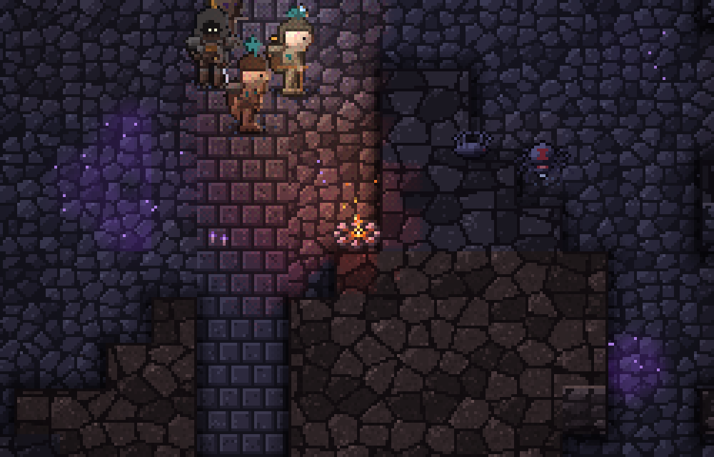
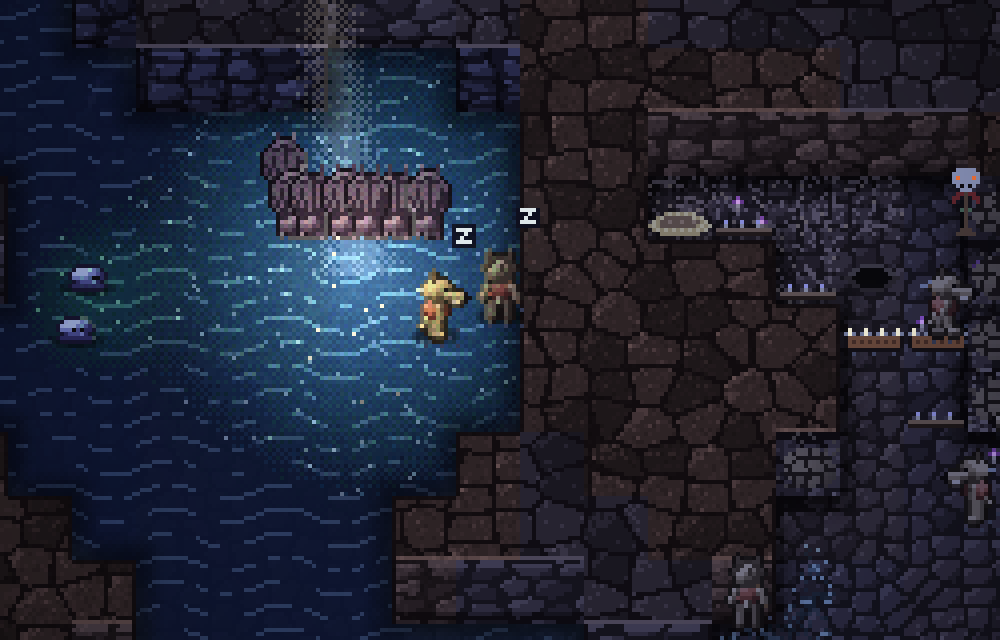
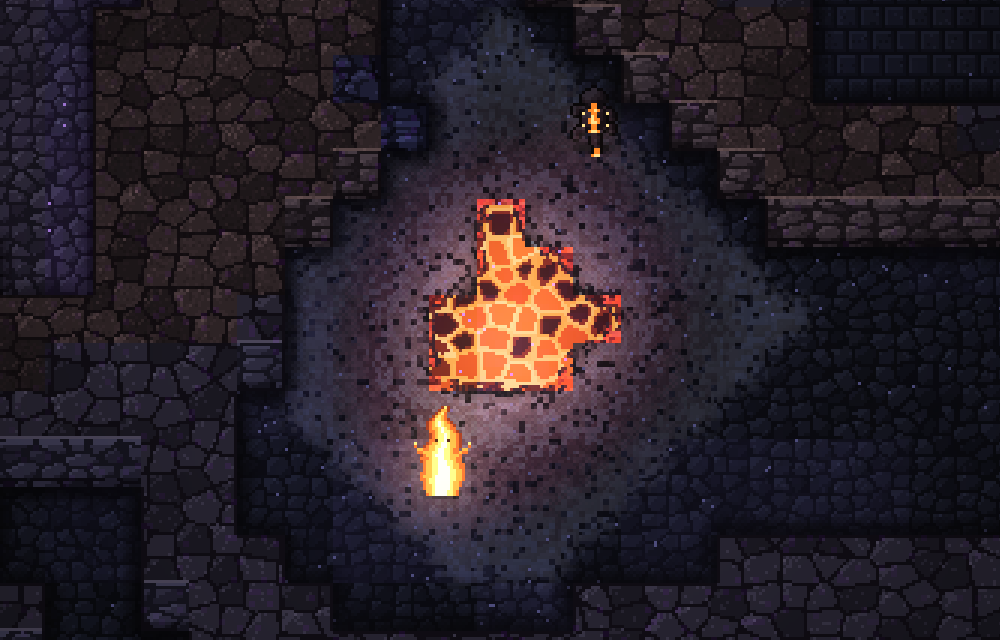
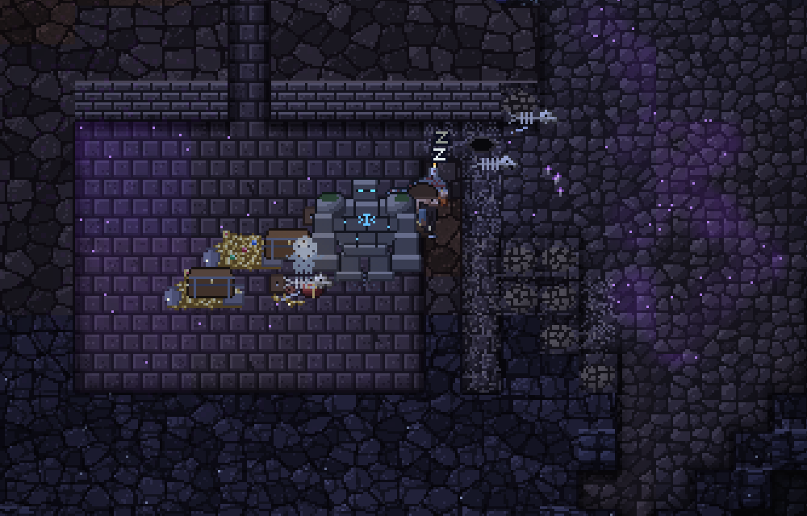

# Moss & Gold

[日本語](README.md)

A game about watching creatures live on their own in a dungeon.

Rats, goblins and adventurers go about their lives in a cave full of glowing moss. For now, there's no way for the player to step in. It runs in your browser.

**[Play in your browser](https://moss-and-gold.snsgr.workers.dev)** (desktop or phone; the in-game text is Japanese for now)

## What it is

Moss and mushrooms grow in an underground dungeon. Creatures move in to eat them, and adventurers come down from the surface. They also fight over food and drive each other off.

The monsters don't come from outside: they spring up from the nutrients and mana gathered in the dungeon's soil. Mana wells up from the depths, and also gathers where adventurers use their skills or fall.

Each creature follows simple rules, but together they do things I didn't expect.

## What you can see right now

  

- Glowing moss and mushrooms, underground water and lava. During the day, light comes in through cracks in the ceiling. Wisps, little specks of light born from the moss, drift toward the brightest patches.
- Small creatures that live on the moss, and the things that hunt them.
- Settlers. Kobolds and goblins build warrens and camps, fight over food with their neighbors, and sometimes end up working for someone stronger.
- Adventurers and dwarves from outside. Adventurers travel back and forth to town, so the same ones come back again and again.
- Further down there are bigger monsters, such as golems and dragons.
- Where the gear of fallen adventurers piles up, an empty suit of armor may rise on its own and wander off collecting weapons.

The settlers take a while to show up, so it helps to fast-forward.

## What I want to add

- Biomes
- A better way of generating the labyrinth
- More kinds of monsters
- Better-looking dungeons and monsters
- Making it easier to tell from the screen what's going on

## Questions

If you try it, I'd like to know:

- whether you could tell what was happening, and which scenes you couldn't follow
- how long you watched
- what creatures or events you'd like to see

## Controls

- Drag to move around (one finger on a phone), scroll to zoom (pinch on a phone).
- The buttons at the top left pause and fast-forward.
- Click or tap a creature to see its name and what it's doing.
- The "シード" (seed) button at the top right makes a new dungeon.
- The game saves on its own, so you can close the page and pick up where you left off.
