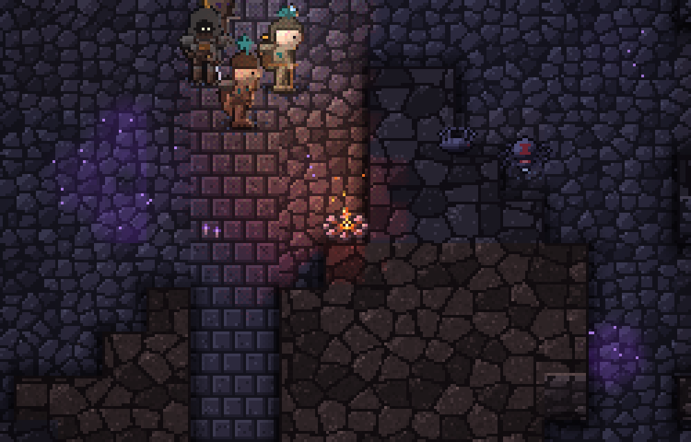
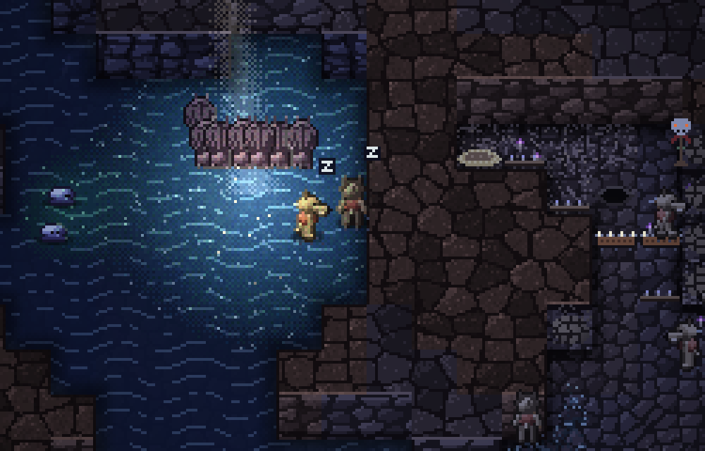
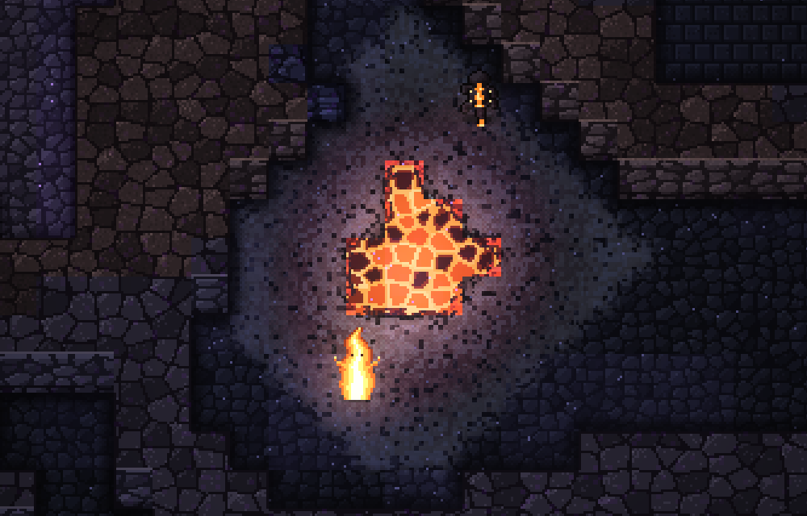
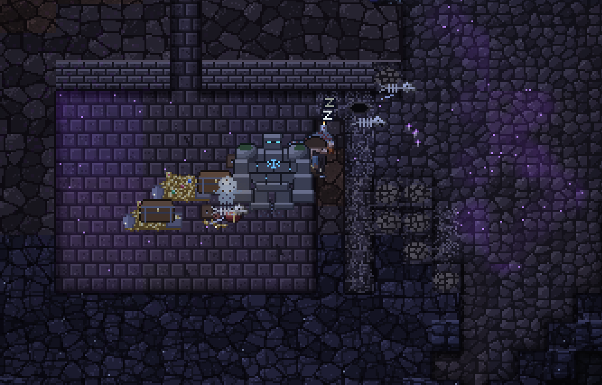

# Moss & Gold（苔と金貨）

[English](README.en.md)

生き物が勝手に暮らすダンジョンを、眺めるゲームです。

光る苔の生えた地下で、ネズミやゴブリンや冒険者が暮らしています。今のところ、プレイヤーが手を出す仕組みはありません。ブラウザですぐに遊べます。

**[ブラウザで遊ぶ](https://moss-and-gold.snsgr.workers.dev)**（PC・スマホ）



## どんなゲームか

地下のダンジョンに苔やキノコが生えて、それを食べる生き物が住みつき、外からは冒険者がやってきます。生き物どうしは、食べたり、奪ったり、追い払ったりしながら暮らしています。

生き物一つ一つの決まりごとは単純です。でも、それが重なると、作った自分でも思っていなかったことが起きます。それを眺めているのが楽しくて作っています。

## いま見られるもの

  

- 光る苔とキノコ、地下水、溶岩。昼は天井の裂け目から日が差します。苔から生まれる光の粒（ウィスプ）が、光る苔に寄っていきます。
- 苔を食べる小さな生き物と、それを狩る生き物。
- 住みついて暮らす種族。コボルトやゴブリンが住処や集落を作り、まわりの生き物と奪い合ったり、従えられたりします。
- 外から来る冒険者とドワーフ。冒険者は町に帰ってはまた潜ってくるので、同じ顔に何度も会えます。
- 深いところには、もっと大きなものも眠っています。

住みつく種族が出てくるまでには少し時間がかかるので、早送りしながら眺めるのがおすすめです。

## 足りないところ

まだ足りないところだらけです。バイオームはまだ無いし、迷宮の作りも、もっと意味のあるものにしたい。モンスターももっと増やしたいし、ダンジョンもモンスターも、見た目をもっと良くしたいです。

いちばん気になっているのは、何が起きているのかが画面から分かりにくいことです。

## 眺めてくれた人へ

もし少し眺めてみてくれたら、こんなことを知りたいです。

- 見ていて、何が起きているか分かったか（分からなかった場面があれば、それも）
- どのくらいの時間、眺めていられたか
- いたら見てみたい生き物や、起きてほしい出来事

## 操作

- 画面の移動はドラッグ（スマホは指）、拡大・縮小はホイール（スマホは二本指）
- 左上のボタンで、止めたり早送りしたりできます
- 生き物をクリック（タップ）すると、名前と様子が見られます
- 右上の「シード」から、別のダンジョンを作れます
- 自動で保存されるので、開き直すと続きから始まります

## 手元で動かす

```bash
npm install
npm run build   # dist/index.html ができる
```

dist/index.html をブラウザで開くと動きます。開発の手引きは [CLAUDE.md](CLAUDE.md) にあります。
