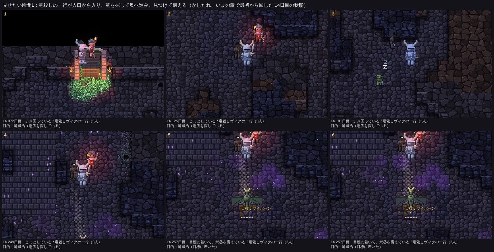
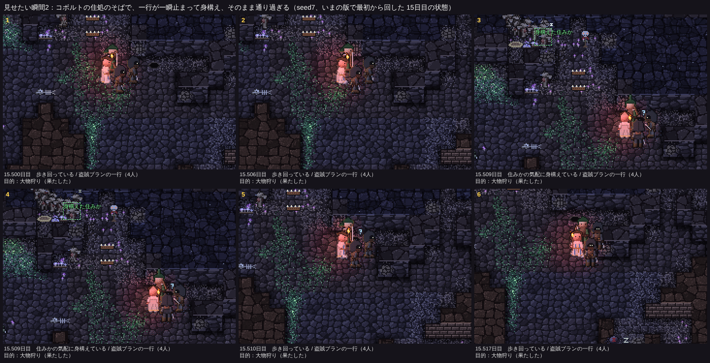
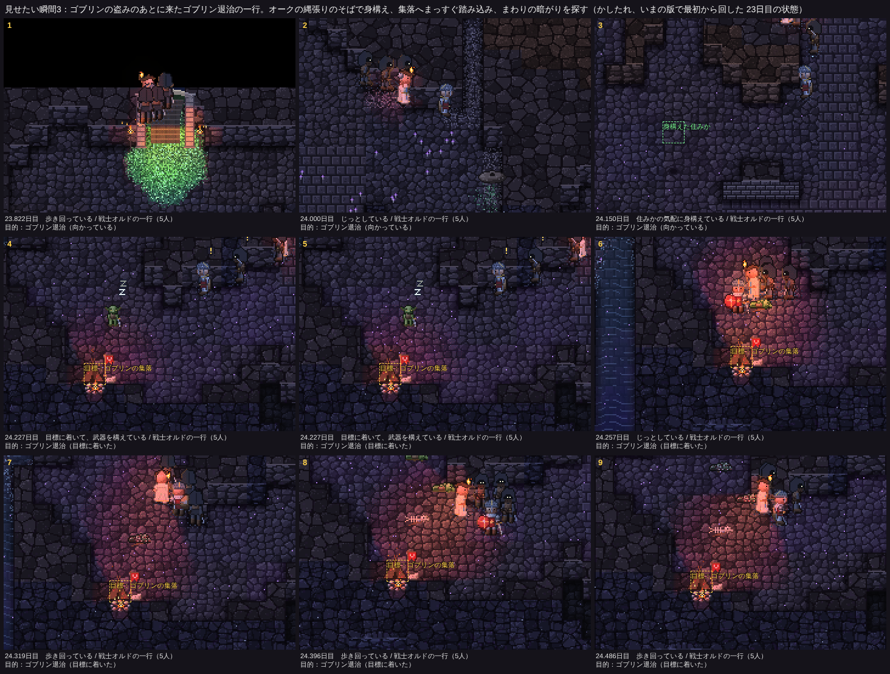

# 冒険者の作り直し（一歩目）：目的が動きで分かる、関係のない住処を避けて通る

見える相互作用の決まり（CLAUDE.md）に沿って、まず見せたい瞬間を決め、それに要る分だけ内部を作った。仕様は README.md の「冒険者の作り直し（一歩目）」、コードは src/eco/aim.ts。

## 見せたい瞬間（撮ったもの）

こまの下は、その刻みの日と、先頭の冒険者の札（様子・一行・目的）。黄色の点線の枠は目標、緑の枠は身構えた住みか（撮るときに重ねた印で、ゲーム画面には出ない）。撮り方は `npm run film`（tools/analysis/film.ts、tools/gallery/film.mjs）。

### 1. 何をしに来たかが、動きで分かる

竜殺しヴィクの一行（3人）が正面の入口から入り（1）、竜の寝床を知らないので噂の方角（深部）へまっすぐ進み（2〜4）、途中でワイバーンを見つけて目標にし、着いたところで立ち止まって構え、皆に「！」が出る（5、6）。このあと一行はワイバーンを倒した（目的を果たした）。

### 2. 関係のない住処は避けて通り、そばでは身構える

大物狩りを果たしたあとの盗賊ブランの一行が、コボルトの住処（罠・寝床・コボルト）のそばを通るとき、一瞬止まって住処の方を向き、先頭に「？」が出る（3、4）。そのまま通り過ぎる（5、6）。一行はコボルトに手を出さない。
この場面では、住処のコボルトは隠れなかった（一行が10マスほど離れていたため）ので、奥で目が光るところは写っていない。

### 3. 目標が集落なら、まっすぐ踏み込む（ゴブリン退治）

ゴブリンに荷物を盗まれた一行が生きて帰り、ゴブリンの盗みの噂が広まったあとに、戦士オルドのゴブリン退治の一行（戦士・僧侶・盗賊3人）が入ってくる（1）。オークの縄張りのそばで身構え（3）、集落にまっすぐ着いて構え、皆に「！」（4、5）。集落のまわりの暗がりを順に探して打ち合い（6〜9。赤い当たりの印と倒れたゴブリン）、食料が乏しくなって引き返した。集落はその後、食べ物が尽きて捨てられた。

## 内部（作ったもの）

- 一行の目標 `Party.aim`（1 宝、2 竜、3 大物、4 アンデッド、5 ゴブリン退治、0 探索）。入ってくるときに、外の噂と職業の役目から一つ決める。優先は、ゴブリン退治 → 竜殺しがいれば竜 → 狩人がいれば大物 → 僧侶がいてアンデッドの噂が 0.4 以上ならアンデッド → 金貨の噂が 0.3 以上で外の世界の地図に宝の区画があれば宝。
- 場所を知らないとき（外の世界の地図の、となりの区画までに載っていない）は、当て推量の行き先（`aimGuess`）へまっすぐ向かう。竜は見かけたという噂の場所（`rumors.dragonX/Y`、新しく持ち帰るようにした）、ゴブリンの集落は最後に盗まれた場所、ほかは深部。着いたら（または4000歩たっても）まわりの奥を探す。途中で目標が見えたら目標にする。歩いて行けない行き先（道筋が見つからない）は、当て推量ならまわりを探し、知っている目標ならあきらめる。
- 着く：先頭が目標のそばに来て見通しが利けば、16歩のあいだ止まって構え（`brace`）、皆に「！」。着いてから果たすまでの間は休まない（焚き火を囲まない）。
- 果たす・あきらめる：宝は区画の山がなくなれば、竜と大物は倒れたら、アンデッドはまわりにいなくなれば、ゴブリンの集落はなくなるか住民がいなくなれば果たした。一定の時間で果たせなければあきらめる。
- ゴブリンの盗み：盗まれた一行が覚え（`Party.robbed`）、生きて帰れば「ゴブリンの盗み」の噂（`rumors.goblin`、1日ごとに 0.8 倍）と盗まれた場所になる。0.5 を超え、ゴブリンの集落があれば、次の一行はゴブリン退治（戦士が選ばれやすく、先頭は戦士）。
- 避けて通る：冒険者の道筋は、目標でない住処・集落・村・縄張りを避けて探し（`advPath`）、避けて行けないときだけふつうに探す。目標でない住民（とその住みかを捨てて去っていく群れ）には自分たちから戦わない（`spareResident`）。戦うのは、一行の誰かに襲いかかっている者と、すぐそばで行く手をふさいで進めなくしている者だけ。
- そばを通る：先頭が目標でない住みかの10マス以内に来て見通しが利けば、同じ所では一度だけ、8歩のあいだ止まって住みかの方を向き、先頭に「？」。
- 記録と札：入ってくるときの記録に目的（例：「竜殺しヴィクの一行（竜殺し・盗賊・戦士）が、深部のドラゴンを探しに、入口から入ってきた」「オルドの一行がオークの縄張りのそばで身構え、そのまま通り過ぎた」「ヴィクの一行が目標に着き、武器を構えた（竜退治）」）、札に「目的：竜退治（向かっている）」「ヴィクの一行（3人）」、構えているときの様子。settle.jsonl に `{k:25}` の enter / arrive / aim / pass / end と、`{k:12, ev:'rob'}`。
- 新しい状態はすべて `Party`（保存は一行ごと JSON）と `rumors`（RU の 9〜13 番目）に入れた。npm test の「保存から読み込み直しても続きの展開が一致」は通る。

途中で直したこと（見せたい瞬間を撮ってみて分かったもの）：

- 初めは「すぐそば（12画素）にいる住民とは戦う」としていたため、行き違ったゴブリンの採集係と戦いになっていた（かしたれの10〜18日で、冒険者から先に手を出した住民の大半）。「すぐそばで、こちらが進めずにいる」ときだけに絞った。住みかを捨てて去っていく群れも見逃すようにした。
- 狩人の一行が噂の場所に着いて大物が見えないと、その場に立ち尽くしていた。見失ったら探し直すようにした。
- 竜殺しの一行が、閉じた空洞の奥の寝床（歩いて行けない）へ向かおうとして入口のそばで半日止まっていた。道筋が見つからなければ、まわりを探すかあきらめるようにした。竜殺しが岩の中を動くワームを狙っていたのも、ドラゴン、ワイバーン、床にいるワームの順にした。
- ゴブリン退治の一行が、目指す集落に着いたあと、その場で焚き火を囲んで休んでいた。着いてから果たすまでは休まないようにした。
- 宝の区画に着いても、区画の端の山が灯りの外にあって見つけられず、次の一行も同じ区画を目指していた。着いたら区画のまわりを照らして探し、見つからなければ「もうない」と覚えるようにした。

## 16シード×25日（`npm run ab -- --preset final`、main と対にした比較）

表は docs/compare-20261110.md。「はっきり／ばらつきの内」は compare.md の目安（シードごとの差の分布、符号検定、1シードを除いても向きが変わらないか）。帳簿のずれは四つとも0。

### 目標でない住民への圧力

| 指標 | main | 新 | 増 / 減（シード） | 目安 |
|---|---:|---:|---:|---|
| 冒険者に倒されたコボルト | 116 | 5 | 1 / 8 | **↓ はっきり** |
| 冒険者に倒されたゴブリン | 206 | 75 | 2 / 7 | ばらつきの内（向きはそろっている。1シードの寄与 27％） |
| 冒険者に倒されたオーク | 81 | 63 | 5 / 5 | ばらつきの内（オークは冒険者を獲物にするので、襲われて打ち返す戦いが残る） |
| 冒険者に倒されたリザードマン | 3 | 8 | 1 / 1 | ばらつきの内（1シードだけ） |
| 冒険者が死んだ | 216 | 184 | 8 / 7 | ばらつきの内 |

冒険者に倒された数の集計は、deaths.jsonl の `by` が冒険者のもの（倒されたゴブリンは compare.md の行、オークとリザードマンは同じ記録から数えた）。

それに引かれて動いたもの：

| 指標 | main | 新 | 目安 |
|---|---:|---:|---|
| コボルト：来た | 651 | 377 | **↓ はっきり**（倒されなくなったぶん、補充の来訪が減る） |
| コボルト：飢え死に | 115 | 38 | **↓ はっきり** |
| コボルト：住処の数 | 45 | 27 | ばらつきの内 |
| ゴブリン：来た | 369 | 239 | ばらつきの内 |
| ゴブリン：中で生まれた | 393 | 516 | ばらつきの内 |
| ゴブリン：飢え死に | 29 | 70 | **↑ はっきり**（集落に残るゴブリンが増え、食べ物の取り合いが増えた） |
| ゴブリン：最後の数 | 73 | 113 | ばらつきの内 |

### 住処・集落・縄張りが続く日数

| 指標（シードごとの中央値の合計） | main | 新 | 目安 |
|---|---:|---:|---|
| コボルトの住処が続いた日数 | 40.8 | 63.3 | ばらつきの内（増 7 / 減 3） |
| ゴブリンの集落が続いた日数 | 18.6 | 20.0 | ばらつきの内 |
| ゴブリン：5日以上続いた集落の割合（％の合計） | 116.6 | 124.1 | ばらつきの内 |
| オークの縄張りが続いた日数 | 6.9 | 8.4 | ばらつきの内（90％区間は 0.03〜0.28 で0をまたがないが、符号検定が届かない） |

### 一行の目標：着いた割合、果たした割合

| 目標 | 一行 | 着いた | 果たした | あきらめた | 全滅 |
|---|---:|---:|---:|---:|---:|
| 探索（目標なし） | 113 | — | — | — | 2 |
| 宝 | 36 | 14（38％） | 8（22％） | 3 | 2 |
| 竜 | 100 | 6（6％） | 6（6％） | 2 | 1 |
| 大物 | 59 | 13（22％） | 13（22％） | 4 | 1 |
| アンデッド | 105 | 64（60％） | 43（40％） | 12 | 3 |
| ゴブリン退治 | 1 | 1（100％） | 0 | 0 | 0 |
| 目標あり計 | 301 | 98（32％） | 70（23％） | 21 | 7 |

- 着かなかった一行の多くは、食料が乏しくなって引き返したか、竜を見て「かなわない」と引き返した（もとからある決まり）。
- 竜退治が少ないのは、竜の寝床の多くが深部の閉じた空洞の奥（歩いて行けない）か、入口から150マス以上離れた地図の隅にあり、食料が持たないため。竜殺しはもとは竜の居場所を知っていてまっすぐ向かっていたが、いまは知らなければ噂の場所と深部を探す。
- 目標でない住みかのそばで身構えたのは70回（コボルトの住処・ゴブリンの集落・リザードマンの村 57、オークの縄張り 13）。

### ゴブリン退治の一行

- 来た回数：16シード×25日で **1回**（かしたれ、23.8日目）。集落に着いて構え、まわりを探して戦ったが、食料が乏しくなって引き返した（果たせず）。一行が引き返したすぐあと（地上の0.1日ほど）、集落は食べ物が尽きて捨てられた（abandon、reason food）。
- 少ない理由：ゴブリンが冒険者の荷物を盗むこと自体が、16シード×25日で4回しか起きない（`{k:12, ev:'rob'}`）。盗むのは、はぐれた者か眠っている者がいて、そばに集落の仲間が少ないときだけ（senses.ts の lurk）。噂の閾値を 0.6 から 0.5 に下げたが、盗みが1回だけで、生還者が少ないと届かない。途中の版（閾値や探し方が少し違うもの）では16シード×25日で1〜4回来て、果たしたのは0〜1回（集落が捨てられた理由は「襲われた回数」と「食べ物」）。

## 見えない所（次の相談で）

- ゴブリンの盗みがめったに起きないので、ゴブリン退治の一行もめったに来ない。盗みの起きやすさ（lurk の条件）を見直すかは、次の相談で決めたい。
- ゴブリン退治の一行は、集落のまわりの暗がりに散って隠れたゴブリンを3マスまでしか見つけられず、探しきれずに食料が尽きることが多い。探し方（松明を掲げて照らす、隠れ場所を一つずつ回る）を見せる動きにする案。
- 竜退治の一行の多くは竜に届かない。届かない寝床（閉じた空洞）をどう扱うか（竜が寝床から出てくるのを待つ、など）。
- 場所を知らずに探している一行は、ふつうの探索と見分けにくい（札の「場所を探している」だけ）。先頭が時々立ち止まって見回す動きの案。
- 住処のそばを通るとき、10マス先ではコボルトが隠れず、「奥で目が光る」瞬間はめったに重ならない。
- そのほかの仕組みの点検は docs/visibility-audit.md。

## 確かめ

- `npm test`：21項目すべて OK（決定性、帳簿、保存からの再現）。
- `npm run check`：9件すべて ✅（新しく「冒険者の一行が目標に着く」「住処のそばで身構えて通り過ぎる」を足した）。
- `npm run ab -- --preset final`：帳簿のずれ0。
- 速さ（`npm run bench -- --repeat 2`、seed4・かしたれ・seed7 を10日目から1日ずつ）：main 9.98 秒、新 9.36 秒（始めの状態が版ごとに違うので目安。遅くはなっていない）。
- 見た目（`npm run gallery` を main の dist と並べた）：決まった場面で、炎や瞬きの時刻の違い以外は変わらない。
