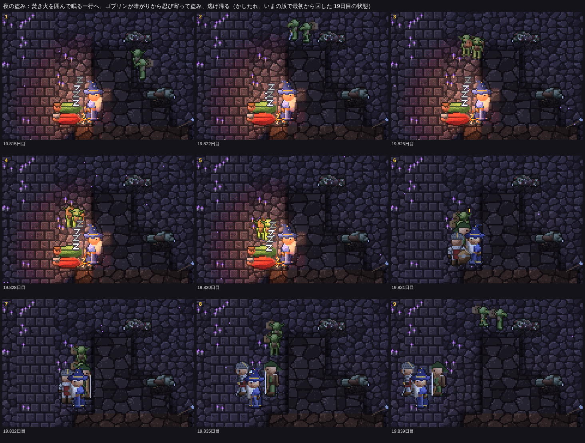
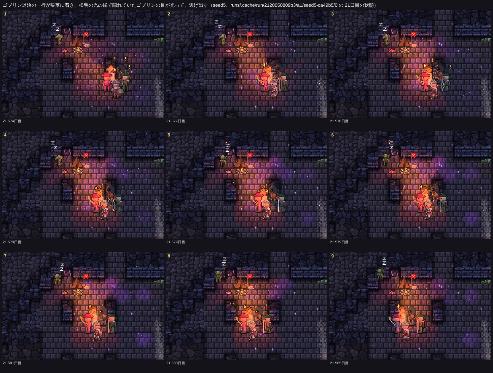
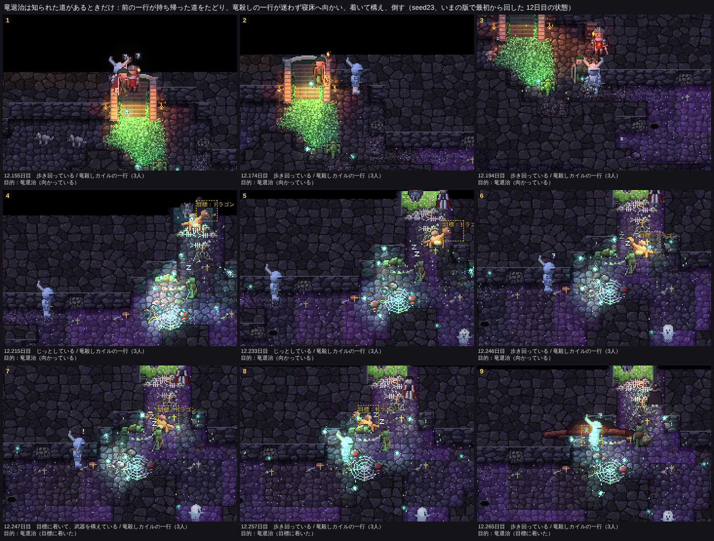
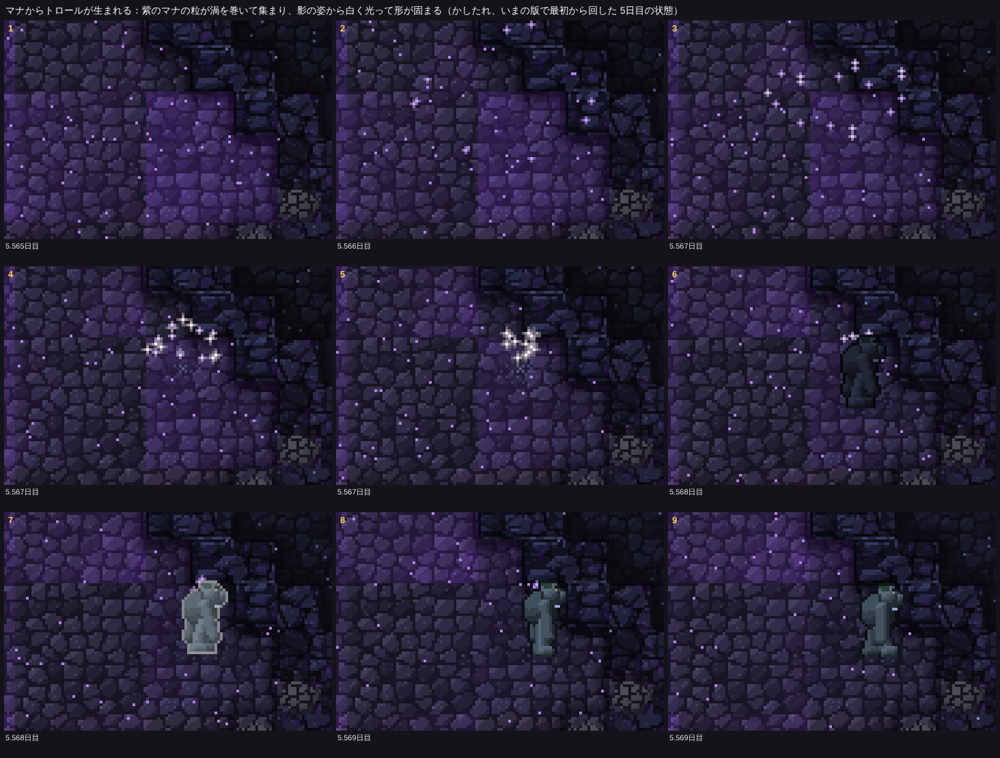
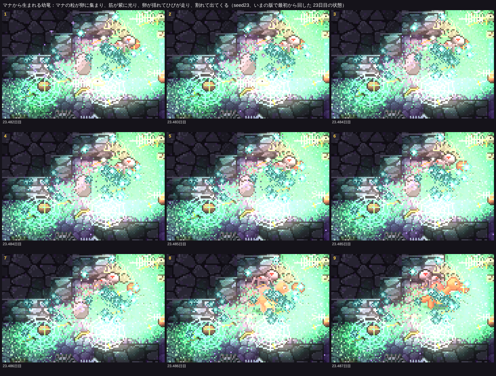
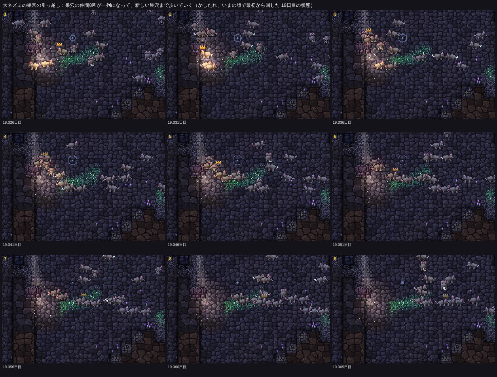

# 冒険者の作り直し（二歩目）と、点検の残りから三つ

見える相互作用の決まり（CLAUDE.md）に沿って、見せたい瞬間を先に決め、それに要る分だけ内部を作った。仕様は README.md の「冒険者の作り直し（二歩目）」、コードは src/eco/raid.ts（夜の盗み）、src/eco/aim.ts（探し出し・竜の寝床への道）、src/eco/kobold.ts（蓄え）、src/eco/rat.ts（引っ越しの列）、src/creatureView.ts（マナからの出現）。

16シード×25日の比較（`npm run ab -- --preset final --base origin/main`）の表は docs/compare-20261111.md（いつもの指標）と docs/adv-20261111.md（目標・盗み・竜退治・引っ越し。新しい道具 `tools/analysis/advreport.ts` で記録から数えた）。「はっきり／ばらつきの内」は compare.md の目安（シードごとの差の90％区間が0をまたがない、符号検定 p<0.1、1シードを除いても向きが変わらない）。**四つの帳簿のずれは0**。

## 見せたい瞬間（撮ったもの）

### 1. 夜の盗み

かしたれ19.8日目。焚き火を囲んで眠る一行（見張りは魔法使い）へ、蓄えの乏しい集落のゴブリン2匹が暗がりから忍び寄る（1〜3）。光の縁で身をひそめ（4）、眠っている者のそばへ駆け寄って食べ物を盗む（5）。盗まれた者に「！」（6）、ゴブリンは逃げ帰り（7〜9）、25マス先の集落で蓄えに入れた（`loot`、20）。この一行は盗まれた直後に焚き火を消して発った（焚き火の時間の終わり）。

### 2. ゴブリン退治の一行が、松明の光で集落のゴブリンを見つける

seed5 21.57日目（前の版の16シードの回の21日目の状態から、いまの版で続けて撮った。この刻みの前後は同じ展開になる）。退治の一行が集落に着いて「！」（1）、松明を掲げて集落のまわりを探す。テントのそばのゴブリンが松明の光の届く所で見つかり（5の「！」）、目を覚まして逃げ出す（9）。
このゴブリンは昼の眠りの最中で、光の中にいたため、光る目の影の姿ではなくふつうの姿で写った。**この版の16シード×25日では、松明での探し出し（`reveal`）は一度も起きなかった**（下の「ゴブリン退治」）。

### 3. 竜退治の一行が、知られた道をたどってまっすぐ寝床へ

seed23 12.15日目。前の一行が寝床の幼竜を見て道を持ち帰ったあと、竜殺しカイルの一行が「竜退治（向かっている）」で入口から入り（1、2）、寝床へまっすぐ向かい（3〜6）、着いて構えて「！」（7）、戦って倒した（9）。seed23 は寝床（深部）が入口のすぐ近くにある珍しい地図で、ほかのシードではこの流れはほとんど起きなかった（下の「竜退治」）。

### 4. マナからの出現（描画だけ）

かしたれ5.57日目、マナからトロールが生まれる。紫のマナの粒が渦を巻いて集まり（2〜5）、影の姿で形が現れ（6）、白く光って固まり（7）、トロールになる（8、9）。

### 5. 幼竜の孵化（描画だけ）

seed23 23.48日目。マナの粒が卵に集まり、卵が揺れて割れ（1〜7）、幼竜が出てくる（8、9）。この場所はまわりの光る苔と胞子がにぎやかで、卵の筋とひびは小さくしか見えない（卵の色を暗くして筋を太くしたあとの画像）。

### 6. 大ネズミの巣穴の引っ越しの列

かしたれ19.33日目。苔の尽きた巣穴を捨てて、大ネズミの王（冠）を先頭に巣穴の仲間8匹が一列になって、新しい巣穴（右へ16マス）まで歩いていく（4〜9）。

## 内部（作ったもの、直したもの）

- **夜の盗み**：夜、蓄えが目安の4割に満たない集落から、10〜50マス先で焚き火を囲む一行へ1〜3匹（`st 15`）。焚き火の残りの時間で着ける所だけ。暗がりを選ぶ道筋（`darkPath`）、光の縁で身をひそめる、眠っている者へ駆け寄って盗む、袋（`units`）に入れて逃げ帰る（`st 16`）、蓄えへ。見張りの向いている側3マスで見つかれば手ぶらで逃げる。冒険者は夜は早めに焚き火を囲む（疲れ2000歩から）。
  - 最初の形では、16シードの8日で盗みに出ても全部見つかった（見張り以外の、焚き火を向いて癒やしている僧侶も気づいていた、4.5マスで見つかっていた）、最後の駆け寄りでも明るい所を避けて遠回りして間に合わなかった、集めの袋がいっぱいの者が出ていた。それぞれ直した。
- **松明での探し出し**：退治を目標にした一行（`huntsCamp`）だけ、目指す集落の隠れたゴブリンを、一行の光の5.5マスで見つける。着いて誰も見えないまま900歩探したら引き返す。
  - 盗みに出るようになって、盗まれた場所（焚き火）が集落から10〜50マス離れるので、退治の一行が当て推量で盗まれた場所に着いても集落が見えなかった。盗まれた場所のまわり12〜35マスを順に探し歩くようにした。
- **竜の寝床への道**：寝床のドラゴンを見通しの利く所から見た一行が、生きて帰って道を持ち帰る（`Lore.dragonWay`）。竜殺しは道が知られているときだけ竜退治（`aimWay`）、なければ「深部の探索」（`aim 6`）。
- **コボルトの蓄え**：probe（10日目などの状態から1日回して、住処のあるコボルトの蓄えの出入りを数えた）で、**直す前は運び込みが一度も起きていなかった**ことが分かった（かしたれ、seed8 は住処なし、abc・seed40 で運び込み0回、腹いっぱいの者は全員住処から離れた所にいた）。原因と直し方：
  1. 集めに出た者が腹を満たすと、住処へ1歩だけ向かってそのまま忘れていた → 腹いっぱいなら住処へ持ち帰る（`st 13`、道中で腹がこなれても半分を越えていれば運び込む）。
  2. 掘り出した土（瓦礫）は「近くの行き止まりのマス」に置く決まりで、住処の横穴の奥がまさに行き止まりなので、**自分たちの掘った土で住処の奥が埋まっていた**（main の16シードで、住処の1日ごとの記録のうち約3割）。奥が岩になると誰も住処に入れず、蓄えを運び込めない → 住処の横穴には瓦礫を置かない（`inWarrenTunnel`、world.ts の `dumpSpoil`）。埋まっていたら寝床を入口の側の開いたマスへ移す。
  3. 畑のキノコは腹を空かせた者がその場で食べるだけだった → 集めの係はまず畑のキノコを摘んで持ち帰る。
- **マナからの出現**：描画用の印 `fxManaBorn`（spawn で origin が mana のとき。保存の FX に入れ、判断には使わない）。卵の殻は割れてから描く。
- **引っ越しの列**：古い巣穴のそば15マスの仲間を、古い巣穴に近い順に一列（`st 11`、`ref2` は前の者）。先頭は遅れた仲間を待つ。冒険者とドワーフが3マス以内なら列のまま離れる（最初の形では、列が冒険者のすぐ足もとを通って払われていた）。

## 16シード×25日（main と対にした比較）

### ゴブリンの盗みと、ゴブリン退治

| 指標 | main | 新 | 目安 |
|---|---:|---:|---|
| 盗みに出た | 0 | 20 | ばらつきの内（増 4 / 減 0。abc が55％） |
| 盗んだ（すべて） | 4 | 6 | ばらつきの内 |
| 　うち盗みに出た者 | 0 | 3 | ばらつきの内 |
| 　うち灯りに潜んだ者（いままでの形） | 4 | 3 | ばらつきの内 |
| 見張りに見つかって逃げ帰った | 0 | 10 | ばらつきの内 |
| 盗んだ物を集落の蓄えに入れた | 0 | 2 | ばらつきの内 |
| ゴブリン退治の一行が来た | 1 | 4 | ばらつきの内 |
| 　集落に着いた / 果たした | 1 / 0 | 1 / 1 | ばらつきの内 |
| 　松明で隠れた者を見つけた | 0 | 0 | 差なし |
| 冒険者に倒されたゴブリン | 64 | 40 | ばらつきの内（減 7 / 増 1） |

- 盗みに出ても、成功は20回のうち3回（見つかった10回、残りは一行が焚き火を消して発ったか、間に合わなかった）。
- ゴブリン退治の一行4組の終わり：かしたれの1組は着いたときすでに集落が空（盗みの直後に集落は捨てられていた）で「果たした」。seed40 の2組と seed7 の1組は、目指した集落が一行の着く前に捨てられた（食べ物が尽きて 1、何度も襲われて 3）か、食料が尽きて引き返した。**松明で見つける場面は、この版の16シードでは起きなかった**（撮ったのは前の版の回の seed5 の状態から）。
- 退治の一行が少ないのは、盗みの成功が少なく（3回）、生還者が持ち帰る噂（1回 0.12、吟遊詩人がいれば3倍、1日ごとに0.8倍）が 0.5 に届きにくいため。噂の仕組みは依頼どおり変えていない。

### 竜退治

| 指標 | main | 新 | 目安 |
|---|---:|---:|---|
| 竜退治の一行 | 106 | 19 | **↓ はっきり** |
| 　道を知って入った（`aimWay`） | （4、地図に載った寝床） | 12 | ばらつきの内（seed23 が90％） |
| 　寝床に着いた | 6（6％） | 1（5％） | ばらつきの内 |
| 　果たした（竜が倒れた） | 6 | 1 | ばらつきの内 |
| 深部の探索（竜殺しが道を知らなかったとき） | 0 | 85 | **↑ はっきり** |
| 竜の寝床への道を持ち帰った | 0 | 3 | ばらつきの内（seed23 だけ） |
| 冒険者に倒されたドラゴン | 6 | 4 | ばらつきの内 |

- 「何度かの遠征で道が明らかになり、ついに竜退治の一行が迷わず深部へ」は、**seed23 だけで起きた**（寝床が入口のそばにある地図。3回道が持ち帰られ、道を知った竜退治が12組来て、1組が着いて倒した）。
- ほかのシードで起きなかった理由（1日ごとの状態から計算した）：ドラゴンの寝床は閉じた空洞の中ではない（16シードとも開いた床）が、入口から歩いて **180〜280マス**（かしたれ205、はじまりの洞窟248、seed5 219、seed35 277、seed30 180）か、**入口から歩いてはつながっていない**（9シード）。一行は食料が4割5分を切ると引き返すので、深部の探索の一行85組はどれも寝床を見る前に引き返した（87組が生還、1組が全滅）。外の世界の地図（探した区画）は遠征ごとに広がるが、毎回入口から歩くので、食料が持つ距離の外へは届かない。→ 見えない所に挙げた。

### 一行が目標を果たした割合（新）

| 目標 | 一行（main → 新） | 着いた | 果たした | 果たした割合（main → 新） |
|---|---:|---:|---:|---:|
| 宝探し | 39 → 27 | 18 | 14 | 21％ → 52％ |
| 竜退治 | 106 → 19 | 1 | 1 | 6％ → 5％ |
| 大物狩り | 61 → 46 | 18 | 17 | 21％ → 37％ |
| アンデッド祓い | 108 → 99 | 46 | 39 | 41％ → 39％ |
| ゴブリン退治 | 1 → 4 | 1 | 1 | 0％ → 25％ |
| 深部の探索 | 0 → 85 | — | 0 | —（道を持ち帰ったのは別の目標の一行） |

いずれも「ばらつきの内」（竜退治の一行の数と深部の探索の数だけ「はっきり」）。死んだ冒険者は 184 → 153（ばらつきの内）。

### コボルトの住処の蓄え

1日ごとの状態（16シード×25日）から計算した（`npm run metric`、値はシードごとの平均の合計）。

| 指標 | main | 新 | 目安 |
|---|---:|---:|---|
| 住処の蓄えの合計 | 97 | 369 | **↑ はっきり** |
| 蓄えが20以上ある住処の数 | 1.4 | 3.5 | **↑ はっきり** |
| 住処の数 | 5.9 | 9.0 | ばらつきの内 |
| 奥が岩で埋まった住処の数 | 1.7 | 0 | **↓ はっきり** |
| 住処の日数の中央値（シードの中央値の合計） | 57.1 | 77.9 | ばらつきの内 |
| コボルト：中で生まれた | 79 | 208 | **↑ はっきり**（蓄えから産むので） |

住処の1日ごとの記録のうち、蓄えが20以上ある割合は約24％ → 約39％。群れがいつも腹を空かせている住処（abc、seed7）では、運び込んだ分をすぐ食べるので蓄えは0近いまま（仕組みは働いていて、食べ物そのものが足りない）。

### 大ネズミの引っ越し

| 指標 | main | 新 | 目安 |
|---|---:|---:|---|
| 巣穴の引っ越し | 152 | 158 | ばらつきの内 |
| 一列で歩いた引っ越し / 歩いた大ネズミ | 0 / 0 | 138 / 479 | **↑ はっきり** |
| 引っ越しの途中で死んだ大ネズミ | — | 110 | — |

途中で死んだ110匹のうち、冒険者に払われた・食べられた83、竜に焼かれた20。巣穴は松明や焚き火の火を避けて移ることが多く、そのとき近くに冒険者がいる。冒険者に倒された大ネズミの割合は、全体では main 27％（546 / 2040）、新 27％（705 / 2575）で変わらない（列にしたことで危なくなったのではない）。

## 見えない所（報告）

- **竜の寝床が遠い**：多くの地図で、寝床は入口から歩いて180マスより遠いか、歩いてはつながっていない。深部の探索の一行は食料が持たずに届かない。前の一行が見つけた所まで地図を持ち帰っても、次の一行はまた入口から歩くので、届く範囲は広がらない（寝床の近くの横穴を見つけて持ち帰る、深部に野営地を置く、などの案。大）。
- **ゴブリン退治がまだ少ない**：盗みの成功が少ない（見張りに見つかるか、一行が発つ）ので、噂が溜まりにくい。来ても、目指した集落が先に捨てられていることが多い（集落が短命）。
- **隠れたゴブリンを松明で見つける場面が起きにくい**：退治の一行が着く頃には集落が空か、ゴブリンが昼の眠りで隠れていない。
- **幼竜の孵化の場所が明るい**：幼竜はマナの濃い深部で生まれ、まわりに光る苔や胞子が多く、卵の筋とひびが見えにくい。seed23 では入口のそばで生まれ、生まれてすぐ冒険者に倒されることがある（256546 刻みに生まれ、256548 刻みに倒された）。
- **引っ越しの列の巣穴の絵**：巣穴の穴は新しい場所に一瞬で移る（列が歩いて着くまで、古い穴も残すと良い。中）。

## 途中で直した道具の不具合

- `npm run film` が、こまごとの状態をあとでまとめて書き出していて、保存の形に入っている生きたオブジェクト（一行の `PT2`、外の世界の地図 `LO` など）が書き出す時点の値になっていた（焚き火を囲んでいるはずのこまで焚き火が消えて写った）。こまごとにその場で写し取るようにした。**前の版の撮影（docs/adventurer-aims-20261110.md の画像）でも、一行の構えや札がずれていたかもしれない**。
- `npm run film` に `--run`（その回の1日ごとの状態から始める）を足した。

## 確かめ

- `npm test`：21項目すべて OK（決定性、四つの帳簿、保存からの再現）。
- `npm run check`：11件すべて ✅（「ゴブリンが夜に盗みに出る」「大ネズミが一列になって巣穴を引っ越す」を足した）。
- `npm run ab -- --preset final --base origin/main`：帳簿のずれ0。
- 見た目の一覧（`npm run gallery`）は回していない（描画の変更は、ゴブリンの袋、マナからの出現、卵の殻の出る時機だけで、どれも上の連続のこまで確かめた）。
