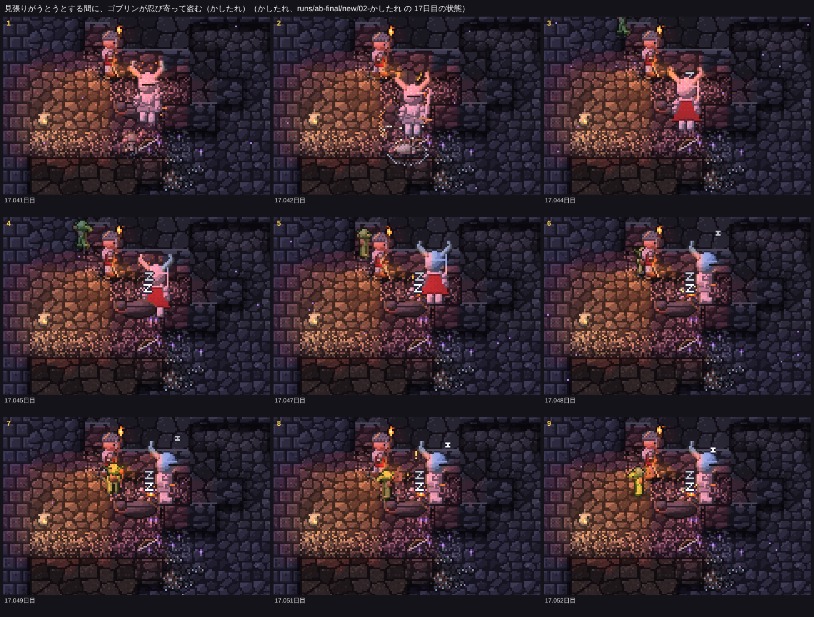
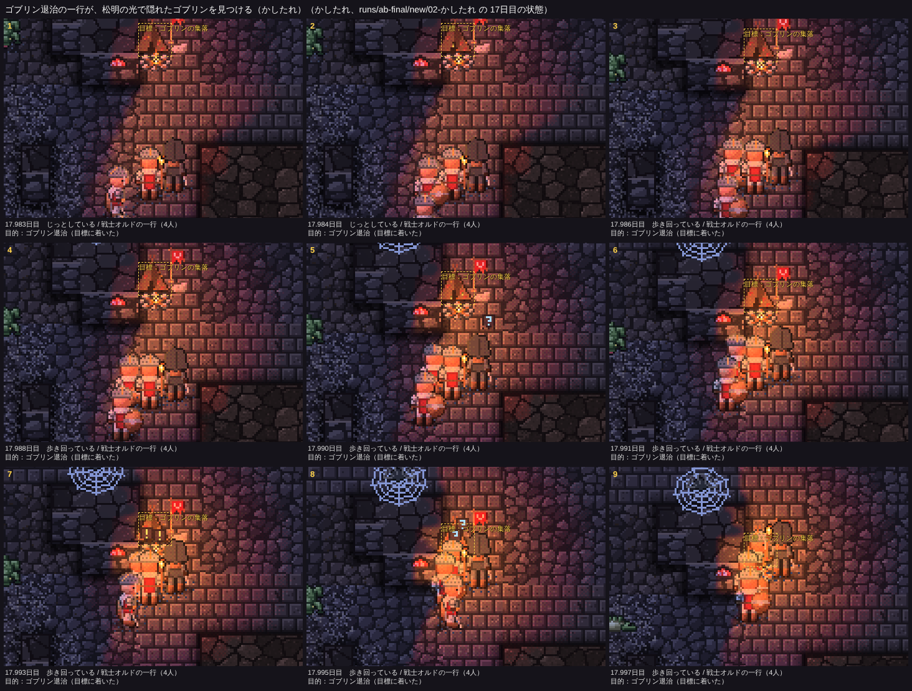
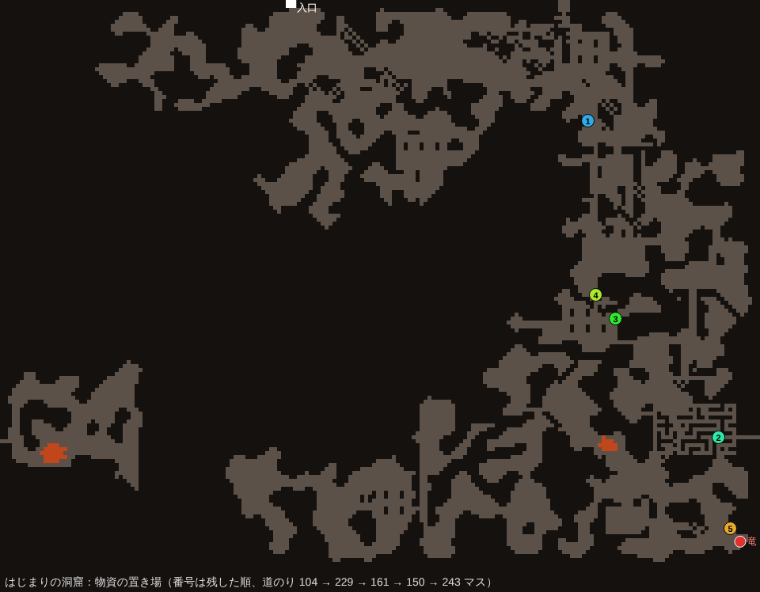
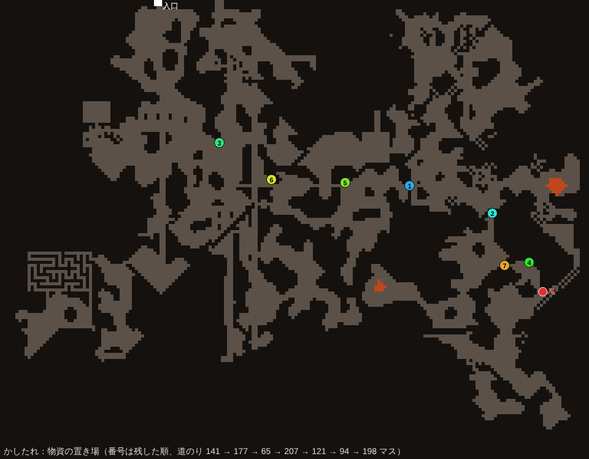
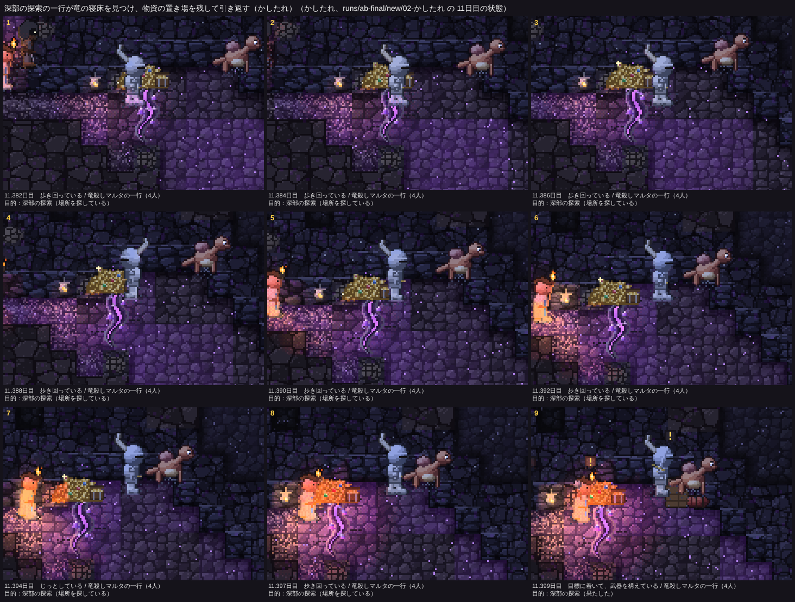
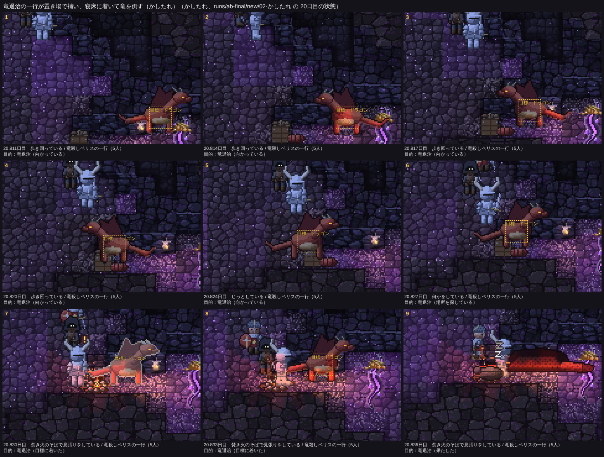
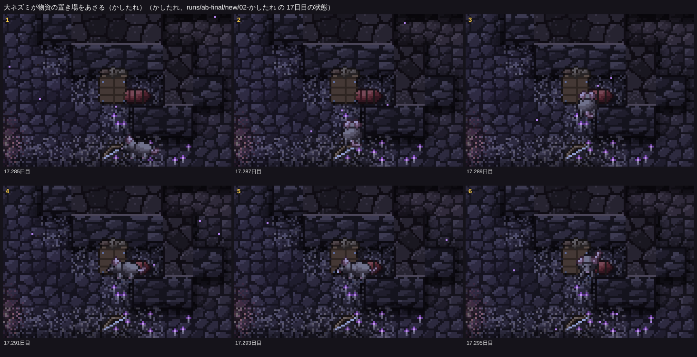
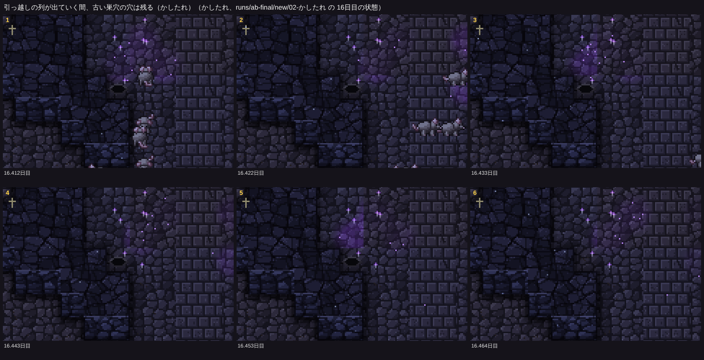

# 冒険者の作り直し（三歩目）：起きる回数、ゴブリン退治の流れ、遠征の積み重ね

方針は「25日に一度も起きない場面は、眺める人にとって存在しないのと同じ」。今回は、見せたい瞬間の起きる回数を上げることを主にした。仕様は README.md の「冒険者の作り直し（三歩目）」、コードは src/eco/cache.ts（物資の置き場）、src/eco/raid.ts（見張りのうとうと）、src/eco/aim.ts（盗みの噂と退治の行き先）、src/creatureView.ts（置き場の絵、巣穴の絵）。

16シード×25日の比較（`npm run ab -- --preset final --base origin/main`）の表は docs/compare-20261112.md（いつもの指標と、新しい「見せたい瞬間の回数」）、docs/adv-20261112.md（冒険者の目標・盗み・置き場。advreport）、遠征ごとの置き場は docs/cache-chain-20261112.md。**四つの帳簿のずれは0**。`npm test` 21項目 OK、`npm run check` 13件 ✅（「焚き火の見張りがうとうとする」「物資の置き場が残され、次の一行が補う」を足した）、`ab --resume-check 12`（はじまりの洞窟・seed5。置き場のあるシード）で、12日目で分けて回しても16日目の状態と記録が通しと一致。

## 1. 見せたい瞬間の回数（比べるときの標準の指標）

`tools/analysis/lib/moments.ts` に数え方を置き、compare.md と advreport の先頭に「見せたい瞬間の回数」の表を出すようにした（起きたシードの数、合計、シードごとの中央値。16シードのうち12以上で1回以上なら ✅）。CLAUDE.md の見える相互作用の決まりに「起きる回数を確かめる」を書き足した。

| 瞬間 | main | 新 |
|---|---|---|
| 夜の盗み：忍び寄った | ❌ 4/16（計 20） | ❌ 5/16（計 15） |
| 夜の盗み：盗んだ | ❌ 2/16（計 3） | ❌ 5/16（計 9） |
| 見張りがうとうとする間に盗まれた | ❌ 0/16 | ❌ 5/16（計 7） |
| ゴブリン退治の一行が集落に着いた | ❌ 1/16（計 1） | ❌ 2/16（計 2） |
| 松明で隠れたゴブリンを見つけた | ❌ 0/16 | ❌ 1/16（計 4） |
| 深部の探索の一行が竜の寝床を見つけた | ❌ 0/16 | ❌ 4/16（計 12） |
| 竜の寝床への道が町に伝わった | ❌ 1/16（計 3） | ❌ 4/16（計 15） |
| 竜退治の一行が寝床に着いた | ❌ 1/16（計 1） | ❌ 2/16（計 3） |
| 冒険者がドラゴンを倒した | ❌ 1/16（計 4） | ❌ 4/16（計 21） |
| **物資の置き場を残した** | ❌ 0/16 | **✅ 15/16（計 71、中央値 4）** |
| **置き場で食料を補った（一行ごと）** | ❌ 0/16 | **✅ 15/16（計 128、中央値 7.5）** |
| 置き場が大ネズミにあさられた | ❌ 0/16 | ❌ 8/16（計 38） |
| マナからの出現（幼竜を除く） | ✅ 16/16（計 663） | ✅ 15/16（計 653） |
| 幼竜の孵化 | ✅ 16/16（計 22） | ✅ 16/16（計 37） |
| 大ネズミの引っ越しの列 | ✅ 16/16（計 138） | ✅ 16/16（計 147） |
| 住処・集落を群れで捨てた | ❌ 10/16（計 42） | ❌ 8/16（計 32） |
| オークの取り立て | ❌ 9/16（計 109） | ❌ 8/16（計 101） |

- 目安に届いたのは、物資の置き場（新しい瞬間）と、もとから届いていたマナからの出現・孵化・引っ越しの列。
- **ゴブリンの側の瞬間は、目安に遠く届かなかった**（下の2）。いちばん大きな理由は、ゴブリンの集落が25日に一度もできないシードが6つ（はじまりの洞窟、seed4、seed8、seed18、seed17、seed23）あること。集落のできた10シードに限っても、盗みに出たのは5シード。
- 竜の側は増えたが（寝床を見つけた 0 → 4シード、ドラゴンを倒した 1 → 4シード）、9シードでは竜の寝床が入口から歩いてつながっていない（前回の報告どおり）ため、届くのは最大7シード。
- オークの取り立てと、群れで住みかを捨てるのは、オーク・コボルト・ゴブリンのいるシードでしか起きない（今回は手を入れていない）。

## 2. ゴブリン退治の流れ

### 作ったもの

- **見張りのうとうと**：焚き火の見張り（先頭）は、起きている間（約180〜440歩）と、うとうとする間（約90〜210歩）を繰り返す（`Party.dozeT / dozeNext`）。うとうと中は頭の上に小さな z が出て、忍び寄るゴブリンに気づかない。光の縁で身をひそめたゴブリンは、見張りが起きていればうとうとするまで待ってから駆け寄る（8匹に1匹はせっかちで待たない）。
- **盗みの噂**：盗まれた一行の生還者が、盗まれた回数と、盗みを働いた集落（ゴブリンが逃げ帰った先）を町に伝える（`Rumors.goblinRobs / goblinCamp`、保存は RU）。伝えられた盗みが2回になれば、ゴブリン退治の一行が来る。
- **退治の行き先**：いちばん最近盗みを働いた集落を、場所を知って目指す。捨てられていれば、そのあった所にいちばん近い別の集落。着くまでは（手傷を負わない限り）焚き火を囲まない。
- **盗みの機会**：盗みが少ない理由を数えた（調べ物の道具は消した）。夜の大半、一行は焚き火を囲まずに歩いていて、囲んでも近くに集落がないことが多かった。そこで、夜は疲れ1200歩から焚き火を囲み（二歩目は2000歩）、夜の焚き火は2400歩続く。盗みに出る集落の蓄えの目安は4割 → 7割、焚き火までの遠さは50 → 80マスまで。

### 撮ったもの

見張りがうとうとする間に、ゴブリンが忍び寄って盗む（かしたれ17.04日目）。眠る者の上の大きな Z とは別に、見張りの頭の上に小さな z（6〜9こま）。ゴブリンが左上の暗がりから寄り（3〜5）、眠っている者のそばで盗んで「！」（7、8）。

ゴブリン退治の一行が集落に着き、松明を掲げて集落のまわりを探す（かしたれ17.98日目）。7こま目でテントのそばに隠れていたゴブリンが見つかり「！」が出る。この一行の目指した集落は、かしたれで2回盗みを働いた集落（17.05日目の盗みを含む）で、生還者の噂から退治の一行が来た。**松明で見つかったゴブリンは暗がりから逃げ出すので、こまの中では小さくしか写らない**（下の見えない所）。

### 数（main → 新、16シード）

| 指標 | main | 新 | 目安 |
|---|---:|---:|---|
| 盗みに出た | 20 | 15 | ばらつきの内 |
| 盗んだ（すべて） | 6 | 15 | ばらつきの内 |
| 　見張りがうとうと中 | 0 | 7 | **↑ はっきり** |
| 見張りに見つかって逃げ帰った | 10 | 6 | ばらつきの内 |
| 盗んだ物を集落の蓄えに入れた | 2 | 8 | ばらつきの内 |
| ゴブリン退治の一行 / 着いた / 果たした | 4 / 1 / 1 | 5 / 2 / 2 | ばらつきの内 |
| 松明で隠れた者を見つけた | 0 | 4（かしたれだけ） | ばらつきの内 |
| 冒険者に倒されたゴブリン | 40 | 29 | ばらつきの内 |
| ゴブリンの集落の数 | 54 | 38 | **↓ はっきり** |
| ゴブリンの集落の日数の中央値 | 27.5 | 46.6 | ばらつきの内 |

- 退治の一行5組のうち着いたのは2組。ほかは、来る途中でワイバーンを見て引き返す（竜殺しのいない一行の今までの決まり。seed27）、明かりを持つ僧侶が倒れて暗くなり引き返す（seed41）、目指す集落が遠く食料が尽きる（seed7）、だった（`partydbg` で一行の様子を刻みごとに見て確かめた）。
- ゴブリンの集落の数は減ったが、一つの集落が長く続くようになった（引っ越しや分かれが減った）。原因までは追えていない。

**ねらい（盗み→退治の一行の到着→松明での探し出しが、たいていのシードで一度は起きる）には届かなかった**。起きたのはかしたれ1シード。ゴブリンが住みつくシード自体が10、そのうえで「夜、焚き火を囲む一行が集落から80マス以内にいる」ことが少ない。

## 3. 遠征の積み重ね（物資の置き場）

### 作ったもの

- 深部の探索の一行の者は、置き場に残す食料の荷（一人60、`Cr.units`。入るときに imported に足し、帳簿に入る）を背負って入り、引き返すときにその場に荷を下ろして置き場（木箱と寝具）を残す。近く（6マス）に置き場があればそこに足す。残した一行が生きて帰れば、置き場は町の知識（`Lore.caches`）に入る。
- 深部の探索と竜退治の一行は、目指す所（深部、竜退治なら道の先）にいちばん近い、まだたどっていない置き場へまっすぐ向かう（途中の置き場は、そばを通れば補う）。**置き場へ向かう途中は焚き火を囲まず、着いた置き場で休む**（休むあいだも置き場の食料で腹を満たすので、発つときは腹いっぱい）。竜や手強い相手、目標のそばの置き場では休まない。
- 引き返す判断（食料4割5分）は、置き場で補ったあとの量で決める（食料の残る置き場が30マス以内なら、着いて補ってから決める）。
- 置き場の食料が減ると木箱の中身が減り、空になれば残骸として残る。腹を空かせた大ネズミがあさる。
- 幼竜が孵ると町に竜の噂が立つ（`rumors.dragon` に 0.6）。竜殺しが深部の探索に来るきっかけ。

最初の形では、置き場の鎖が入口から50〜90マスで行ったり来たりした。理由は二つで、(1) 入口から50マスほどで食料の半分以上を使っていた（歩くより焚き火で食べていた）、(2) 目指す点を「竜を見かけた噂の場所」にしたら、ワイバーンやワームを見た場所でも書き換わって、後の一行が置き場をたどらなくなった。(1) は置き場で休むように、(2) は深部へ戻して直した。

### 置き場の道のり（入口から歩いて、マス）の推移

竜の寝床が入口から歩いてつながっているシード（新しく残した置き場の順。→ の後ほど後の遠征）：

| シード | 竜の寝床 | 置き場の道のりの推移 | 寝床を見つけた／道が伝わった | 竜退治が寝床に着いた |
|---|---:|---|---|---|
| かしたれ | 205 | 141 → 177 → 65 → **207** → 121 → 94 → 198 | 2回 / 3回 | 1回（置き場をたどって） |
| はじまりの洞窟 | 248 | 104 → 229 → 161 → 150 → **243** | 1回（その一行は全滅、道は伝わらず） | — |
| seed5 | 205 | 135 → 146 → 202 → 163 → 171 → **217** → 177 | 3回 / 3回 | —（深部の探索が竜を倒した） |
| seed30 | 178 | 139 → 169 → **179** | 6回 / 7回 | —（同上） |
| seed35 | 284 | 113 → 91 → 127 → **200** → 101 → 55 → 121 | — | — |
| seed6 | 267 | 77 → 110 → 75 | — | — |

- 遠征を重ねると置き場が奥へ伸びる様子は、かしたれ、はじまりの洞窟、seed5、seed30 ではっきり出た。地図（番号は残した順、赤い丸が竜）：

（seed5 と seed30 は docs/img/cache-chain-seed5.png、cache-chain-seed30.png）

- 伸びたあとに浅い所へ戻るのは、奥の置き場の食料を前の一行が食べ尽くしていて（残骸）、次の一行が補えずに手前で引き返すため。荷が少しずつ前へ運ばれていく「ジープの問題」と同じで、一行ごとの荷（一人60）では、奥の置き場を満たし続けるには足りない。
- 寝床が歩いてつながっていない9シードでも、置き場は残され（15/16シード）、次の一行が補うが、奥は深部ではなく入口から100マス前後の行き止まりへ伸びる。

### 撮ったもの

深部の探索の一行が竜の寝床を見つけ、構えて「！」を出し、その場に置き場（木箱と寝具）を残して引き返す（かしたれ11.38日目。9こま目、若い竜のそばに木箱が現れる）。

その10日後、竜退治の一行（竜殺しベリス）が知られた道と置き場をたどって寝床に着き、寝床のそばの置き場で食料を補い、竜を倒す（かしたれ20.81日目。1〜3こまに木箱と寝具、7こまで「目標に着いた」、9こまで倒した）。この一行は途中の置き場（入口から121マス）でも補っていた（docs/cache-chain-20261112.md）。

大ネズミが置き場の食料をあさる（かしたれ17.29日目）：

見た目の一覧（`npm run gallery`）に「冒険者の物資の置き場」の場面を足した（abc、14.3日目）：

### 冒険者の目標と死者（main → 新）

| 目標 | 一行 | 着いた | 果たした |
|---|---:|---:|---:|
| 宝探し | 27 → 19 | 18 → 9 | 14 → 6 |
| 竜退治 | 19 → 40（**↑ はっきり**） | 1 → 3 | 1 → 3 |
| 大物狩り | 46 → 28 | 18 → 9 | 17 → 7 |
| アンデッド祓い | 99 → 58（**↓ はっきり**） | 46 → 33 | 39 → 26 |
| ゴブリン退治 | 4 → 5 | 1 → 2 | 1 → 2 |
| 深部の探索 | 85 → 120 | — | 0 → 12（寝床を見つけた） |

- 死んだ冒険者 153 → 151、冒険者に倒されたドラゴン 4 → 21（ほとんどは深部の探索の一行が寝床で幼竜・若い竜を倒した。seed30 だけで9）。どれも「ばらつきの内」。
- 幼竜の孵化で竜の噂が立つようにしたので、竜殺しの率いる一行（竜退治・深部の探索）が増え、そのぶんアンデッド祓いと宝探しが減った（一行は同時に1組なので、取り合いになる）。

## 4. 大ネズミの巣穴の絵

列の先頭が新しい巣穴に着くまで、古い場所に穴を描くようにした（描画用の印 `fxMarch`。保存の FX に入れ、判断には使わない）。かしたれ16.41日目、巣穴の仲間が一列で出ていく間（1〜5こま）古い穴は残り、先頭が新しい巣穴に着いた6こま目で消える。

## 見えない所（報告）

- **ゴブリン退治の流れは、ほとんどのシードで起きない**：ゴブリンが住みつかないシードが6つ。住みつくシードでも、一行が夜に集落の近くで焚き火を囲むことが少ない。退治の一行はワイバーンを見ると引き返し、明かりを持つ者が倒れると引き返す（大）。
- **松明で見つかったゴブリンが小さい**：見つかった瞬間に逃げ散るので、光の縁で光る目のこまが短い（見つかった者を一瞬立ち止まらせるなど。小〜中）。
- **奥の置き場の食料が足りない**：前の一行が食べ尽くした置き場は残骸になり、次の一行は奥まで補えない。町が置き場の様子（空かどうか）を知らないので、空の置き場へ向かうこともある（荷を前の置き場に足していく、空の置き場は町の地図から消す、など。中）。
- **見張りのうとうとの印が小さい**：見張りの z は、眠る者の大きな Z と同じ形の小さいもので、こまの中で見分けにくい（頭がこっくりと垂れる姿を足す、など。小）。
- **眠るドラゴンの場面が一覧で見つからない**：`npm run gallery` の「眠るドラゴン」（abc の6〜14日目）は main でも見つからない（以前からの抜け。場面の探し方を直すのは次に）。コボルトの住処の場面は、この版のかしたれで住処が少なく出たので abc に替えた。

## 途中で足した道具

- `tools/analysis/lib/moments.ts`：見せたい瞬間の数え方（compare と advreport が使う）。
- `tools/analysis/cachemap.ts`：遠征ごとの置き場の表と、置き場を地図に描いた画像（`--png`）。
- `tools/analysis/lairdist.ts`：竜の寝床・深部・置き場の、入口から歩いた道のり。
- `tools/analysis/partydbg.ts`：一行の様子（目標、引き返したか、明かり、食料、見たもの）を刻みごとに。
