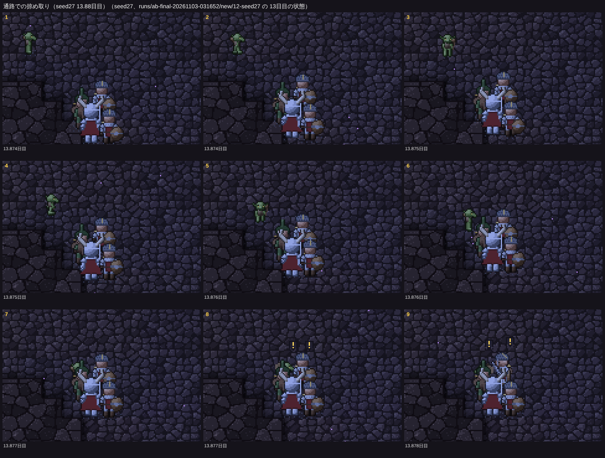
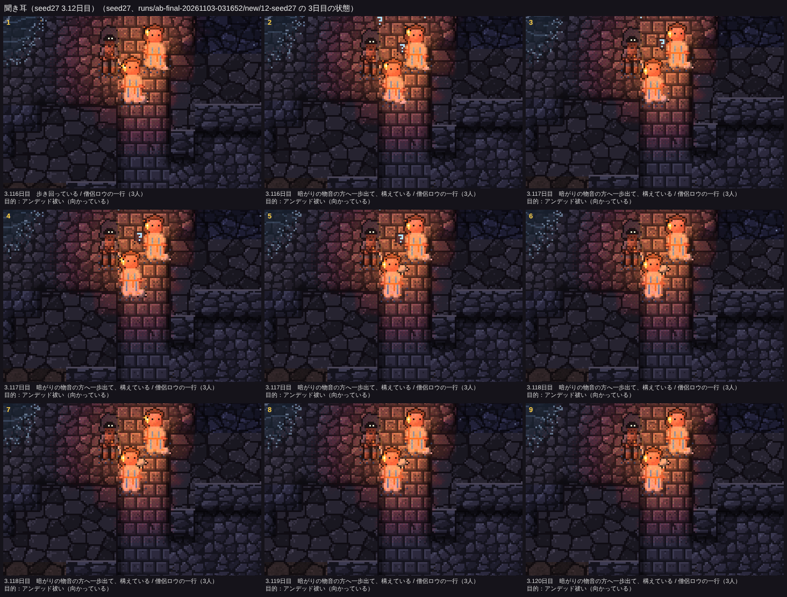
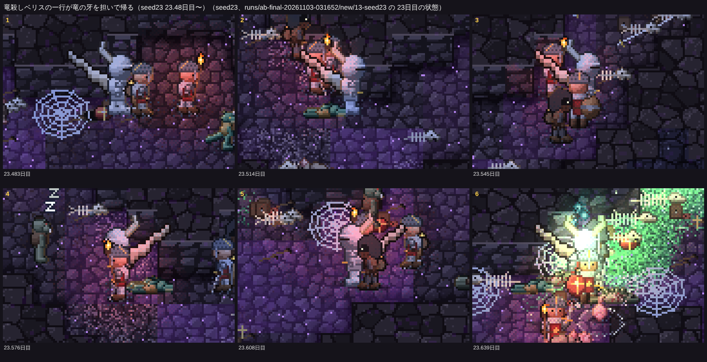
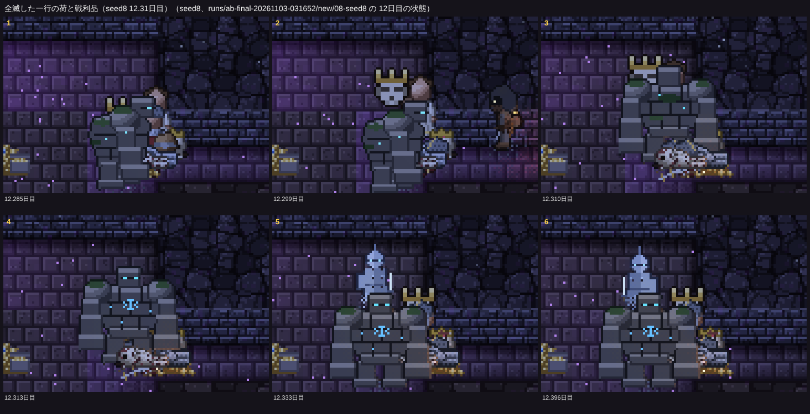

# 冒険者の作り直し（四歩目）：通路での掠め取り、聞き耳、戦利品

見える相互作用の決まりに従い、まず「画面で何が見えるか」を決めてから内部を作った。仕様は README.md の「冒険者の作り直し（四歩目）」、コードは src/eco/raid.ts（掠め取り）、src/eco/listen.ts（聞き耳）、src/eco/loot.ts（戦利品）、src/eco/senses.ts（物音の種類）、src/sprites.ts と src/creatureView.ts（金貨の袋・戦利品・荷の絵）。

16シード×25日の比較（`npm run ab -- --preset final --base origin/main`）は docs/compare-20261113.md、冒険者とゴブリンの数は docs/adv-20261113.md。**四つの帳簿のずれは0**。`npm test` 21項目 OK、`npm run check` 16件 ✅（掠め取り・聞き耳・戦利品の確かめを足した）、`ab --resume-check 7 --seeds かしたれ --days 10`（8.4日目に掠め取りが起きる区間）で、分けて回しても状態と記録が通しと一致。

## 0. 前回のゴブリンの集落の数の減少（54→38）の原因

PR #10 の前の版（2321ab9）を16シード×25日回し直して、main と並べた。

- この「集落の数」は**集落ができた回数**で、新しい群れは、いま集落が一つもないときだけ来る（arrivals.ts）。だから数は「捨てられて建て直された回数」を数えている。
- main では一つの集落が長く続くようになった：捨てられた回数は、蓄えが尽きて 18→15、襲われて 16→10、群れが分かれて 14→8。ゴブリンの群れの来訪も 41→30。
- **集落のある日数（16シードの合計）は 115→103日**で、ほとんど変わらない（減ったのは seed40・seed41 の2シード。seed41 は最初の集落ができたのが 7.5→14.8日目と遅れた）。
- 長続きした理由は、(1) 冒険者の一行が深部の探索（置き場をたどってまっすぐ奥へ）に偏り、集落のそばを通って散らす（`scatterCamp`）回数が減ったこと、(2) abc のように、集落の蓄えが高く保たれた（abc の 8.5〜12日目で、集落の蓄えに入った量 609 → 2723。集めに出た者の摘んだ苔・キノコと、コボルトとの争いで出た死骸）こと。
- **扱い**：眺める人にとって、ゴブリンの集落がある時間はほぼ同じで、一つの集落が長くいるのはむしろ見やすい。意図しない不具合ではないので直さない。比べるときは「集落の数」より、集落のある日数と一つの集落の日数を見るほうがよい。

## 1. ゴブリンの流れを短くする：通路での掠め取り

### 見せたい瞬間

暗い通路を行く一行の最後尾に、ゴブリンが暗がりから忍び寄り、荷（食べ物）を掠め取って暗がりへ逃げる。最後尾の冒険者が気づいて「！」、一行が振り返る。

### 作ったもの

- 出る：蓄えが目安の9割に満たない集落から、松明を持たない1匹。一行が近く（最後尾まで24マス、歩いて32マス）を暗い所で歩いていれば、すぐ最後尾をつける。いなければ、一行が50マスの内にいるときだけ、冒険者の通り道（人の気配の濃い所）から6〜9マス脇の暗がりで待ち伏せる（2400歩。最後尾が12マスに来たらつけはじめ、30マスなら寄っていく）。待ち伏せる者は暗がりで目だけが光る。
- つける：一行の灯りの外を、最後尾のすぐ後ろ（3.5マス）まで。灯りに入ってしまったら下がる。灯りの中で、こちらを向いた者（盗賊と狩人は向きによらず）に見られると、ときどき見つかって手ぶらで逃げ帰る。
- 掠め取る：一行が歩いていて、最後尾もゴブリンも暗い所にいて、5マスまで寄れたら、一行の歩みの2倍より速く駆け寄り、荷から食べ物を20（頭のいる集落は30）掠め取る。最後尾とゴブリンに「！」、一行は逃げていく方へ振り返って止まる。逃げ帰るゴブリンは追われない。盗みは今までどおり盗まれた回数として噂になり、ゴブリン退治の一行を呼ぶ。
- 夜の焚き火での盗みはそのまま残した（集落ごとの出る間隔 `raidT` は共有）。

最初の形では、出ても追いつけずにあきらめるだけだった：直線36マス（歩いて50マス）先の、遠ざかる一行を追っていた。待ち伏せと近い一行だけに絞り、灯りの縁ぎりぎりまでつけてから短く駆け寄るようにした。次に、待ち伏せに出るゴブリン（はじめは1〜2匹、3600歩、一行がどこにいても）が長く集落を離れて狩りをしなくなり、大ネズミの入れ替わりが減った（8シードの比較で、大ネズミの巣穴の引っ越しが 40→16「はっきり」。掠め取りを止めると 40→35 に戻ることで突き止めた）。待ち伏せを1匹、2400歩、一行が50マスの内にいるときだけにして、ばらつきの内に戻した。また撮ってみると、盗んだ松明を持つゴブリンが日の差す入口で掠め取っていたので、松明を持つ者は出さず、駆け寄るのは暗い所でだけにした。

### 撮ったもの

seed27 13.87日目。ゴブリンが左上の暗がりから最後尾へ寄り（1〜6こま）、取りついて（7）、荷を掠め取って逃げる。最後尾と仲間に「！」が出て、一行が振り返る（8、9。札は「荷を掠め取られて、振り返っている」）。

### 数（main → 新、16シード×25日）

| 指標 | main | 新 | 目安 |
|---|---:|---:|---|
| 通路での掠め取り：盗んだ | 0 | 28（7シード） | **↑ はっきり** |
| 通路での掠め取り：つけた | 0 | 60（8シード） | **↑ はっきり** |
| ゴブリンの盗み（夜と通路の合計） | 9（5シード） | 29（7シード） | ばらつきの内 |
| 夜の盗み：出た / 盗んだ | 15 / 9 | 10 / 1 | ばらつきの内 |
| 掠め取りが見つかった | — | 14 | |
| ゴブリン退治の一行 / 着いた / 果たした | 5 / 2 / 2 | 18 / 9 / 9 | 一行は **↑ はっきり**、ほかはばらつきの内 |
| 冒険者に倒されたゴブリン | 29 | 89 | ばらつきの内 |

- **ゴブリンの集落ができた9シードのうち7シードで掠め取りが起きた**（abc 6、かしたれ 7、seed27 7、seed40 4、seed7 2、seed4 1、seed30 1）。起きなかった2シードは、seed41（3回つけたが見つかった・追いつけなかった）と seed23（集落が終わりの頃にできた）。集落のない7シード（はじまりの洞窟、seed5、seed6、seed8、seed18、seed35、seed17）では起きようがない。表の目安（16シードのうち12以上）は ❌ だが、依頼の目安「集落があるシードのたいていで、25日に数回」には届いた。
- 盗みが噂になってゴブリン退治の一行が 5→18 組来るようになり、9組が集落に着いて果たした（「ときどき」：集落のあるシードで25日に2組ほど）。一行は同時に1組なので、そのぶん深部の探索が 120→109 組に減り、**物資の置き場を残した回数が 71→61 に「はっきり」減った**（深部の探索の一行あたりの置き場の数は 0.59→0.56 で変わらない）。
- 夜の焚き火での盗みは、出る間隔を掠め取りと共有したので、出た回数 15→10、盗んだ 9→1 に減った（ばらつきの内）。夜の盗みも残したい場合は、間隔を分けるのが次の手（下の見えない所）。

## 2. 見えないけれど聞こえる：聞き耳

### 見せたい瞬間

暗がりで物音（戦いの音、足音、うなり声）がすると、一行が立ち止まって音の方を向き、頭に「？」、前衛が一歩前に出て構える。しばらく何も起きなければ、また歩き出す。

### 作ったもの

- 物音に種類を足した：大きな音（戦い・崩落・掘る音。今までどおり獣を呼び、眠りを覚ます）、足音（トロール、ミノタウロス、オーク、バジリスク、ゴーレム、ワーム、スケルトン、ゾンビ、リザードマン、若い竜と成竜が歩くと）、うなり声（腹を空かせたか戦いの中のトロール、ミノタウロス、オーク、バジリスク、ワイバーン、ドラゴン、大トカゲ、ゾンビ、吸血鬼）。足音とうなり声は一行がいるときだけ立て、冒険者だけが聞く（獣の振る舞いを変えないように）。
- 一行は、灯りの外の暗い所の音を、音の大きさのマス数（盗賊と狩人は1.5倍）で聞き取る。聞こえたら32歩立ち止まり、皆が音の方を向いて「？」、前衛（戦士か竜殺し）が初めの7歩で前へ出て構える。同じ方角（8方位）の音には900歩、どの方角でも200歩あける。見えた相手には、今までどおり戦う・避ける（敵の判断が聞き耳より先）。

### 撮ったもの

seed27 3.12日目。暗がりの奥のうなり声に、僧侶ロウの一行（3人）が立ち止まり、頭に「？」（2〜5こま）、皆が音の方を向き、先頭の僧侶が構える（札は「暗がりの物音の方へ一歩出て、構えている」）。

### 数

聞き耳で止まった：0 → **557（16/16シード、中央値33）、✅**。一行あたり約1.4回。止まる時間は短く（32歩）、冒険者の死者 151→150、目標の数も変わらなかった。

## 3. 戦利品を担いで帰る

### 見せたい瞬間

帰り道の一行が、金貨の袋や戦利品（竜の牙、トロールの棍棒など）を担いで入口へ向かう。全滅した一行の倒れた所には、荷と戦利品が残る。

### 作ったもの

- 目標（竜、大物、アンデッド、ゴブリン退治）を果たした一行は、倒した相手にちなむ戦利品（竜の牙、ワームの牙、トロールの棍棒、ミノタウロスの角、バジリスクの眼、吸血鬼の牙、リッチの杖、古い骨の冠、ゴブリンの頭の角兜、オークの斧など）を一つ、竜殺しか戦士が背に担ぐ。担ぐ者が倒れれば仲間が担ぎ直し、生きて帰れば記録に「竜殺しベリスの一行が竜の牙を持ち帰った」。全滅すれば倒れた所に残る（床の道具）。
- 倒れた冒険者は荷（背負い袋と寝具）を残す。金貨は今までどおり宝の山になる。
- 金貨を持つ冒険者は、持てる量に対する割合で大きさの変わる革袋を背に担ぐ（描画だけ）。
- 戦利品は小さいと兜の角や武器と紛れて見分けられなかったので、2倍の大きさに縁取りをつけ、背中から体の輪郭の外へ突き出すように描いた（絵の部品は下の一覧）。

### 撮ったもの

seed23 23.48日目〜。竜を倒した竜殺しベリスの一行が、竜の牙を背に担いで入口へ帰る（白い大きな牙）。

seed8 12.29日目。アンデッド祓いを果たして骨の冠を担いでいた一行が、宝物庫の番のゴーレムに全滅させられ（1〜3こま）、骨の冠と荷が倒れた所に残る（3〜6こま）。

### 数

戦利品を手に入れた 45、持ち帰った 42（**12/16シード、✅**）、全滅して残った 1。中身は古い骨の冠 28、ゴブリンの頭の角兜 9、オークの斧 3、竜の牙・ワームの牙・トロールの棍棒・吸血鬼の牙・リッチの杖が1ずつ。

## 4. 見せたい瞬間の回数（main → 新、16シード×25日）

| 瞬間 | main | 新 |
|---|---|---|
| 通路での掠め取り：盗んだ | ❌ 0/16 | ❌ 7/16（計 28） |
| ゴブリンの盗み（夜と通路の合計） | ❌ 5/16（計 9） | ❌ 7/16（計 29） |
| ゴブリン退治の一行が集落に着いた | ❌ 2/16（計 2） | ❌ 5/16（計 9） |
| **聞き耳で止まる** | ❌ 0/16 | **✅ 16/16（計 557）** |
| **戦利品を持ち帰った** | ❌ 0/16 | **✅ 12/16（計 42）** |
| 物資の置き場を残した | ✅ 15/16（計 71） | ✅ 15/16（計 61） |
| マナからの出現・幼竜の孵化・引っ越しの列 | ✅ | ✅（ばらつきの内） |

ほかの指標（大ネズミ、コボルト、ゴブリンの数、冒険者の死者など）はどれも「ばらつきの内」。

## 見えない所（報告）

- **夜の焚き火での盗みが減った**：掠め取りと出る間隔を共有したため（出た 15→10、盗んだ 9→1）。間隔を分ければ戻せる（小）。
- **戦利品が古い骨の冠に偏る**：アンデッド祓いを果たす一行が多いため。竜の牙や棍棒は16シード×25日で1回ずつ（中。大物狩りの目標を果たしやすくするのは別の手直し）。
- **待ち伏せのゴブリンの多くは空振り**：abc では一行が集落から44〜100マス離れた深部へ向かうので、待ち伏せに出ても通らない（待ち伏せ 27回、掠め取り 6回）。一行の通る道をもっと正確に知る手（町の地図の道筋を待ち伏せの場所に使うなど）がある（中）。
- **聞き耳の「？」が小さい**：暗い所では見分けにくい（小）。

## 途中で足した道具

- `npm run film` に `--dy`（カメラを縦にずらす。大きく寄ると足もとに合ったカメラで体が上にはみ出すため）。
