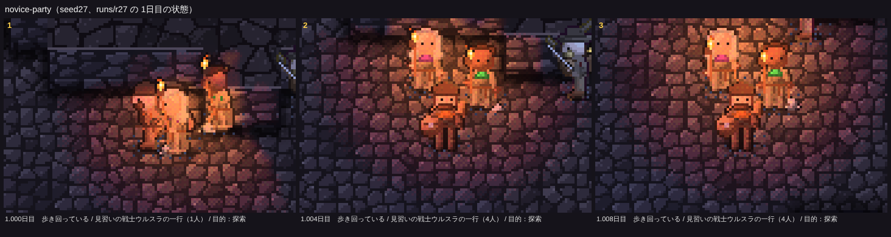
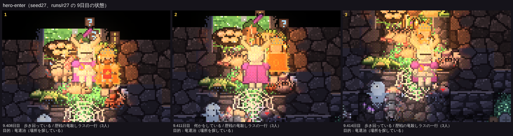
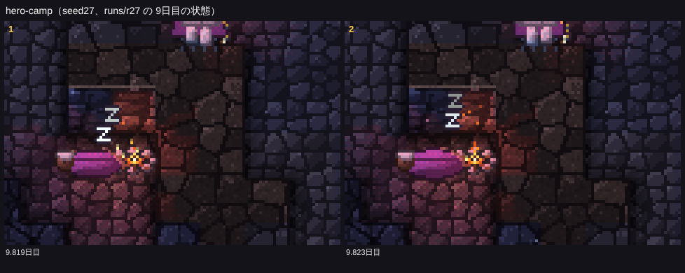

# 冒険者の作り直し（五歩目）：町の名簿、同じ顔と位の装備、墓標

見える相互作用の決まりに従い、まず「画面で何が見えるか」を決めてから内部を作った。名簿の画面は作らず、姿と動きで分かるようにした。仕様は README.md の「冒険者の作り直し（五歩目）」、コードは src/eco/roster.ts（名簿・位・墓標）、src/sprites.ts の `heroSprite`・`graveMarker`・`prayLight`（絵）、src/atlas.ts と src/renderer.ts（あとから描き足すます目）。

16シード×25日の比較（`npm run ab -- --preset final --base origin/main`）は docs/compare-20261114-roster.md、冒険者の数は docs/adv-20261114-roster.md。**四つの帳簿のずれは0**。`npm test` 21項目 OK、`npm run check` 全件 ✅（名簿の確かめを足した）。

## 見せたい瞬間と、作ったもの

### 1. 同じ顔がまた来る

冒険者一人ひとりに姿（`look`）がある：髪の色（6）、肌の色（4）、身につける色（6。首の布、戦士と竜殺しの羽根飾り、吟遊詩人と狩人の羽根、マント）、体つき（細い・ふつう・がっしり）、頭の形（髭、僧侶の長い髪、魔法使いの帽子の帯、盗賊の頭巾の色）。新人は、同じ職業の者と身につける色と髪の色が重ならないように選ぶ。一行は町の名簿（12人）から組むので、同じ姿の者が何度も来る。札は「歴戦の戦士アルド（帰還5回）」、入るときの記録は「熟練の戦士ウルスラの一行（戦士ウルスラ（熟練、3度目）・僧侶イオ（熟練、4度目）・…）が、…」。

### 2. 装備が良くなる

位は帰還の回数で上がる（2回で熟練、4回で歴戦、7回で英雄）。冒険者はゲームの画面で30画素ほどしかないので、細部（徽章の点など）ではなく**輪郭と色の面**で位が読めるようにした。職業ごとの違いは残した：

| 位 | 姿 |
|---|---|
| 見習い | 鎧を着ない古着：くすんだ茶色の布に継ぎ当て、金の飾りも羽根飾りもない、少し猫背。戦士と竜殺しは革の胴着と革の帽子、戦士は棍棒と小さな木の盾。魔法使いは星の帽子ではなく粗末な頭巾 |
| 熟練 | 職業らしい姿（鎖かたびらに羽根飾りの兜、星の帽子と青い法衣、白い法衣など）と紋章（戦士は盾に身につける色と金の十字、ほかは胸に金縁の徽章） |
| 歴戦 | 身につける色の肩当てと、前からも体の両脇に見える幅のマント（魔法使い・僧侶は肩掛け）、ひと回り大きな武器と羽根飾り |
| 英雄 | 白金の鎧と深い色の衣（魔法使いは紫の法衣）、翼の冠（戦士・竜殺し）・司教冠（僧侶）・金の冠、金縁で背に紋章のあるマント（止まっていてもはためく）、光る武器、体のまわりのほのかな金の光（暗がりでも光る） |

焚き火で眠るときの寝具も、身につける色の毛布（見習いは古い毛布、英雄は金の縁）。位が上がって初めての遠征では、入ってきてしばらく金の光の粒が体のまわりを立ちのぼる（「見違えた」。描画だけ）。

見た目は二度作り直した。最初の形は紋章の点やマントの縁だけで、位がほとんど見分けられなかった。二度目は見習いから金を抜き、歴戦と英雄に肩当てと幅広のマントを足した。それでも見習いと熟練の差が小さかったので、三度目は見習いを鎧のない古着にし、英雄は白金・冠・金の光で、ひと目で格の違う姿にした。

位ごとの姿の一覧（職業ごとに二人ぶん、正面・横・後ろ。色は絵そのもの。下に墓標）：

ゲームの画面：

seed27 1.0日目、はじめの見習いの一行（革の帽子に古着の戦士ウルスラたち）。

seed27 11.15日目、英雄の竜殺しラスの一行。中央の竜殺しは白金の鎧、翼の冠、紫のマントに金の光。左上は見習い（革の帽子）、右上は歴戦の盗賊（赤いマント）。

seed27 9.41日目、英雄になって初めての遠征で入口から入ってくる一行（日の差す入口）。

seed27 9.82日目、焚き火で眠る冒険者の、身につける色の毛布。

強さは位ごとに ×1.07・×1.14・×1.2（`RANK_MUL`。英雄で頭打ち。体力も強さから決まる）。

### 3. 墓標が立つ

熟練以上の冒険者が倒れた所に墓標が立つ（熟練は木の十字に身につける色の布、歴戦は石の墓標、英雄は石の墓標に剣）。20を超えたら古いものから崩れて消える。のちの一行の先頭が6マス以内で墓標を見通せると、一度だけ60歩立ち止まって皆が墓標の方を向く（武器は構えない）。僧侶がいれば祈り、墓標と僧侶の上に光る聖印が立ちのぼる。墓標を触ると札に「熟練の僧侶イオがここに眠る／帰還3回。5.7日目に倒れた」。

seed27 7.63日目：右の石の墓標（歴戦の冒険者）の前で、一行が立ち止まって墓標の方を向き、左の僧侶が祈る（墓標と僧侶の上に聖印の光）。

## 数（main → 新、16シード×25日）

main は #14 を取り込んだあとの版（冒険者の一行の上限2）。この PR は main を取り込んでから比べ直した（`npm run ab -- --preset final --base origin/main`）。

### 見せたい瞬間

| 瞬間 | main | 新 |
|---|---|---|
| **同じ顔の再訪**（2回目以上の遠征の冒険者） | — | ✅ 16/16（計 2640、中央値 165.5） |
| **位が上がった：熟練** | — | ✅ 16/16（計 329） |
| **位が上がった：歴戦** | — | ✅ 16/16（計 254） |
| **位が上がった：英雄** | — | ✅ 16/16（計 171） |
| **墓標が立った** | — | ✅ 16/16（計 173、中央値 9.5） |
| **墓標の前で一行が立ち止まった** | — | ✅ 16/16（計 2108、中央値 100） |
| **墓標の前で僧侶が祈った** | — | ✅ 16/16（計 1221） |

ほかの瞬間（物資の置き場、聞き耳、戦利品など）はどれも「ばらつきの内」。

### 強くなりすぎていないか

| 指標 | main | 新 | 目安 |
|---|---:|---:|---|
| 死んだ冒険者 | 243 | 253 | ばらつきの内（8シードで増、8で減） |
| 冒険者がドラゴンを倒した | 19 | 10 | ばらつきの内 |
| 竜退治の一行が寝床に着いた / 果たした | 4 / 3 | 3 / 3 | ばらつきの内 |
| 冒険者に倒されたゴブリン | 116 | 121 | ばらつきの内 |
| コボルト：中で生まれた | 106 | 205 | **↑ はっきり**（1シードの寄与は seed35 の34％。名簿はコボルトに直接は触れないので、冒険者の強さが変わったことから展開が分かれた結果と見ている。原因は追っていない） |

死者は変わらず、竜を倒す数も増えていない。英雄でも竜には一行で挑む強さに収まっている。上限2では遠征が多いので、位の上がり方が速く、英雄も多く倒れる（倒れた英雄 70人）。

## 名簿の推移（シードごと、25日の間）

各位の人数（見＝見習い、熟、歴、英）、初めて英雄が生まれた日、倒れた数（位ごと）、加わった新人、墓標、遠征の延べ人数（`node tools/analysis/rosterlog.mjs runs/ab-final-roster2/new`）。

| シード | 5日目 | 10日目 | 15日目 | 20日目 | 25日目 | 初めての英雄 | 倒れた（見・熟・歴・英） | 新人 | 墓標 | 遠征の延べ人数 |
|---|---|---|---|---|---|---|---|---:|---:|---|
| 01-abc | 見5 熟5 歴2 英0 | 見4 熟2 歴4 英2 | 見1 熟4 歴4 英3 | 見2 熟1 歴3 英6 | 見3 熟1 歴1 英7 | 8.9日目 | 11 / 4 / 3 / 4 | 22 | 11 | 177（再訪 145） |
| 02-かしたれ | 見4 熟8 歴0 英0 | 見1 熟2 歴7 英2 | 見1 熟1 歴4 英6 | 見2 熟0 歴4 英6 | 見1 熟1 歴1 英9 | 8.9日目 | 4 / 2 / 1 / 4 | 11 | 7 | 199（再訪 176） |
| 03-はじまりの洞窟 | 見4 熟7 歴1 英0 | 見2 熟1 歴5 英4 | 見2 熟3 歴2 英5 | 見4 熟2 歴1 英5 | 見5 熟1 歴0 英6 | 7.9日目 | 5 / 4 / 5 / 3 | 17 | 12 | 180（再訪 155） |
| 04-seed4 | 見4 熟8 歴0 英0 | 見4 熟2 歴6 英0 | 見2 熟5 歴2 英3 | 見0 熟2 歴5 英5 | 見0 熟0 歴2 英10 | 10.2日目 | 2 / 2 / 4 / 1 | 9 | 7 | 162（再訪 141） |
| 05-seed5 | 見3 熟9 歴0 英0 | 見1 熟3 歴7 英1 | 見2 熟3 歴2 英5 | 見4 熟1 歴3 英4 | 見1 熟2 歴3 英6 | 8.4日目 | 6 / 2 / 3 / 4 | 15 | 9 | 178（再訪 151） |
| 06-seed6 | 見3 熟9 歴0 英0 | 見4 熟1 歴4 英3 | 見1 熟2 歴2 英7 | 見1 熟0 歴2 英9 | 見5 熟1 歴0 英6 | 9.2日目 | 4 / 1 / 1 / 5 | 11 | 7 | 194（再訪 172） |
| 07-seed7 | 見8 熟4 歴0 英0 | 見0 熟3 歴8 英1 | 見1 熟0 歴5 英6 | 見4 熟1 歴0 英7 | 見3 熟1 歴3 英5 | 9.1日目 | 12 / 5 / 2 / 6 | 25 | 13 | 214（再訪 178） |
| 08-seed8 | 見4 熟6 歴2 英0 | 見2 熟4 歴1 英5 | 見3 熟1 歴3 英5 | 見2 熟1 歴3 英6 | 見1 熟1 歴2 英8 | 8.8日目 | 3 / 2 / 5 / 3 | 13 | 10 | 216（再訪 191） |
| 09-seed40 | 見4 熟7 歴1 英0 | 見1 熟2 歴6 英3 | 見1 熟1 歴2 英8 | 見4 熟0 歴3 英5 | 見1 熟2 歴3 英6 | 8.4日目 | 1 / 0 / 1 / 3 | 5 | 4 | 159（再訪 142） |
| 10-seed41 | 見3 熟8 歴1 英0 | 見0 熟5 歴4 英3 | 見3 熟4 歴2 英3 | 見0 熟4 歴4 英4 | 見1 熟2 歴4 英5 | 8.7日目 | 3 / 4 / 3 / 6 | 16 | 13 | 187（再訪 159） |
| 11-seed18 | 見5 熟5 歴2 英0 | 見3 熟2 歴5 英2 | 見1 熟1 歴3 英7 | 見1 熟1 歴3 英7 | 見2 熟2 歴1 英7 | 7.5日目 | 1 / 3 / 1 / 4 | 9 | 8 | 195（再訪 175） |
| 12-seed27 | 見5 熟6 歴1 英0 | 見3 熟2 歴5 英2 | 見3 熟1 歴3 英5 | 見2 熟3 歴4 英3 | 見3 熟2 歴1 英6 | 7.3日目 | 6 / 4 / 7 / 6 | 23 | 17 | 222（再訪 187） |
| 13-seed23 | 見1 熟8 歴3 英0 | 見4 熟1 歴2 英5 | 見4 熟1 歴1 英6 | 見5 熟1 歴3 英3 | 見1 熟4 歴0 英7 | 6.5日目 | 11 / 6 / 5 / 7 | 29 | 18 | 273（再訪 232） |
| 14-seed35 | 見7 熟3 歴2 英0 | 見6 熟5 歴0 英1 | 見4 熟3 歴4 英1 | 見6 熟4 歴0 英2 | 見5 熟4 歴2 英1 | 7.7日目 | 9 / 11 / 9 / 2 | 31 | 22 | 163（再訪 122） |
| 15-seed17 | 見2 熟8 歴2 英0 | 見1 熟1 歴8 英2 | 見0 熟0 歴3 英9 | 見5 熟1 歴1 英5 | 見1 熟1 歴6 英4 | 7.5日目 | 0 / 0 / 0 / 8 | 8 | 8 | 197（再訪 178） |
| 16-seed30 | 見2 熟8 歴2 英0 | 見1 熟4 歴5 英2 | 見3 熟2 歴5 英2 | 見0 熟1 歴6 英5 | 見3 熟0 歴1 英8 | 8.8日目 | 2 / 0 / 3 / 4 | 9 | 7 | 155（再訪 136） |
| **合計** |  |  |  |  |  | 英雄の出たシード 16 | 80 / 50 / 53 / 70 | 253 | 173 | 3071（再訪 2640） |

- すべてのシードで英雄が生まれた（上限1のときより早く、6.5〜10.2日目、多くは7〜9日目）。倒れたのは253人で、熟練以上の173人が墓標になった。
- 遠征が多いので、名簿は早く育ち、中盤以降は英雄と歴戦が多い。倒れる英雄も多く、新人が入れ替わり加わる。
- 墓標の前で立ち止まるのは一行あたり約2.7回（墓標は20まで、一行は同じ墓標では一度だけ）。眺めていて多すぎると感じたら、立ち止まる墓標を「同じ一行の仲間だった者」や「近くの一つ」に絞る手がある。

## 見えない所（報告）

- **松明の灯りの中では身につける色が見分けにくい**：灯りの橙に色が寄るため、「あの人だ」は姿の輪郭（体つき・髭・長い髪・羽根飾り）と札に頼る（中。描画で身につける色の部分だけ明かりの色寄せを弱める手がある）。
- **名簿が英雄ばかりになるシードがある**：引退がないため（中。英雄が何回か帰ったら引退して新人に替わる、など）。
- **古い墓標が崩れて消える瞬間は記録だけ**（小。崩れる土ぼこりの演出を足せる）。

## 途中で足した道具

- `node tools/analysis/rosterlog.mjs <batch の回>`：名簿の推移の表。
- `node tools/gallery/heroes.mjs`：位ごとの姿の一覧（docs/img/hero-ranks.png）。
- 見せたい瞬間の数え方（tools/analysis/lib/moments.ts）に、同じ顔の再訪、位が上がった回数（位ごと）、墓標、墓標で立ち止まった・祈った回数を足した。
