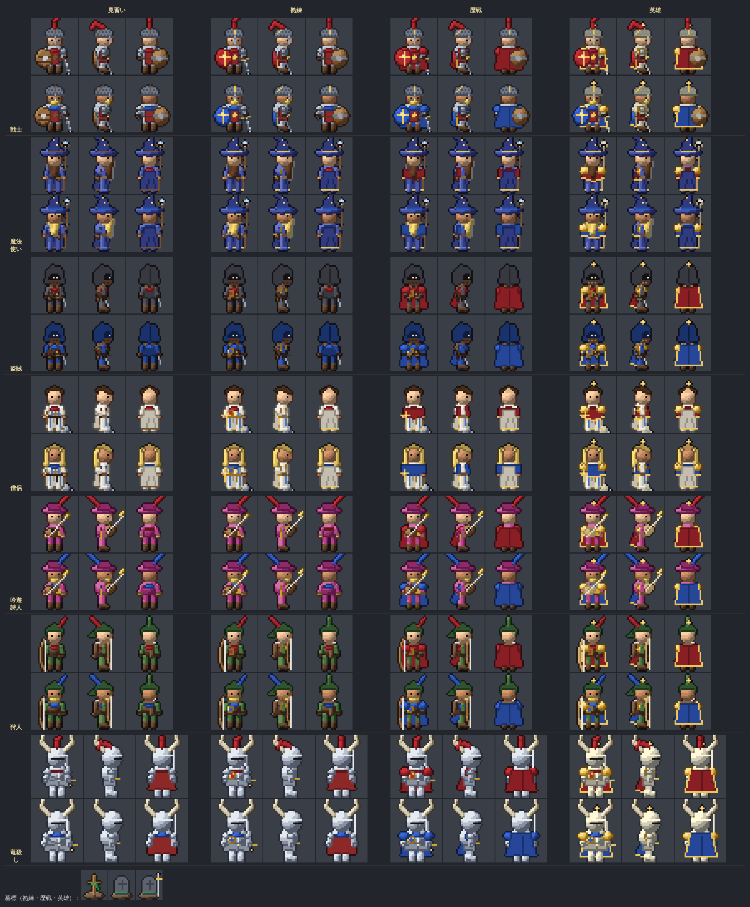
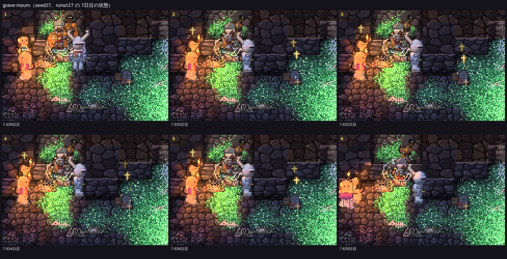

# 冒険者の作り直し（五歩目）：町の名簿、同じ顔と位の装備、墓標

見える相互作用の決まりに従い、まず「画面で何が見えるか」を決めてから内部を作った。名簿の画面は作らず、姿と動きで分かるようにした。仕様は README.md の「冒険者の作り直し（五歩目）」、コードは src/eco/roster.ts（名簿・位・墓標）、src/sprites.ts の `heroSprite`・`graveMarker`・`prayLight`（絵）、src/atlas.ts と src/renderer.ts（あとから描き足すます目）。

16シード×25日の比較（`npm run ab -- --preset final --base origin/main`）は docs/compare-20261114-roster.md、冒険者の数は docs/adv-20261114-roster.md。**四つの帳簿のずれは0**。`npm test` 21項目 OK、`npm run check` 全件 ✅（名簿の確かめを足した）。

## 見せたい瞬間と、作ったもの

### 1. 同じ顔がまた来る

冒険者一人ひとりに姿（`look`）がある：髪の色（6）、肌の色（4）、身につける色（6。首の布、戦士と竜殺しの羽根飾り、吟遊詩人と狩人の羽根、マント）、体つき（細い・ふつう・がっしり）、頭の形（髭、僧侶の長い髪、魔法使いの帽子の帯、盗賊の頭巾の色）。新人は、同じ職業の者と身につける色と髪の色が重ならないように選ぶ。一行は町の名簿（12人）から組むので、同じ姿の者が何度も来る。札は「歴戦の戦士アルド（帰還5回）」、入るときの記録は「熟練の戦士ウルスラの一行（戦士ウルスラ（熟練、3度目）・僧侶イオ（熟練、4度目）・…）が、…」。

### 2. 装備が良くなる

位は帰還の回数で上がる（2回で熟練、4回で歴戦、7回で英雄）。職業ごとの違いを残したまま、位ごとに装備が目に見えて変わる：

| 位 | 姿 |
|---|---|
| 見習い | 金の飾りのない地味な布（金の画素を茶色の布に）。戦士は木の丸盾 |
| 熟練 | 金の飾りが戻り、紋章：戦士は盾が身につける色に金の十字、ほかは胸に金縁の徽章 |
| 歴戦 | 身につける色の肩当てと、前からも体の両脇に見える幅のマント（魔法使い・僧侶は肩掛け） |
| 英雄 | 金の肩当て、金を帯びた鎧、金縁のマント、頭の上の金の星、武器がほのかに光る（暗がりでも光る） |

最初の形では、位の違いが紋章の小さな点やマントの縁だけで、ほとんど見分けられなかった（作業の途中で指摘を受けた）。そこで見習いから金を抜き、歴戦は肩当てと幅の広いマントで輪郭を変え、英雄は全体が金を帯びるようにした。

位ごとの姿の一覧（職業ごとに二人ぶん、正面・横・後ろ。色は絵そのもの。下に墓標）：

ゲームの画面（seed27 11.15日目）：英雄の竜殺しラスの一行。中央の竜殺しは金の肩当てと金縁の紫のマント、後ろの盗賊は歴戦の赤いマント。

強さは位ごとに ×1.07・×1.14・×1.2（`RANK_MUL`。英雄で頭打ち。体力も強さから決まる）。

### 3. 墓標が立つ

熟練以上の冒険者が倒れた所に墓標が立つ（熟練は木の十字に身につける色の布、歴戦は石の墓標、英雄は石の墓標に剣）。20を超えたら古いものから崩れて消える。のちの一行の先頭が6マス以内で墓標を見通せると、一度だけ60歩立ち止まって皆が墓標の方を向く（武器は構えない）。僧侶がいれば祈り、墓標と僧侶の上に光る聖印が立ちのぼる。墓標を触ると札に「熟練の僧侶イオがここに眠る／帰還3回。5.7日目に倒れた」。

seed27 7.63日目：右の石の墓標（歴戦の冒険者）の前で、一行が立ち止まって墓標の方を向き、左の僧侶が祈る（墓標と僧侶の上に聖印の光）。

## 数（main → 新、16シード×25日）

### 見せたい瞬間

| 瞬間 | main | 新 |
|---|---|---|
| **同じ顔の再訪**（2回目以上の遠征の冒険者） | — | ✅ 16/16（計 1183、中央値 73.5） |
| **位が上がった：熟練** | — | ✅ 16/16（計 222） |
| **位が上がった：歴戦** | — | ✅ 16/16（計 147） |
| **位が上がった：英雄** | — | ✅ 16/16（計 77） |
| **墓標が立った** | — | ✅ 15/16（計 79） |
| **墓標の前で一行が立ち止まった** | — | ✅ 15/16（計 470、中央値 21.5） |
| **墓標の前で僧侶が祈った** | — | ✅ 14/16（計 281） |

ほかの瞬間（物資の置き場、聞き耳、戦利品、竜退治など）はどれも「ばらつきの内」。

### 強くなりすぎていないか

| 指標 | main | 新 | 目安 |
|---|---:|---:|---|
| 死んだ冒険者 | 150 | 121 | ばらつきの内（5シードで増、11で減。差の中央値 −3.5） |
| 一行の数（延べ） | 387 | 377 | |
| 冒険者がドラゴンを倒した | 17 | 22 | ばらつきの内 |
| 竜退治の一行が寝床に着いた / 果たした | 4 / 2 | 4 / 3 | ばらつきの内 |
| 冒険者に倒されたゴブリン | 89 | 55 | ばらつきの内 |

死者は約2割減ったが、ばらつきの内。竜を倒す数もほとんど変わらず、英雄でも竜には一行で挑む強さに収まっている。ただし、名簿が育つ終盤ほど強い一行が多くなる（下の表の25日目）ので、30日以上回すと差が開くかもしれない。

## 名簿の推移（シードごと、25日の間）

各位の人数（見＝見習い、熟、歴、英）、初めて英雄が生まれた日、倒れた数（位ごと）、加わった新人、墓標、遠征の延べ人数（`node tools/analysis/rosterlog.mjs runs/ab-final-roster/new`）。

| シード | 5日目 | 10日目 | 15日目 | 20日目 | 25日目 | 初めての英雄 | 倒れた（見・熟・歴・英） | 新人 | 墓標 | 遠征の延べ人数 |
|---|---|---|---|---|---|---|---|---:|---:|---|
| abc | 見10 熟2 歴0 英0 | 見4 熟5 歴2 英1 | 見6 熟2 歴3 英1 | 見3 熟3 歴4 英2 | 見2 熟2 歴4 英4 | 9.9日目 | 6 / 2 / 1 / 0 | 9 | 3 | 87（再訪 68） |
| かしたれ | 見8 熟4 歴0 英0 | 見4 熟4 歴4 英0 | 見5 熟4 歴3 英0 | 見1 熟6 歴4 英1 | 見5 熟3 歴3 英1 | 18.3日目 | 3 / 2 / 2 / 2 | 9 | 6 | 76（再訪 56） |
| はじまりの洞窟 | 見8 熟3 歴1 英0 | 見4 熟6 歴2 英0 | 見3 熟3 歴6 英0 | 見3 熟4 歴2 英3 | 見8 熟1 歴0 英3 | 15.0日目 | 2 / 4 / 6 / 1 | 13 | 11 | 101（再訪 80） |
| seed4 | 見9 熟3 歴0 英0 | 見6 熟4 歴2 英0 | 見6 熟2 歴3 英1 | 見4 熟1 歴5 英2 | 見4 熟3 歴1 英4 | 13.7日目 | 1 / 1 / 3 / 0 | 5 | 4 | 74（再訪 58） |
| seed5 | 見8 熟4 歴0 英0 | 見6 熟3 歴3 英0 | 見5 熟1 歴5 英1 | 見4 熟3 歴3 英2 | 見1 熟5 歴4 英2 | 13.7日目 | 2 / 0 / 1 / 0 | 3 | 1 | 68（再訪 53） |
| seed6 | 見9 熟3 歴0 英0 | 見5 熟6 歴1 英0 | 見1 熟5 歴6 英0 | 見1 熟1 歴5 英5 | 見2 熟1 歴0 英9 | 18.0日目 | 0 / 0 / 1 / 0 | 1 | 1 | 84（再訪 73） |
| seed7 | 見6 熟5 歴1 英0 | 見5 熟5 歴2 英0 | 見3 熟6 歴2 英1 | 見4 熟1 歴5 英2 | 見2 熟1 歴4 英5 | 13.4日目 | 1 / 3 / 3 / 0 | 7 | 6 | 103（再訪 86） |
| seed8 | 見9 熟3 歴0 英0 | 見2 熟8 歴2 英0 | 見5 熟3 歴3 英1 | 見2 熟3 歴6 英1 | 見0 熟3 歴5 英4 | 12.1日目 | 1 / 1 / 2 / 1 | 5 | 4 | 98（再訪 81） |
| seed40 | 見8 熟3 歴1 英0 | 見4 熟4 歴3 英1 | 見3 熟2 歴6 英1 | 見1 熟3 歴3 英5 | 見1 熟3 歴2 英6 | 10.0日目 | 1 / 0 / 0 / 0 | 1 | 0 | 87（再訪 74） |
| seed41 | 見8 熟3 歴1 英0 | 見3 熟8 歴1 英0 | 見2 熟5 歴4 英1 | 見7 熟1 歴2 英2 | 見6 熟2 歴3 英1 | 14.8日目 | 5 / 1 / 4 / 2 | 12 | 7 | 85（再訪 64） |
| seed18 | 見8 熟3 歴1 英0 | 見3 熟8 歴1 英0 | 見1 熟3 歴8 英0 | 見3 熟2 歴7 英0 | 見3 熟0 歴4 英5 | 15.4日目 | 1 / 1 / 1 / 2 | 5 | 4 | 93（再訪 77） |
| seed27 | 見7 熟3 歴2 英0 | 見3 熟4 歴2 英3 | 見3 熟5 歴2 英2 | 見5 熟3 歴2 英2 | 見4 熟2 歴2 英4 | 8.5日目 | 6 / 4 / 1 / 2 | 13 | 7 | 113（再訪 90） |
| seed23 | 見11 熟0 歴1 英0 | 見8 熟3 歴1 英0 | 見2 熟4 歴6 英0 | 見1 熟3 歴2 英6 | 見2 熟3 歴1 英6 | 15.1日目 | 7 / 4 / 2 / 2 | 15 | 8 | 135（再訪 109） |
| seed35 | 見8 熟3 歴1 英0 | 見5 熟6 歴1 英0 | 見7 熟2 歴3 英0 | 見8 熟2 歴1 英1 | 見3 熟7 歴1 英1 | 11.3日目 | 1 / 1 / 2 / 2 | 6 | 5 | 77（再訪 59） |
| seed17 | 見6 熟6 歴0 英0 | 見4 熟4 歴4 英0 | 見6 熟3 歴0 英3 | 見6 熟2 歴1 英3 | 見4 熟3 歴2 英3 | 12.0日目 | 5 / 7 / 3 / 0 | 15 | 10 | 118（再訪 95） |
| seed30 | 見8 熟3 歴1 英0 | 見5 熟5 歴2 英0 | 見4 熟4 歴3 英1 | 見5 熟3 歴1 英3 | 見2 熟4 歴2 英4 | 14.1日目 | 0 / 1 / 0 / 1 | 2 | 2 | 73（再訪 60） |
| **合計** | | | | | | 英雄の出たシード 16 | 42 / 32 / 32 / 15 | 121 | 79 | 1472（再訪 1183） |

- すべてのシードで英雄が生まれた（早いのは8.5日目、遅いのは18.3日目）。倒れたのは121人で、そのうち79人（熟練以上）が墓標になった。
- 倒れる者の少ないシード（seed6・seed40）では、25日目に名簿の半分以上が英雄になる。眺める人には「強い一行の時代」に見えるが、顔ぶれの入れ替わりは少ない。

## 見えない所（報告）

- **見習い→熟練の違いが小さい**：金の飾りと紋章（盾・胸の徽章）だけで、寄らないと分かりにくい（小。熟練に、身につける色の腕章か腰帯を足すなど）。
- **松明の灯りの中では身につける色が見分けにくい**：灯りの橙に色が寄るため、「あの人だ」は姿の輪郭（体つき・髭・長い髪・羽根飾り）と札に頼る（中。描画で身につける色の部分だけ明かりの色寄せを弱める手がある）。
- **名簿が英雄ばかりになるシードがある**：引退がないため（中。英雄が何回か帰ったら引退して新人に替わる、など）。
- **古い墓標が崩れて消える瞬間は記録だけ**（小。崩れる土ぼこりの演出を足せる）。

## 途中で足した道具

- `node tools/analysis/rosterlog.mjs <batch の回>`：名簿の推移の表。
- `node tools/gallery/heroes.mjs`：位ごとの姿の一覧（docs/img/hero-ranks.png）。
- 見せたい瞬間の数え方（tools/analysis/lib/moments.ts）に、同じ顔の再訪、位が上がった回数（位ごと）、墓標、墓標で立ち止まった・祈った回数を足した。
