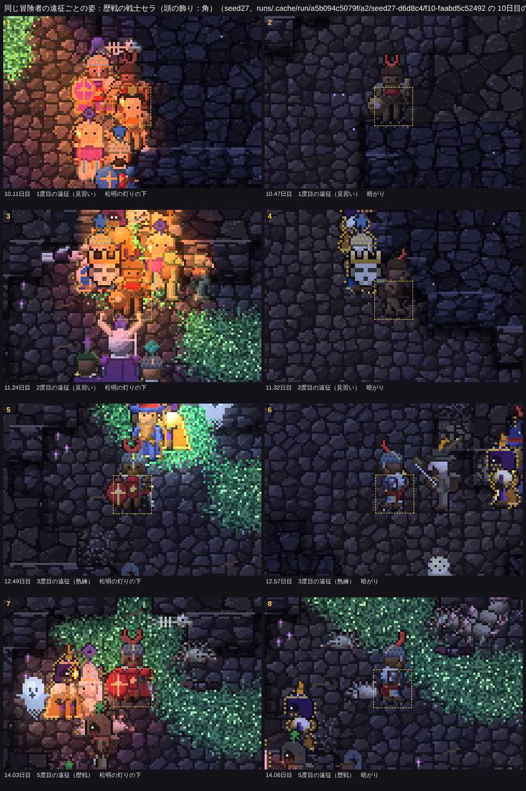
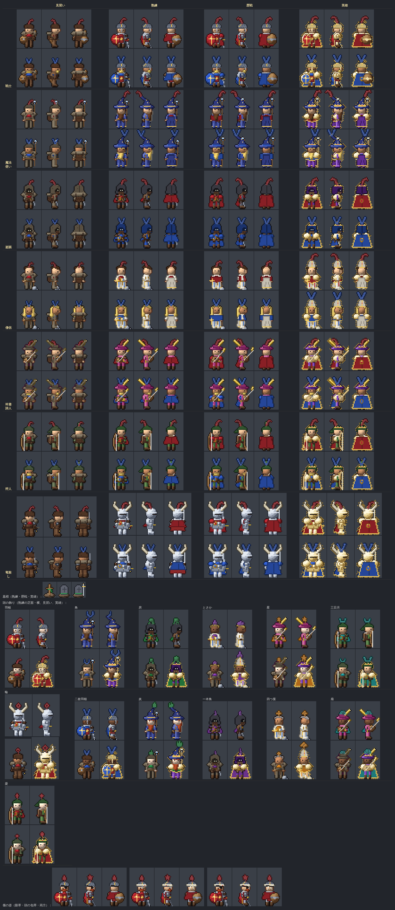
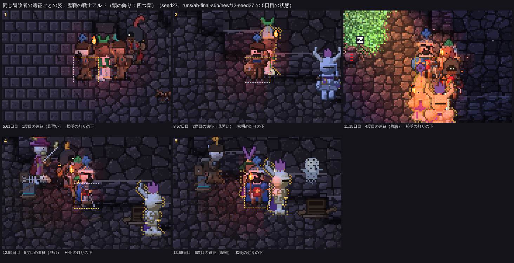
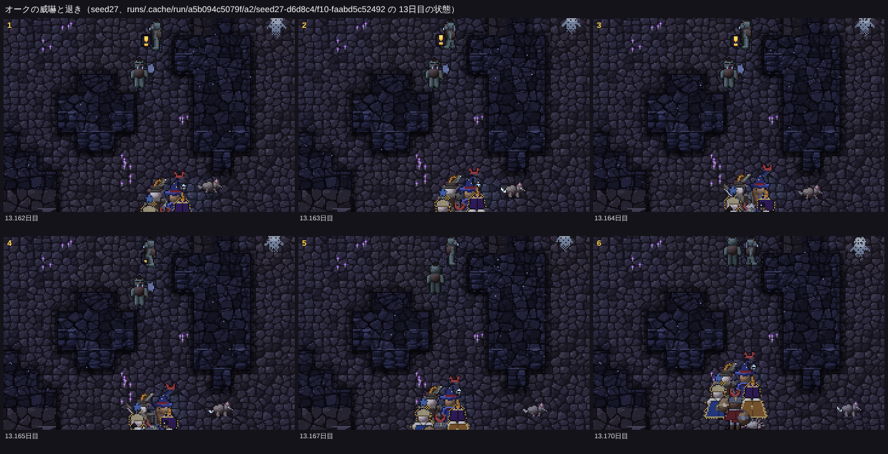

# 冒険者の作り直し（六歩目）：頭の飾りと位の形、引退と傷、オークの見極め

見える相互作用の決まりに従い、まず「画面で何が見えるか」を決めてから内部を作った。仕様は README.md の「冒険者の作り直し（六歩目）」、コードは src/eco/roster.ts（飾り・引退・傷）、src/eco/orc.ts の `orcWary`（オークの見極め）、src/sprites.ts の `crestPrims`・`withCrest`・`noviceRoll`・`scarPrims`（絵）。

16シード×25日の比較（`npm run ab -- --preset final --base origin/main`）は docs/compare-20261115-step6.md。**四つの帳簿のずれは0**。`npm test` すべて OK、`npm run check` 全件 ✅（引退とオークの威嚇の確かめを足した）、`npm run ab -- --resume-check 12 --seeds seed27,かしたれ --days 16` で、12日目で分けて回しても状態も記録も通しと一致。

## 見せたい瞬間と、作ったもの

### 1. 同じ顔だと、画面で分かる

前回は身につける色で見分けようとしたが、松明の灯りで色が橙に寄り、混み合った画面では同じ人と読み取れなかった。そこで**形**で見分ける。

- 一人ひとりの兜・帽子・頭巾のてっぺんに、形の違う**頭の飾り**：羽根・角・房・とさか・星・三日月・輪・二枚羽根・炎・一本角・四つ葉・扇・菱の13種。名簿の中で重ならない（引退の前に名簿が一時13人になるので13種）。位が変わっても同じ形のまま、位が上がるほど少し大きくなる。
- 飾りの中だけ**ほのかに自ら光る**（色は身につける色を暗めに抑えた光。輪郭は光らない）。灯りの橙に色が寄らず、暗がりでも形が浮かぶ。光の強さは身につける色の 0.62 倍＋34 に抑え、体のまわりの光（英雄）より弱い。
- 前の戦士・竜殺しの羽根飾りと、吟遊詩人・狩人の色の羽根は、飾りに置き換えた（羽根の飾りと紛れるので）。

同じ冒険者を遠征ごとに並べた連続（左が松明の灯りの下、右が暗がり。`node tools/analysis/launch.mjs samehero`）。seed27 の戦士セラ（飾りは赤い「角」）。見習いの古着（1〜2度目）から熟練の鎖かたびら（3度目）、歴戦のマント（5度目）へ姿が変わっても、灯りの下でも暗がりでも同じ赤い角で分かる。セラは、引退する英雄テッサが最後の遠征に連れてきた見習い。

### 2. 位の違いを形で

色だけでなく、輪郭で位が読めるようにした（見習いと熟練の差が、寄らないと分からなかった点も直した）。

| 位 | 形の印 |
|---|---|
| 見習い | 背に丸めた毛布の背負い袋（正面からも肩の上に両端が見える）。古着、猫背 |
| 熟練 | 小さな革の肩当てと、腰までの短いマント（ローブの者は法衣のまま） |
| 歴戦 | 身につける色の肩当てと、足もとまでのマント |
| 英雄 | 大きく張り出す白金の肩当てと、地に引きずる長さの幅広い金縁のマント |

位ごとの姿の一覧（撮り直し。職業ごとに二人ぶん、正面・横・後ろ。下に墓標、頭の飾り13種、傷の姿）：

### 3. 引退

遠征を重ねた英雄は、最後の遠征で**同じ職業の見習いを連れて**入ってくる（入るときの記録は「英雄テッサの最後の遠征、見習いの戦士セラを連れて。…」）。最後の遠征の英雄のまわりには金の粒が二つ、ゆっくり立ちのぼる（描画だけ）。生きて帰ると記録に「英雄テッサ（戦士、帰還10回）が引退した」と残り、それきり来ない。連れてきた見習いが名簿に残って後を継ぐ。

- 英雄になってから3回の遠征を終えて帰ると引退（`RETIRE_AFTER`、帰還10回）。その前の遠征（帰還9回で入るとき）に、同じ職業の見習いを名簿に加えて一行に入れる（名簿は一時13人。最後の遠征で英雄が倒れたら墓標が立ち、新人は加わらない）。

seed27 10.1日目、英雄テッサの最後の遠征（印は解析の重ね書き）。テッサのすぐ下（青い印）が見習いのセラ（赤い角の飾り）。灯りの中で混み合うので、印がないと読みにくい（見えない所に挙げた）：

11.1日目、生きて帰る英雄テッサ（この直後、入口を出て引退の記録が残る）：

### 4. 傷

遠征の間にいちばん減った体力が上限の**半分**を切って生きて帰ると、**眼帯か頭の包帯**（重ねて負えば両方）が姿に残り、そのあと地上の1.5日は遠征に出ない。

- 目安の「2割」では、帰還の約0.7％しか当たらなかった（確かめの回で帰還282回のうち2回。帰還の93％は無傷で、深手を負った者はたいていそのまま倒れる）。25日にほとんど見えないので、半分に下げた（25日に16シードで計38回、14シードで1回以上）。

seed27 の戦士アルド（飾りは青い「四つ葉」）の遠征ごとの姿。1度目は傷なし、6日目に眼帯、9.6日目にさらに頭の包帯が加わり、のちの遠征でも残っている：

### 5. オークの見極め

オークは冒険者の一行に気づくと（7マス、見通しが利く）、一行の強さ（体力を加味した強さの和に、英雄一人ごとに2割を足す）が、近く（6マス）のオークの強さの和の1.5倍を超えれば、襲わずに**唸って武器を打ち鳴らし**（一行の方を向いて武器を振り続け、頭の上に「！」が跳ねる。24歩）、**縄張りの奥へ退く**（まず一行からいちばん遠い見通しの利く所へ下がり、離れたら住みかの印へ）。勝ち目があれば今までどおり襲う。威嚇して退くオークは、どの一行も追わない（大物退治の目標がオークのときは除く）。一行に打たれたら打ち返す。

調べてみると、冒険者に倒されたオークの多くは、オークから襲いかかったのではなく、縄張りの外（入ってきたばかりの口のそば、飢えて去る途中）で一行に出くわして、一行から攻められたものだった（`probe deaths --kind 13 --cause fight`）。そこで見極めは、腹ぺこの狩りのときだけでなく、出くわしたとき全般に効くようにした。退くはずのオークが住みかへの道で一行の側へ歩いていく例があったので、まず一行から離れる方へ下がるようにした。

seed27 13.16日目：上のオークが一行（下）に気づき、「！」を出して武器を振る（1〜3こま）。そのあと背を向けて退く（5〜6こま）：

## 数（main → 新、16シード×25日）

### 見せたい瞬間

| 瞬間 | main | 新 |
|---|---|---|
| **英雄の最後の遠征**（見習いを連れて入った） | — | ✅ 16/16（計 138、中央値 7.5） |
| **英雄が引退した** | — | ✅ 16/16（計 122、中央値 7） |
| **傷の残った帰還**（眼帯・包帯） | — | ✅ 14/16（計 38、中央値 2） |
| **オークが威嚇して退いた** | — | ✅ 13/16（計 543、中央値 34.5。オークの来ない3シードでは0） |

ほかの瞬間はどれも「ばらつきの内」（位が上がる回数は、引退で見習いが入れ替わるので増えた：熟練 329→422、歴戦 254→318、英雄 171→220。「はっきり」）。

### オークと冒険者

| シード | 冒険者に倒されたオーク（前 → 後） | オークのいる日数（前 → 後） | ゴブリンの集落のある日数（前 → 後） | 冒険者の死者（前 → 後） | オークの威嚇（前 → 後） |
|---|---|---|---|---|---|
| 01-abc | 3 → 1 | 14.25 → 11.5 | 12.5 → 12.75 | 22 → 20 | 0 → 10 |
| 02-かしたれ | 21 → 9 | 14 → 14.75 | 9.5 → 7.5 | 11 → 18 | 0 → 115 |
| 03-はじまりの洞窟 | 2 → 4 | 4 → 5.5 | 0 → 2.25 | 17 → 10 | 0 → 44 |
| 04-seed4 | 2 → 3 | 3.25 → 9.25 | 0 → 0 | 9 → 8 | 0 → 48 |
| 05-seed5 | 0 → 6 | 0 → 7.75 | 0 → 0.75 | 15 → 19 | 0 → 42 |
| 06-seed6 | 2 → 1 | 2.5 → 4.75 | 0 → 0 | 11 → 12 | 0 → 29 |
| 07-seed7 | 18 → 10 | 10.75 → 11.75 | 8 → 2.5 | 25 → 15 | 0 → 63 |
| 08-seed8 | 0 → 0 | 0.25 → 3.75 | 0 → 0 | 13 → 11 | 0 → 8 |
| 09-seed40 | 9 → 1 | 11.25 → 12.75 | 7.5 → 5.5 | 5 → 8 | 0 → 40 |
| 10-seed41 | 2 → 2 | 12.25 → 11.25 | 7.5 → 5.5 | 16 → 13 | 0 → 21 |
| 11-seed18 | 5 → 0 | 3.25 → 2.25 | 2.75 → 1.5 | 9 → 15 | 0 → 2 |
| 12-seed27 | 25 → 15 | 14.25 → 13.75 | 6.5 → 9 | 23 → 9 | 0 → 80 |
| 13-seed23 | 9 → 2 | 7.75 → 4 | 3.5 → 0 | 29 → 11 | 0 → 41 |
| 14-seed35 | 0 → 0 | 8.5 → 7.75 | 4.75 → 6.25 | 31 → 25 | 0 → 0 |
| 15-seed17 | 0 → 0 | 0 → 0 | 0 → 0 | 8 → 10 | 0 → 0 |
| 16-seed30 | 2 → 0 | 2.75 → 0 | 1.25 → 0 | 9 → 5 | 0 → 0 |
| **合計** | 100 → 54 | 109 → 120.75 | 63.75 → 53.5 | 253 → 209 | 0 → 543 |

- 冒険者に倒されたオーク **100 → 54**（半分ほど）。残りの多くは、大物退治の目標がオークの一行（`rumors.beastKind` がオーク）に倒されたもので、これは目標どおり。
- オークのいる日数は 109 → 121 日（ばらつきの内）。ゴブリンの集落のある日数は 64 → 54（seed7 の 8→2.5、seed23 の 3.5→0 が大きい。原因は追っていない）。
- 冒険者の死者 253 → 209（ばらつきの内、6シードで増・10で減）。冒険者がドラゴンを倒した 10 → 7（ばらつきの内）。
- ほかに「はっきり」と出たのは、ゴブリンの飢え死に 60 → 23（↓）。原因は追っていない（オークに従う集落の取り立ての回数は 35 → 25 で、ばらつきの内）。

## 名簿の推移（シードごと、25日の間）

各位の人数（見＝見習い、熟、歴、英）、初めて英雄が生まれた日、倒れた数（位ごと）、引退、傷の残った帰還、加わった新人、墓標、遠征の延べ人数（`node tools/analysis/rosterlog.mjs runs/ab-final-s6b/new`）。

| シード | 5日目 | 10日目 | 15日目 | 20日目 | 25日目 | 初めての英雄 | 倒れた（見・熟・歴・英） | 引退 | 傷 | 新人 | 墓標 | 遠征の延べ人数 |
|---|---|---|---|---|---|---|---|---:|---:|---:|---:|---|
| 01-abc | 見5 熟5 歴2 英0 | 見4 熟3 歴4 英1 | 見1 熟4 歴3 英4 | 見3 熟1 歴5 英3 | 見3 熟4 歴1 英5 | 9.2日目 | 9 / 4 / 5 / 2 | 4 | 2 | 25 | 11 | 179（再訪 143） |
| 02-かしたれ | 見4 熟8 歴0 英0 | 見1 熟2 歴8 英1 | 見6 熟2 歴0 英5 | 見2 熟4 歴5 英1 | 見3 熟4 歴2 英4 | 9.7日目 | 5 / 4 / 3 / 6 | 6 | 2 | 25 | 13 | 216（再訪 179） |
| 03-はじまりの洞窟 | 見4 熟7 歴1 英0 | 見3 熟1 歴5 英4 | 見1 熟5 歴2 英4 | 見3 熟1 歴6 英3 | 見7 熟1 歴1 英4 | 7.9日目 | 2 / 4 / 2 / 2 | 8 | 2 | 19 | 8 | 180（再訪 151） |
| 04-seed4 | 見4 熟8 歴0 英0 | 見2 熟4 歴6 英0 | 見2 熟4 歴3 英4 | 見5 熟4 歴1 英3 | 見0 熟6 歴5 英1 | 10.1日目 | 1 / 4 / 3 / 0 | 7 | 3 | 15 | 7 | 157（再訪 130） |
| 05-seed5 | 見3 熟9 歴0 英0 | 見1 熟3 歴7 英1 | 見4 熟4 歴1 英3 | 見5 熟1 歴5 英1 | 見5 熟3 歴2 英3 | 8.4日目 | 4 / 4 / 8 / 3 | 3 | 5 | 23 | 15 | 178（再訪 145） |
| 06-seed6 | 見3 熟9 歴0 英0 | 見4 熟1 歴4 英3 | 見4 熟5 歴2 英1 | 見2 熟3 歴6 英2 | 見4 熟4 歴3 英2 | 9.2日目 | 2 / 4 / 5 / 1 | 9 | 1 | 22 | 10 | 202（再訪 168） |
| 07-seed7 | 見8 熟4 歴0 英0 | 見0 熟4 歴7 英1 | 見4 熟1 歴3 英5 | 見5 熟0 歴4 英3 | 見1 熟3 歴4 英4 | 9.1日目 | 5 / 4 / 2 / 4 | 6 | 1 | 21 | 10 | 191（再訪 159） |
| 08-seed8 | 見4 熟6 歴2 英0 | 見1 熟3 歴5 英3 | 見5 熟3 歴2 英3 | 見3 熟3 歴4 英2 | 見0 熟5 歴2 英5 | 8.8日目 | 2 / 3 / 3 / 3 | 7 | 4 | 18 | 9 | 204（再訪 174） |
| 09-seed40 | 見4 熟7 歴1 英0 | 見1 熟3 歴6 英2 | 見2 熟3 歴2 英6 | 見5 熟1 歴3 英3 | 見2 熟4 歴4 英3 | 8.4日目 | 3 / 0 / 4 / 1 | 8 | 3 | 17 | 5 | 183（再訪 154） |
| 10-seed41 | 見3 熟8 歴1 英0 | 見2 熟4 歴4 英2 | 見1 熟4 歴5 英2 | 見2 熟0 歴3 英7 | 見8 熟2 歴1 英1 | 8.6日目 | 1 / 3 / 5 / 4 | 7 | 1 | 20 | 12 | 185（再訪 157） |
| 11-seed18 | 見5 熟5 歴2 英0 | 見3 熟2 歴5 英2 | 見2 熟7 歴0 英4 | 見5 熟3 歴2 英3 | 見2 熟3 歴5 英3 | 7.5日目 | 6 / 6 / 2 / 1 | 9 | 1 | 25 | 9 | 207（再訪 170） |
| 12-seed27 | 見5 熟6 歴1 英0 | 見3 熟1 歴5 英3 | 見3 熟5 歴4 英1 | 見1 熟2 歴1 英9 | 見3 熟1 歴2 英7 | 6.6日目 | 2 / 5 / 2 / 0 | 14 | 3 | 24 | 7 | 270（再訪 234） |
| 13-seed23 | 見1 熟8 歴3 英0 | 見2 熟4 歴3 英4 | 見2 熟1 歴7 英2 | 見6 熟0 歴3 英4 | 見3 熟3 歴5 英1 | 6.5日目 | 4 / 2 / 1 / 4 | 16 | 6 | 27 | 7 | 275（再訪 236） |
| 14-seed35 | 見7 熟3 歴2 英0 | 見6 熟5 歴0 英1 | 見3 熟6 歴3 英0 | 見2 熟2 歴6 英3 | 見3 熟2 歴3 英5 | 7.7日目 | 10 / 7 / 7 / 1 | 4 | 0 | 30 | 15 | 197（再訪 155） |
| 15-seed17 | 見2 熟8 歴2 英0 | 見1 熟1 歴8 英2 | 見2 熟1 歴3 英6 | 見5 熟3 歴1 英3 | 見3 熟2 歴3 英5 | 7.5日目 | 4 / 2 / 2 / 2 | 8 | 4 | 19 | 6 | 200（再訪 171） |
| 16-seed30 | 見2 熟8 歴2 英0 | 見1 熟4 歴5 英2 | 見2 熟3 歴4 英3 | 見1 熟0 歴9 英2 | 見4 熟1 歴0 英7 | 8.8日目 | 0 / 0 / 1 / 4 | 6 | 0 | 11 | 5 | 166（再訪 144） |
| **合計** |  |  |  |  |  | 英雄の出たシード 16 | 60 / 56 / 55 / 38 | 122 | 38 | 341 | 149 | 3190（再訪 2670） |

- 前回は引退がなく、25日目に英雄が6〜10人のシードが多かった（seed6 で9人、seed4 で10人）。いまは25日目に1〜7人、**10〜25日目の平均ではシードごとに2.1〜4.4人**（16のうち13シードが2〜4人。`npm run metric -- --runs runs/ab-final-s6b/new --expr "e.roster.filter(h=>h.rank===3).length" --days 10-25`）。英雄が引退して見習いに替わり、また育つ波がある（seed27 は20日目以降に7〜9人）。
- 引退は1シードあたり3〜16回（計122）。新人は 253 → 341。

## 見えない所（報告）

- **松明の灯りの中で混み合う一行は、まだ読み取りにくい**：灯りの近くでは体全体が橙の塊になる（飾りは光るので形は残る）。灯りの色寄せを体の部分で弱める、一行の並びを広げる、などの手がある（中）。
- **傷で休んでいる冒険者は画面に出ない**：「来ない」ことは見えない。休んでいる者の名前を記録に出す、入口のそばで包帯を巻いて座る、などの手がある（小）。
- **引退の瞬間そのもの**は、入口を出たときの記録だけ（最後の遠征の英雄の金の粒は足した）。入口で振り返って手を振る、などの動きを足せる（小）。
- **オークの威嚇の唸り声**は音の記録（`noise`）だけで、画面では「！」と武器を振る動き。オークの来ないシード（seed17・seed30・seed35）では見えない。

## 途中で足した道具

- `node tools/analysis/launch.mjs samehero --seed <シード> --from <日> --to <日> [--hero <名簿の番号>] [--run <回>] [--one]`：同じ冒険者を遠征ごとに、松明の灯りの下と暗がりで並べて撮る（`--one` で遠征ごとに一こま）。
- `node tools/analysis/orcadv.mjs <前の回> <後の回>`：冒険者に倒されたオーク、オークのいる日数、ゴブリンの集落のある日数、冒険者の死者、オークの威嚇。
- `npm run film` は、引退の最後の遠征の英雄と、連れの見習いに名前の印を重ねる。
- 見せたい瞬間の数え方（tools/analysis/lib/moments.ts）に、英雄の最後の遠征、引退、傷の残った帰還、オークの威嚇を足した。`npm run check` に引退とオークの威嚇の確かめを足した。名簿の推移（rosterlog.mjs）に引退と傷の列を足した。
