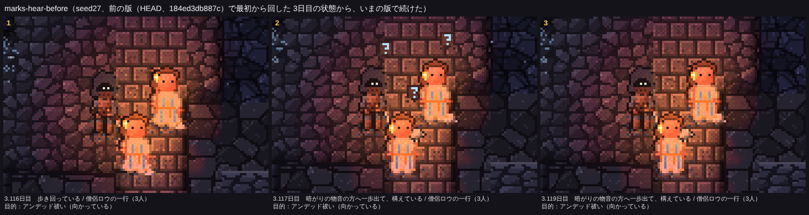
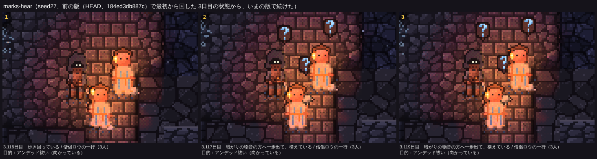
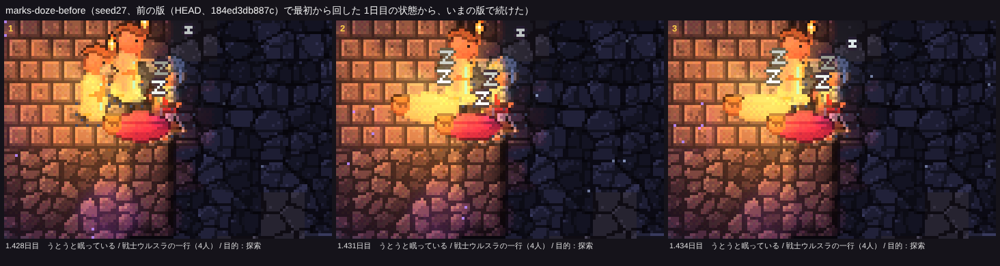
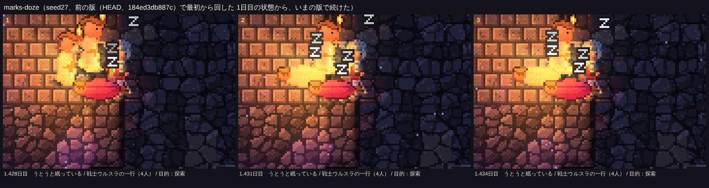

# 一行の上限2の比べ直し、夜の盗みの間隔、頭の上の印

16シード×25日の比較は docs/compare-20261114.md（main＝上限1 → 新＝上限2）と docs/adv-20261114.md（冒険者・ゴブリン・見せたい瞬間）。**四つの帳簿のずれは0**。`npm test` 21項目 OK、`npm run check` 全件 ✅、`ab --resume-check 7 --seeds かしたれ --days 10` で分けて回しても状態と記録が通しと一致。

## 1. 一行の上限を2にして比べ直す

### 途中で見つけた不具合：上の横穴の岩壁が崩れても、横穴が開かないことがある

最初に main のまま上限1と2を比べると、abc・seed23・seed30 でゴブリン・コボルト・オークがほとんど来なくなり（abc の集落のある日数 15.8→2.3日）、集落とオークの縄張りの日数が大きく減った。追うと、冒険者の害ではなかった。

- ゴブリン・コボルト・オークは地表の横穴からしか来ない。abc の地表の横穴は一つで、3〜5日目に岩壁が崩れて開く（`breakTopWall`）。
- 上限2の abc では、崩れて掘った通路の出口のマスが、掘った土（`dumpSpoil`）で埋まり、通路は閉じた空洞のまま横穴が開かなかった。それでも「崩れた」の印（`wallBroken`）が立つので、二度と掘り直さない。記録には「岩壁が崩れ、上の横穴から外の風が吹き込んだ」と出るのに、横穴は閉じたまま（23日目まで何も来ない）。
- 一行の数が変わると、そのころの地形（ドワーフの掘り跡など）が変わって、どのシードで起きるかが変わる。上限のせいではなく、前から潜んでいた不具合。
- **直した**：横穴が開くまで、地上の時間で1日のあいだ100歩ごとに掘り直す。記録は横穴が開いたときだけ出す（src/eco/islands.ts）。seed30 の減り方はワームが別の所を掘った違い（横穴の開き方の運）で、直す対象ではない。

### 直したあとの比べ直し（同じ新しいコードで上限1 → 上限2、16シード×25日）

| 見たいこと | 上限1 | 上限2 | 目安 |
|---|---:|---:|---|
| 物資の置き場を残した | 61 | 110 | **↑ はっきり** |
| 置き場で食料を補った（一行ごと） | 105 | 270 | **↑ はっきり** |
| 聞き耳で止まる | 658 | 1350 | **↑ はっきり** |
| 戦利品を持ち帰った | 44 | 107 | ばらつきの内（15/16シードで起きた） |
| 一行：アンデッド祓い（果たした） | 58（22） | 146（70） | **↑ はっきり** |
| 一行：深部の探索 | 111 | 233 | **↑ はっきり** |
| 一行：竜退治 / 寝床に着いた / ドラゴンを倒した | 45 / 5 / 16 | 63 / 4 / 19 | ばらつきの内 |
| 一行：大物狩り（果たした） | 46（7） | 118（18） | ばらつきの内 |
| 一行：ゴブリン退治（集落に着いた） | 18（14） | 26（21） | ばらつきの内 |
| 通路での掠め取り：盗んだ | 30 | 41 | ばらつきの内 |
| 冒険者に倒されたコボルト | 3 | 2 | ばらつきの内 |
| 冒険者に倒されたゴブリン | 99 | 116 | ばらつきの内 |
| 冒険者に倒されたオーク | 78 | 131 | 増えた（9シードで増、3で減） |
| コボルトの住処のある日数 | 176.8 | 188.3 | ばらつきの内 |
| ゴブリンの集落のある日数 | 83 | 57 | ばらつきの内（4シードで増、7で減） |
| オークのいる日数 | 124 | 100 | ばらつきの内（2シードで増、9で減） |
| 死んだ冒険者 | 141 | 243 | **↑ はっきり**（一行の数が約1.9倍。一行あたりはむしろ少し減った） |

- **瞬間ははっきり増え、住民への害はどれもばらつきの内だったので、既定を2にした**（`Ecology.ADV_MAX_PARTIES = 2`）。
- 気をつけて見たいこと：ゴブリンの集落の日数とオークのいる日数は、ばらつきの内ながら減る向き。冒険者に倒されたオークは 78→131。オークは目標でない縄張りでも、行く手をふさげば戦うため、一行が倍になれば出会いも増える。次に冒険者を変えるときは、この三つを見つづける。
- 冒険者が死ぬ数の増え方は、一行の数の増え方とほぼ同じ（一行あたり 0.36→0.32）。

## 2. 夜の盗みと掠め取りの間隔を分ける

集落の「次に出られる刻み」を、夜の盗み（`Camp.raidT`）と通路での掠め取り（新しい `Camp.snatchT`。保存に入れた）に分けた（src/eco/raid.ts）。同じ上限1どうしで main → 新：

| 瞬間 | main | 新 |
|---|---:|---:|
| 夜の盗み：忍び寄った | 10 | 20（**↑ はっきり**） |
| 夜の盗み：盗んだ | 1 | 9（PR #13 の前と同じ） |
| 通路での掠め取り：盗んだ | 28 | 30 |

## 3. 頭の上の印

「！」「？」「z」をまとめて見直した（描画だけ。src/sprites.ts の `mark` と `zMark`、src/creatureView.ts）。

- 「！」「？」：7×8 → 9×12 画素の吹き出し。ほぼ黒の縁と暗い地に、2〜3画素の太さの光る字（下の端を少し濃く）。明るい所では暗い吹き出しが、暗い所では光る字が目に入る。
- 聞き耳の「？」は、出た瞬間の約2秒だけだったのを、立ち止まって耳を澄ませている間（32歩）ずっと出し、小さく上下に揺らす。
- 「z」：小さな z を 3×3 → 4×4 画素に。縁取りを斜めにも回した。冒険者（焚き火の見張りのうとうと）は大きな Z を使う。

撮ったもの（seed27。上が前、下が後）：

暗い通路の聞き耳（3.12日目）：

日の差す明るい所（5.67日目。「？」と「！」）：

焚き火の見張りのうとうと（1.43日目。右上の小さな z が大きな Z に）：

目標に着いた一行の「！」（3.18日目）：

## 確かめの手直し

- `npm run check` のオークの取り立ての二つの確かめは、4シード（かしたれ・seed8・abc・seed7）から、オークの縄張りが長く続く かしたれ・seed27 に替えた。上限2では、main の10日目から分かれた先の8日間に4シードとも取り立てが起きなかった（最初から回した上限2の結果では、かしたれで4回あった）。一つの区間の運で落ちていた。

## 見えない所（報告）

- 岩壁が崩れたのに横穴が開かない不具合は、記録の文と画面が食い違う「見えない所」だった（直した）。
- 地表の横穴がワームに開けられるかどうかで、そのシードに住みつく種族が来るかがほぼ決まる（seed30）。眺める人には、横穴が開いた瞬間が見えないので、なぜ来ないのかは分からない（中）。
