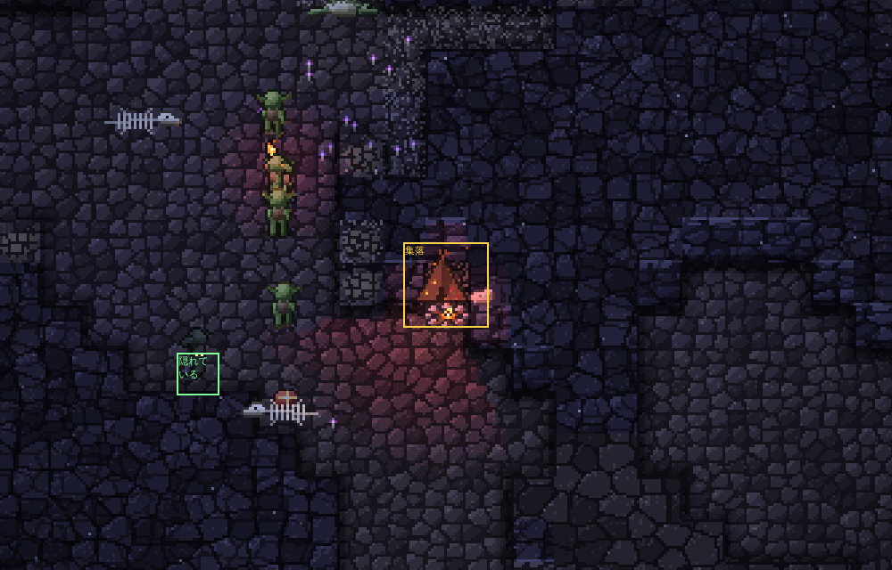

# 住みつける仕組み（四巡目：大ネズミの来方、比べ方、ゴブリン）の結果

16のシードを25日ずつ、冒険者の一行の上限1で回した。

| 回 | 中身 |
|---|---|
| 基準 | 1（大ネズミの来方）だけを入れた状態（コミット d27a891） |
| ゴブリン | 基準に、3（ゴブリンの住みつける仕組み）を入れた状態 |

- シードごとの数字（付録）：docs/compare-20261106.md（16シード）、docs/compare-20261106-8seeds.md（前回までの8シードだけ）
- 種ごとの比較の表：docs/summary-batch-20261106-base.md、docs/summary-batch-20261106-gob.md

決定性と保存からの再現は保たれている（`npm test` OK、abc と seed27 を7日目で分けて回しても10日目の状態が通しと一致）。四つの帳簿のずれは、どちらの回も16シードすべてで0。

## 2. 比べ方：16シード

前回までの8シード（abc、かしたれ、はじまりの洞窟、seed4〜seed8）に、地表の横穴をふさぐ岩の厚さと溶岩の多さが違う8つ（seed40、seed41、seed18、seed27、seed23、seed35、seed17、seed30）を足した。

- 横穴が早く開く（岩が0〜1マス）：seed40、seed41、seed18
- 横穴が遅く開く（岩が4マス以上）：seed27、seed23
- 溶岩の多い：seed35、seed17
- 中ほど：seed30

## 目安（16シードまとめて）

| 目安 | 基準 | ゴブリン |
|---|---:|---:|
| ゴブリン：豊かなシード（豊かさの上半分）の集落の日数の中央値：5日以上 | 0.5 | **0.8（届かない）** |
| ゴブリン：集落の日数の中央値（すべて） | 0.5 | 1.0 |
| ゴブリン：5日以上続いた集落 | 5 / 220（2.3％） | 3 / 66（4.5％） |
| ゴブリンが絶えたシード | 3 | 3 |
| コボルト：住処の日数の中央値 | 2.0 | 2.1 |
| コボルト：豊かなシードの住処の日数の中央値 | 1.8 | 1.6 |
| 大ネズミが絶えたシード | 0 | 0 |
| 四つの帳簿のずれ | 0 | 0 |

集落の日数は、地上の1/4日ごとの記録に集落があった期間（コボルトの住処と同じ数え方）。1/4日より短い集落は数に入らない。

## 1. 大ネズミの来方

口や天井の裂け目ごとに、まわり（道のり40マス）の食べられる苔で養える数（いまある量を、一匹が地上の1日に食べる量で割る）が、そこにいる大ネズミより2匹以上多いときだけ、そこから来るようにした（地上の約2時間ごとに調べて保存）。来た大ネズミは、入ってきた所のそばの巣穴に入る。

| | 三巡目（8シード） | 基準（8シード） | 基準（16シード） | ゴブリン（16シード） |
|---|---:|---:|---:|---:|
| 来た | 1,500 | **1,058** | 2,216 | 2,174 |
| 　そのうち天井の裂け目から | 58 | **754** | — | — |
| 中で生まれた | 557 | 641 | 2,462 | 2,197 |
| 群れで出ていった | 490 | **60** | 246 | 178 |
| 飢え死に | 346 | **701** | 1,520 | 1,545 |
| 　道のり10マス以内に食べられる苔があった割合 | 56％ | 75％ | 71％ | 70％ |
| 絶えたシード | 0 | 0 | 0 | 0 |

- **来る数は減り（1,500 → 1,058）、群れで出ていく数も大きく減った（490 → 60）**。来ては出ていく出入りは、ねらいどおり少なくなった。
- **飢え死には倍になった（346 → 701、目安の方向とは逆）**。

### 飢え死にが増えた理由

来る所が、地表の横穴から天井の裂け目へ移った（8シードで、横穴から 1,442 → 304、裂け目から 58 → 754）。天井の裂け目は日の光が差すので、まわりに苔が育ちやすく、「道のり40マスで養える数に余裕がある」の判定を通りやすい。三巡目までは、横穴が開いたあとは裂け目からほとんど来なかった。

そして、増えた飢え死には裂け目のそばで起きている：飢え死にのうち、天井の裂け目から15マス以内で死んだものが 109 / 346 → 429 / 701。`npm run autopsy`（seed7）で見ると、裂け目のそばの飢え死には、ほとんどが苔を目指して歩いている途中（st 1）で、目当ての苔まで3〜10マスのところで力尽きている。大ネズミは腹の容れ物が小さく（8）、食べずにいられるのは地上の約1,000刻み（歩いて20マスほど）なので、「道のり40マス」の中に苔があっても、着く前に飢える。

道のりの40マスという範囲が、大ネズミの足には遠すぎる、というのが見立て。直すとすれば、裂け目と口の判定を「歩いて着ける近さ（15〜20マス）」で数えるか、近いものほど重く数えるかだが、数値を決める前に相談したい（基準を作り直すことになるので、今回は手を付けていない）。

## 3. ゴブリン

| | 基準 | ゴブリン |
|---|---:|---:|
| 集落ができた数（1/4日以上続いたもの） | 220 | 66 |
| 集落の日数の中央値 | 0.5 | 1.0 |
| 5日以上続いた集落 | 5（2.3％） | 3（4.5％） |
| 来たゴブリン | 1,335 | **388** |
| 中で生まれた | 629 | 491 |
| 一匹ずつ飢えて去った | 548 | **0** |
| 集落ごと群れで去った（abandoned） | 0 | 199 |
| 飢え死に | 96 | 22 |
| 冒険者に倒された | 513 | **105** |
| 絶えたシード | 3 | 3 |

集落の終わり方（ゴブリン、settle.jsonl から）：何度も襲われて 30、蓄えが尽きて 15、皆いなくなった 25（1匹になった・竜はどちらも0）。新しくできた集落は、来て作った 66、増えて分かれた 12。

### 豊かさの順（ゴブリン）

| シード | 豊かさ | 集落の日数 中央値 / 最長 / 数：基準 | ゴブリン | 来た / 生まれた：基準 | ゴブリン |
|---|---:|---:|---:|---:|---:|
| seed23 | 14.3 | 0.5 / 11.0 / 14 | 2.8 / 7.7 / 10 | 85 / 114 | 28 / 148 |
| seed27 | 11.4 | 0.5 / 13.3 / 12 | 1.5 / 3.4 / 7 | 90 / 136 | 56 / 59 |
| abc | 10.2 | 0.5 / 4.8 / 7 | 0.8 / 3.8 / 11 | 75 / 23 | 55 / 83 |
| seed7 | 7.4 | 1.1 / 4.3 / 20 | 0.9 / 1.3 / 6 | 100 / 60 | 41 / 20 |
| seed35 | 6.3 | 0.5 / 1.3 / 30 | 0.3 / 1.8 / 11 | 160 / 54 | 64 / 49 |
| seed18 | 5.1 | 0.5 / 3.8 / 15 | — / — / 0 | 90 / 22 | 0 / 0 |
| seed6 | 4.1 | 0.3 / 0.8 / 17 | 0.3 / 0.3 / 2 | 115 / 26 | 15 / 4 |
| seed17 | 3.8 | 0.5 / 2.4 / 4 | 0.9 / 0.9 / 1 | 35 / 8 | 5 / 7 |
| seed40 | 3.6 | 0.5 / 5.3 / 26 | 1.4 / 4.3 / 6 | 150 / 37 | 43 / 57 |
| seed5 | 3.3 | 0.9 / 5.5 / 12 | — / — / 0 | 65 / 36 | 0 / 0 |
| seed41 | 3.3 | 0.5 / 0.5 / 3 | 2.7 / 6.2 / 4 | 20 / 5 | 15 / 27 |
| seed4 | 2.8 | 0.8 / 1.0 / 3 | — / — / 0 | 20 / 4 | 5 / 0 |
| seed30 | 2.7 | 0.6 / 1.3 / 8 | 4.3 / 4.3 / 1 | 40 / 19 | 13 / 23 |
| はじまりの洞窟 | 2.6 | 0.8 / 2.5 / 15 | — / — / 0 | 100 / 30 | 0 / 0 |
| かしたれ | 2.3 | 0.5 / 4.8 / 21 | 1.0 / 1.8 / 7 | 120 / 33 | 48 / 14 |
| seed8 | 1.2 | 0.5 / 3.8 / 13 | — / — / 0 | 70 / 22 | 0 / 0 |

- 来る数は口のまわりの食べ物で決まるようになり、5シード（seed18、seed5、seed4、はじまりの洞窟、seed8）にはほとんど来なくなった（来る数 1,335 → 388）。その5つのうち4つは豊かさの下半分。
- 来たゴブリンが一匹ずつ飢えて去ることはなくなった（548 → 0）。冒険者に倒される数は 513 → 105。
- 豊かな seed23 では、集落の中央値が 0.5 → 2.8日、最長 7.7日、中で148匹生まれた。

### 目安（豊かなシードで5日）に届かない理由

集落が続かない一番の理由は、**襲われること**（終わり方 30 / 70）と、**皆いなくなること**（25 / 70：散り散りに倒されたか、集落を離れた者が戻らなかった）。冒険者からは身を守れるようになったが、ほかの種に倒されている：

| ゴブリンを倒した種（16シード） | 基準 | ゴブリン |
|---|---:|---:|
| コボルト | 265 | 207 |
| オーク | 70 | **169** |
| 冒険者 | 513 | 105 |
| ヴァンパイア | 102 | 53 |
| ドラゴン（焼けた） | 188 | 33 |

- **オーク**：オークは「ゴブリンかコボルトの集落があると、その20マス以内に縄張りを持ちに来る」（`pickLair`）。ゴブリンの集落が長く続くようになったぶん、オークがそばに住みつき、集落の縄張り争い（`defend`）で倒されることが増えた（70 → 169）。集落の場所選びでオークの縄張りは避けていない（依頼の条件になかったので）。
- **コボルト**：集落の場所はコボルトの住処から離しているが（下に書くとおり10マスでは近すぎたので15マスにした）、ゴブリンは腹を空かせると集落から最大20マスまで食べ物を探しに出るので、コボルトの縄張り（住処から12マス）に入って食べられる。
- **蓄え**：蓄えはあまり貯まっていない。ゴブリンは一匹が地上の1日に約160の食べ物を使い、集落のまわりの苔は薄いので、狩りに出た者は自分の腹を満たすのが精一杯で、持ち帰る余りが出にくい。蓄えが増えるのは、ネズミを狩ったとき、死骸を拾ったとき、冒険者から盗んだとき。ネズミの多い所（seed23、seed41）では続いている。
- **冒険者からの守り**（散って隠れる、待ち伏せ）は、ほとんど働く場面がない：集落を冒険者の通り道から15マス以上離したので、一行が集落の13マス以内に来ることがまれ（16シード×25日で、散って隠れた記録 1、待ち伏せた記録 2。記録は地上の約10分に一度までなので、実際の回数はもう少し多い）。冒険者に倒されたゴブリンが 513 → 105 に減ったのは、守りの働きより、集落を通り道から離したことの効き目と見ている。

まとめると、冒険者を避けて暗がりに住む仕組みは効いているが、集落を終わらせているのはオークとコボルトとの縄張り争いで、ここは「住みつける仕組み」の外にある。次に手を入れるなら、(1) オークが縄張りを持つ場所を集落から離す（または、集落の場所選びでオークの縄張りを避ける）、(2) ゴブリンが食べ物を探す範囲をコボルトの縄張りの外に限る、のどちらかだと考えている。

### ゴブリンとコボルトの殺し合い、冒険者

| | 基準 | ゴブリン |
|---|---:|---:|
| コボルトに倒されたゴブリン | 265 | 207 |
| ゴブリンに倒されたコボルト | 425 | 416 |
| 死んだ冒険者 | 186 | 211 |

死んだ冒険者は少し増えた（+25）。ゴブリンの待ち伏せの記録はまれなので、主な理由はほかにある（展開の違い）と見ている。

### 試しに回して見つけて直したこと

1. **腹を空かせたゴブリンが、食べ物があるのに飢えていた**：目当ての苔を毎刻み選び直し（調べる点の選び方が刻みごとに変わる）、さらに自分の居場所のまわりから選ぶので、歩くたびに目当てが変わり、行ったり来たりして食べられずにいた。基準でも同じで、そのときは一匹ずつ飢えて去っていたので目立たなかった（基準で一匹ずつ飢えて去った 548）。集落のある者は、集落のまわりを残らず調べて、行きやすい苔かキノコを目当てにするようにした。
2. **はじめの集落の食べ物の数え方**：コボルトと同じ「まわり8マス」では、かしたれ では口から行ける所に一つも条件を満たす場所がなかった。ゴブリンは狩りと死骸あさりで広く動くので、まわり14マス（苔とキノコは半分に数え、ネズミは1匹100、死骸も数える）にした。
3. **コボルトの住処との間合い**：依頼の「10マスほど」で回すと、集落の真ん中がコボルトが住処を守る範囲（12マス）に入り、abc ではゴブリンがコボルトに群れで食べられた（15日で43匹）。15マスにした。
4. **蓄えが尽きたときの見切り**：ゴブリンは腹を空かせてから地上の約0.4日で飢え死にするので、コボルトと同じ「蓄えが尽きて1日」では間に合わず、捨てる前に飢え死にしていた。「尽きて1/3日たち、皆が腹を空かせているか、飢え死にしかけている者がいる」にした。

### 隠れているコボルトとゴブリンの見え方

最初は、隠れている者を目だけで描いていた（コボルトと同じ）。目は2画素だけで、ほとんど見えず、住処や集落が空に見えていた。隠れているのは「ほかの生き物に気づかれない」というシミュレーションの状態なので、眺める人には見せることにした：暗く沈んだ影の姿（閉じた空洞の中の生き物と同じ色の抜き方）でこちらを向かせ、その上に光る目を重ねる。描画だけの変更で、展開は変わらない。

左が前（目だけ）、右が後（影の姿と光る目）。ゴブリン（seed6、19.5日目、`npm run shot -- --seed seed6 --find gobhide --day 19.45 --until 19.7 --zoom 3 --every 10`、4倍に切り出し）：

コボルト（かしたれ、21.7日目、`npm run shot -- --seed かしたれ --find hide --zoom 3 --every 10`、住処のまわりを3倍に切り出し。右の上、罠の右に隠れている1匹）：

集落のまわりの様子（後）。印のついた1匹は隠れ場所に着いて影の姿になり、集落の左の3匹は隠れ場所へ向かっている途中（まだふつうに見える）：

## コボルト（悪くなっていないか）

| | 基準 | ゴブリン |
|---|---:|---:|
| 住処の日数の中央値 | 2.0 | 2.1 |
| 5日以上続いた住処 | 11 / 58（19％） | 10 / 60（17％） |
| 冒険者に倒されたコボルト | 93 | 101 |
| 住処の終わり方：蓄えが尽きた / 襲われた | 16 / 4 | 23 / 3 |
| 飢え死に | 108 | 98 |

ほぼ同じ（16シードでの差は、展開の違いの幅に収まっている）。豊かなシードの住処の中央値は 1.8 / 1.6 で、三巡目（8シード、3.5日）より低いが、これは基準の時点ですでに低い（大ネズミの来方を変えたことと、シードが増えたことによる）。

## ついでに

- `npm run compare` に `--seeds`（一部のシードだけ比べる）と、ゴブリンの集落・殺し合い・死んだ冒険者の表を足した。目安は tools/analysis/goals-round4.json。
- `npm run shot` に `--find camp / gobhide` と `--every`（何刻みごとに探すか）を足した。
- 分析の切り替え `--goblin-farm` は外した（ゴブリンが来る条件にキノコの総量を使わなくなったため）。
