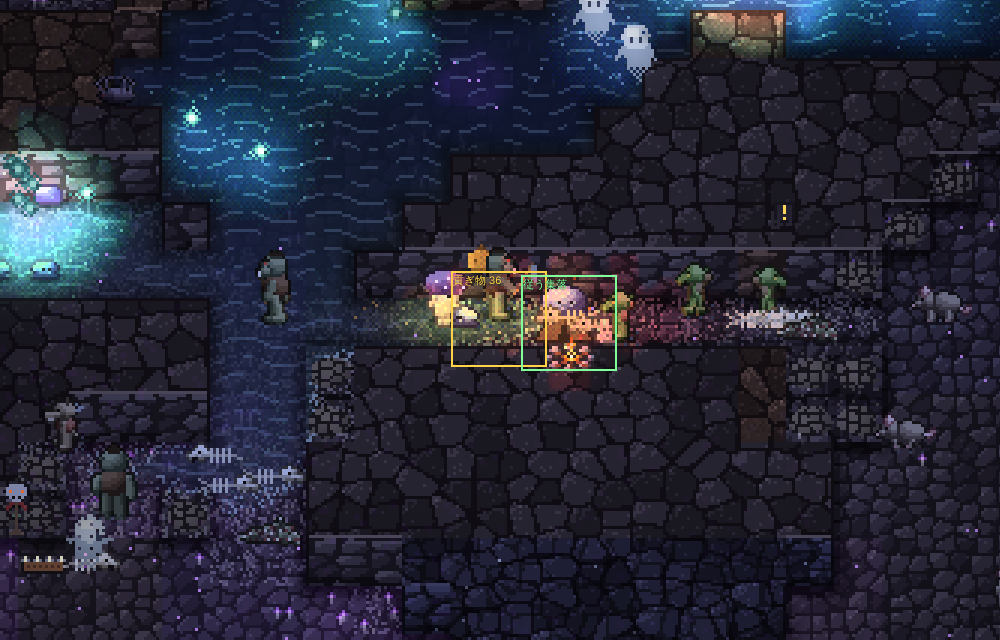
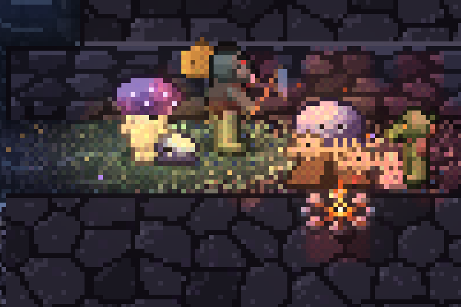

# 住みつける仕組み（五巡目：大ネズミの判定、ゴブリンとオーク・コボルトの関係、ゴブリンの食べ物）の結果

16のシードを25日ずつ、冒険者の一行の上限1で回し、前回の「ゴブリン」（四巡目、docs/settling-20261106.md）と比べた。

- シードごとの数字（付録）：docs/compare-20261107.md（16シード。四巡目の基準・四巡目・五巡目）、docs/compare-20261107-8seeds.md（前回までの8シード。三巡目・四巡目・五巡目）
- 種ごとの比較の表：docs/summary-batch-20261107.md

決定性と保存からの再現は保たれている（`npm test` OK、abc と seed40 を7日目で分けて回しても10日目の状態が通しと一致）。四つの帳簿のずれは16シードすべてで0。

## 目安

| 目安 | 四巡目 | 五巡目 |
|---|---:|---:|
| 大ネズミの飢え死に（前回までの8シード）：三巡目の346に戻るか | 698 | **444（戻らない）** |
| ゴブリン：豊かなシード（上半分）の集落の日数の中央値：5日以上 | 0.8 | **1.3（届かない）** |
| ゴブリン：5日以上続いた集落 | 3 / 66（4.5％） | 2 / 52（3.8％） |
| ゴブリンが絶えたシード | 3 | **7（悪くなった）** |
| コボルト：住処の日数の中央値 | 2.1 | 2.0 |
| 四つの帳簿のずれ | 0 | 0 |

## 1. 大ネズミ：判定の範囲を18マスに

入口ごとの判定の範囲と、来た大ネズミが巣穴を作る範囲を、道のり40マスから18マスにした（`Ecology.RAT_DOOR_REACH`）。

| | 三巡目（8） | 四巡目（8） | 五巡目（8） | 四巡目（16） | 五巡目（16） |
|---|---:|---:|---:|---:|---:|
| 飢え死に | 346 | 698 | **444** | 1,545 | **1,085** |
| 　天井の裂け目から15マス以内 | 109 | 361 | **266** | 892 | **618** |
| 　道のり10マス以内に食べられる苔があった割合 | 56％ | 71％ | 68％ | 70％ | 72％ |
| 来た：地表の横穴 | 1,442 | 278 | 296 | 678 | 704 |
| 来た：天井の裂け目 | 58 | 740 | **556** | 1,496 | **1,218** |
| 中で生まれた | 557 | 707 | 799 | 2,197 | 2,179 |
| 群れで出ていった | 490 | 92 | 60 | 178 | 134 |
| 絶えたシード | 0 | 0 | 0 | 0 | 0 |

- 飢え死には3割減った（16シードで 1,545 → 1,085）。ただ、三巡目の346には戻っていない。
- **天井の裂け目から来る数は、まだ三巡目の10倍ほど多い**（8シードで 58 → 556）。範囲を18マスに狭めても、日の差す裂け目のまわりには苔があり、判定を通る。三巡目に裂け目から少なかったのは、範囲の広さのためではなく、「地表の横穴が開いたら、裂け目からは来ない」という決まりがあったから（四巡目に、横穴と裂け目を同じ判定で選ぶように変えた）。
- **残った飢え死にの7割は、道のり10マス以内に苔があるところで起きている**。裂け目のそばの飢え死には、苔を目指して歩く途中（st 1）で力尽きるものが多い（四巡目に seed7 で `npm run autopsy` を回して確かめた。今回は回していない）。苔が近くにあるのに着けないので、範囲の広さとは別に、途中で足止めされている（細い通路や仲間との押し合い）と見ている（今回は確かめていない）。判定の範囲を狭めるだけでは足りない。
- 三巡目の数に近づけるなら、「横穴が開いたら裂け目からは来ない」に戻すのがいちばん直接的だが、三巡目に戻るだけなので、相談したい。

## 2. オークはゴブリンを従える

- オークはゴブリンを獲物にせず、ゴブリンの集落を襲いに行かない。ゴブリンもオークを縄張りの敵にしない。
- オークの縄張り（寝床）から20マス以内のゴブリンの集落は、いちばん近い縄張りのオークに従う（地上の約2時間ごとに調べる。`Camp.lx, ly`）。従ってから地上の0.5〜1日後に最初の取り立て、その後は地上の0.8〜1.2日ごと（`tribT`）。
- 取り立ては、縄張りのオークのうち手の空いた一匹が集落へ行き、蓄えの3割を袋に詰めて（`units`）縄張りへ持ち帰って食べる（食べきれない分は縄張りの土へ。養分の帳簿は保たれている）。記録は「オークがゴブリンの集落から貢ぎ物を取り立てた」、settle.jsonl の `{k:13, ev:'tribute', n}`。
- 用心棒：従う集落のそば（8マス）にコボルトが来たら、縄張りから25マスまでのオークが追い払いに行く。
- 見た目：取り立てたオークは、口を縛った麻袋を肩に担いで帰る（新しい小さな絵 `A.sack`）。

| オーク（16シード） | 四巡目 | 五巡目 |
|---|---:|---:|
| オークに倒されたゴブリン | 169 | **0** |
| 従えた集落 | — | 74 |
| 取り立て | — | 13回（合計155。うち3回は着いたとき蓄えが空だった） |
| 縄張りが続いた日数の中央値 | 0.8 | 0.8 |
| 飢えて去ったオーク | 243 | 287 |

- オークとの殺し合いはなくなった。
- **取り立ては少ない（74の従う集落に13回）**。取り立ての時が来ても、集落の蓄えが10に満たないことが多く、そのたびに地上の約2時間待つ。蓄えがほとんど貯まらない理由は、下の4に書く。
- **オークの縄張りが続く日数は変わっていない（0.8日）**。オークの縄張りが終わる主な理由は、飢えて去ること（287）。ゴブリンを獲物にしなくなったぶん食べ物が減り、取り立ての量（25日・16シードで合計155）では埋まらない。

撮り方：`npm run shot -- --seed seed30 --find tribute --day 20.58 --until 20.8 --zoom 3 --every 10 --out docs/img --name orc-tribute`。オークが集落で36を取り立てた直後。

## 3. ゴブリンはコボルトの縄張りに入らない

- ゴブリンは、コボルトの住処から12マスの中の苔・獲物・死骸を目当てにしない。道筋も、縄張りを通らない道筋を先に探し、なければふつうに探す。
- 試しに回して、コボルトの住処がゴブリンの集落のすぐそば（4マスほど）にできて殺し合う例が見つかった（ゴブリンの集落はコボルトの住処から15マス離すが、逆の決まりがなかった）。コボルトも住処をゴブリンの集落から15マス離すようにした。

| 16シード | 四巡目 | 五巡目 |
|---|---:|---:|
| コボルトに倒されたゴブリン | 207 | 157 |
| ゴブリンに倒されたコボルト | 416 | 231 |

コボルトとの殺し合いは減ったが、なくなってはいない（157）。食べ物を探す目当てと道筋は縄張りの外になったが、縄張りのすぐ外で獲物を追っているゴブリンを、縄張りを守るコボルト（住処から12マスの中にいて、3マス以内の相手を襲う）が襲う。

## 4. ゴブリンの食べ物を狩りと死骸あさり中心に

- 腹を空かせたら、まず小さな獲物（大ネズミ、アリ）を狩り、次に死骸をあさる（12マス、長く食べていなければ16、20マスまで）。苔とキノコは、どちらも見つからないときに、腹の4割まで食べる足し。
- 狩りの食べ残し（eat の units）は持ち帰って蓄えにする（前は畑のキノコの肥やしにしていた）。
- 狩りに出た者（st 4）は苔を食べず、集落のまわり16マスを歩いて獲物と死骸を探す。腹を空かせたら自分が食べるほうを先にする。
- 腹の減り方を7割にした（meta 40 → 57。一匹が地上の1日に使う食べ物 約180 → 約126）。

| ゴブリン（16シード） | 四巡目 | 五巡目 |
|---|---:|---:|
| 集落の日数の中央値（すべて / 豊かな上半分） | 1.0 / 0.8 | 1.1 / 1.3 |
| 5日以上続いた集落 | 3 / 66 | 2 / 52 |
| 来た / **中で生まれた** | 388 / **491** | 501 / **161** |
| 絶えたシード | 3 | **7** |
| 終わり方：蓄えが尽きた / 襲われた / 1匹 / 皆いなくなった | 15 / 30 / 0 / 25 | 14 / 27 / 1 / 23 |
| 集落ごと群れで去った / 飢え死に | 199 / 22 | 151 / 4 |
| 倒した種：冒険者 / オーク / コボルト / そのほか | 105 / 169 / 207 / 99 | 194 / 0 / 157 / 126 |
| ゴブリンが狩った大ネズミ | 258 | 378 |

### 目安に届かない理由：狩りでは食べていけない

**中で生まれた数が 491 → 161 に減り、絶えたシードが 3 → 7 に増えた。** 子は集落の蓄えが目安の3割以上あるときだけ生まれるが、その蓄えがほとんど貯まっていない。

- 狩った大ネズミは 258 → 378 に増えたが、16シード×25日で378匹は、1シードあたり地上の1日に約1匹（食べ物にして約12）。集落の10匹ほどのゴブリンが使う量（1日に約1,200）の1％ほどにしかならない。
- 四巡目までのゴブリンの肉の多くは、実はコボルトだった（ゴブリンに倒されたコボルト 416）。コボルトとの殺し合いを減らしたことで、この食べ物も減った（231）。
- 足りない分は、腹の4割までの苔で食いつないでいる。飢え死にはほとんどない（22 → 4）が、腹が満ちないので余りが出ず、蓄えにならない。蓄えがないので、子も生まれず、オークへの貢ぎ物も出せない。
- まとめると、狩りと死骸あさりを中心にするには、獲物がゴブリンの数に対して1〜2桁足りない。いまのダンジョンでの大ネズミの数（巣穴のまわりの苔で決まる）では、ゴブリンの群れを養えない。
- 考えられる道は二つ：(1) 苔とキノコも蓄えになる（四巡目のように腹いっぱいまで食べ、余りを持ち帰る）。つまり「狩りが主」をやめる。(2) ゴブリンの群れの大きさを、まわりの獲物の数に合わせる（来る数・生まれる数を、狩れる大ネズミの数で抑える）。(2) のほうが「獲物の多い所に住みつく」というねらいに合うと考えている。

冒険者に倒されたゴブリンが 105 → 194 に増えたのは、狩りに出たゴブリンが集落のまわり16マスを歩き回るようになり、冒険者の通り道に近づくことが増えたためと見ている（確かめてはいない）。

## コボルト

| | 四巡目 | 五巡目 |
|---|---:|---:|
| 住処の日数の中央値 | 2.1 | 2.0 |
| 5日以上続いた住処 | 10 / 60 | 10 / 60 |
| 冒険者に倒されたコボルト | 101 | 78 |
| ゴブリンに倒されたコボルト | 416 | 231 |
| 住処の終わり方：蓄えが尽きた / 襲われた | 23 / 3 | 24 / 3 |

悪くはなっていない。

## 死んだ冒険者

211 → 258（+47）。手を下した種で増えたのは、ゴーレム（23 → 46）、ヴァンパイア（13 → 27）、オーク（55 → 68）。ゴブリンに倒された冒険者は 2 → 6。ゴブリンとオークの関係を変えたことと結びつく増え方ではなく、展開の違いの幅と見ている。

## ついでに

- `npm run compare` に、オーク（従えた集落、取り立て、縄張りの日数）、ゴブリンを倒した種の内訳、大ネズミの来た所（横穴・裂け目）と裂け目のそばの飢え死にの表を足した。
- `npm run shot -- --find tribute`（貢ぎ物の袋を担いで帰るオーク）。
