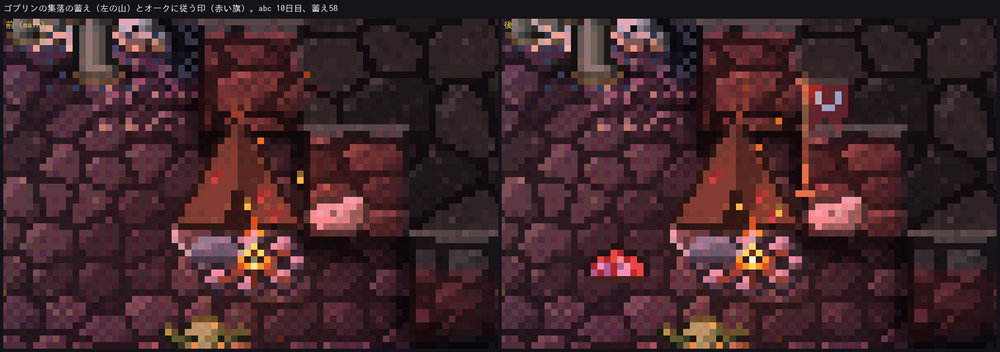
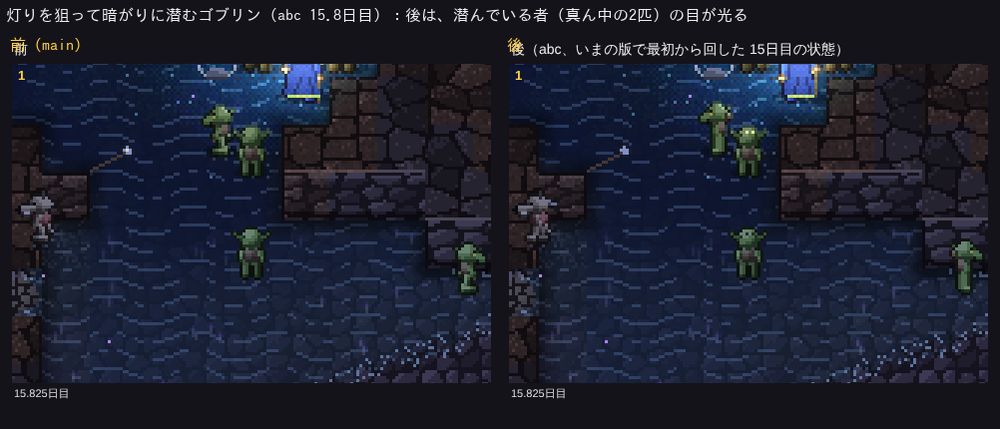

# 見える相互作用の点検（2026-11-02）

このゲームは眺めるゲームなので、仕組みが画面の中の動きや姿として見えなければ、眺める人には存在しないのと同じ。
ここでは、これまでの仕組みを一つずつ「画面で何が見えるか」で点検した（決まりは CLAUDE.md の「「画面に見えること」を先に決める」）。

- 「いま見えること」は、ゲーム画面に描かれるもの（生き物の動き、姿、地形、演出）。ゲーム内ログの文章と生き物の情報パネルは「補助」として分けて書いた。
- 手間：**小**＝描画だけで済み、いまある部品か小さな絵を足せばよい。**中**＝新しい絵や演出を何枚か作るか、描画のための値をシミュレーションから読み出す工夫が要る。**大**＝見せるための新しい振る舞い（シミュレーション側）が要る。
- ✅＝この点検の中で直したもの（前後の画像を下に添えた）。🆕＝今回の冒険者の作り直しで新しく見えるようにしたもの。✅2＝冒険者の作り直しの二歩目（docs/adventurer-step2-20261111.md）で直したもの。
- 参照：CV＝src/creatureView.ts、VW＝src/eco/view.ts（情報パネルの文章）、SH＝src/shaders.ts。

## 一覧

| 仕組み | 内部で起きていること | いま見えること | 見えていない所 | 見せ方の案（手間） |
|---|---|---|---|---|
| マナの巡り | 深部・裂け目・宝物庫・溶岩・岩盤から湧き、岩にしみて広がり、口から逃げ、薄れる。生き物は食べて受け取り、死ぬと土に返す（world.ts の manaStep） | 床の紫のもやと瞬く粒、岩の淡い紫の筋（SH:596-611）。マナ35ほどで飽和 | 生き物が抱えるマナ。流れの向き。濃い所と薄い所の差（飽和のため深部は一様に見える） | マナを多く抱えた生き物に淡い紫の暈（小）。ウィスプがマナを吸う瞬間に粒が吸い込まれる（中） |
| 養分の巡り | 死骸が腐り、食べ残し・灰・糞が土に戻り、苔とキノコが吸い上げる。水が流し去る | 肥えた土は暗く湿って見える、苔とキノコ、胞子、死骸の三段階（新しい・腐りかけ・骨）、血の跡 | 土に戻る瞬間（蓄えの吐き出し、石像の風化、燃料の灰）、水に流される養分 | 戻る瞬間に土に染みる小さな斑（中）。流れ去りは見せなくてよい |
| ドラゴンの育ち | 寝床でマナを吸い、日数とマナと宝の量で幼竜→若い竜→成竜（dragon.ts:137-160） | 段階ごとに別の絵と眠りの絵、育つ瞬間の紫の光の輪（CV:101-107）、卵の殻、成竜は飛ぶ | 次の段階までの進み具合 | 育ちが近いほど寝床のマナのもやを濃く（中）。情報パネルに「育ち具合」（補助、小） |
| 特別な個体 | 火の精・亡霊の騎士・大ネズミの王・ゴブリンの頭・水の精・光の精・骨の竜・キノコの主（c.elite） | それぞれ専用の絵か冠・角兜（CV:646, 697-701）、技の色、情報パネルに名前 | ほぼなし | — |
| コボルトの住処：横穴・罠・畑 | 岩壁に4マスの横穴を掘り、入口に罠、まわりにキノコの畑 | 掘った跡、入口の飾り柱、奥の寝床、罠、畑の畝と育ったキノコ（CV:316-335）、罠にかかった者の「！」 | 掘っている途中の向き・進み | —（掘る動きは見えている） |
| コボルトの住処：蓄え | 狩りと畑の余りを `store` に溜め、飢えたら食べる | **✅ 寝床の脇に積んだキノコの傘の山（三段階、尽きると消える）**。前は数字だけ | 16シードの多くでは蓄えはほとんど0のまま（山が出る時間が短い）。仕組みとして蓄えが溜まりにくいこと自体が「見えない」原因。**✅2 原因は蓄えの仕組みの不具合だった：運び込みが一度も起きておらず（腹を満たした集めの係が住処へ1歩だけ向かって忘れる、住処の奥が自分たちの掘った土で埋まる）、畑のキノコも蓄えに入らなかった。直した** | 運び込む者が獲物を担ぐ姿（中） |
| コボルトの住処：隠れる | 強い相手が近づくと奥に隠れ、入口に踏み込まれない限り気づかれない | 暗く沈んだ影の姿と光る目（CV:650-716） | — | — |
| コボルトの住処：捨てる | 蓄えが尽きて1日、襲われて4回、1匹で1日、竜の近く、で群れごと去るか移る | 群れで口へ歩いていく、ゲーム内ログ | 捨てた理由（飢え・襲われた・竜）。襲われた回数 `raids` | 去る群れの先頭に理由の印（竜なら「！」で振り返る、飢えなら肩を落として遅い歩み）（中） |
| ゴブリンの集落：蓄え | 集めに出た者が持ち帰り、出産と飢えに使う | **✅ 小屋の脇の肉と骨とキノコの山（三段階）**。前は数字だけ | ~~集めに出た者が袋を担いで帰る姿（`units` はあるが絵がない）~~ **✅2 袋が6以上の者は背に袋を背負う（摘んだ物も、盗んだ物も）** | — |
| ゴブリンの集落：潜む（hide 1） | 明らかに強い一行が来ると、まわりの暗がりに散って隠れる | 影の姿と光る目（暗い所だけ） | — | — |
| ゴブリンの集落：待ち伏せ（hide 2）・灯りに潜む（lurk） | 弱い一行を暗がりで待ち、隙があれば盗むか襲う | 暗がりの縁で灯りの方を向いて止まる。**✅ 暗い所で潜んでいる間は目が光る**（前は立っているだけで、潜んでいると分からなかった） | 誰を狙っているか | **✅2 夜の盗み：蓄えの乏しい集落から焚き火へ忍び寄り、光の縁で身をひそめて（目が光る）、眠っている者へ駆け寄って盗み、袋を背負って逃げ帰る。盗まれた者と、見つけた見張りに「！」**。盗んだ瞬間に荷物の粒が飛ぶ（中） |
| ゴブリンの集落：かがり火 | 枯れキノコの軸を集めて燃やし、尽きると消える | 火と火の粉。**✅ 火の粉の数と高さが燃料の多さで変わる**（前は燃えているかいないかだけ） | — | — |
| ゴブリンの集落：分かれる・捨てる | 大きくなると一部が蓄えを分けて別の所へ。尽きる・襲われる・独り・竜で捨てる | 群れで歩いていく、新しい小屋が建つ、ゲーム内ログ | 分かれた先と元のつながり。捨てた理由 | 分かれる群れが袋（分けた蓄え）を担ぐ（中） |
| オークの縄張りと貢ぎ物 | 縄張りから20マス以内の集落を従え、腹が減ると取り立てに行き、袋を担いで帰る | 取り立てた袋を肩に担いで帰るオーク（CV:709）、ゲーム内ログ。**✅ 従う集落の小屋の後ろに牙の印の赤い旗**（前は従っているかどうかが見えなかった） | 縄張りの広さ。取り立てに行く途中（`st 5`）はふつうの歩き | 取り立てに来たオークの前でゴブリンが袋を差し出す短い動き（中） |
| 大ネズミの巣穴 | 苔に合わせて殖え、苔が尽きると豊かな所へ移る（`relocateBurrow`） | 巣穴の穴、子ネズミの絵 | ~~巣穴が移るときに穴が瞬間移動する（群れが歩いて移る姿はある）。~~ **✅2 巣穴のそばの仲間が一列になって新しい巣穴まで歩いていく（先頭は遅れた仲間を待つ）**。巣穴の広さ（`cap`）と混み具合 | 移る前に古い穴が崩れて埋まる（小〜中）。混んだ巣穴は穴を大きく（中） |
| 大ネズミ：群れで出ていく | 苔がなく飢えかけたら、巣穴の仲間と開いた横穴から出ていく（`st 8`） | 列になって口へ歩いていく | ふつうの移動と見分けがつかない | 出ていく群れは尾を下げ速足（新しい歩きの絵、中） |
| 大ネズミ：割れ目から入り直す | 中の数が2匹以下になると天井の割れ目から2〜3匹ずつ | 割れ目の光の筋の下に現れる | 落ちてくる・降りてくる瞬間 | 割れ目から土くずと一緒に降りる短い演出（中） |
| 来し方：マナから | トロール・ミノタウロス・バジリスク・幼竜などがマナの濃い所から生まれる | ゲーム内ログ（大物だけ）。幼竜は卵の殻。**✅2 生まれる場所に紫のマナの粒が渦を巻いて集まり、影の姿から白く光って形が固まる。幼竜は卵に筋が光り、揺れて割れて出てくる** | ~~生まれる瞬間（突然そこにいる）~~ | — |
| 来し方：自然の口 | 地表の横穴、地底の裂け目、川の口から獣や種族 | 口の絵（昼夜）、裂け目の立ちのぼる粒、川の口。生き物は口から歩いて入ってくる | — | — |
| 来し方：人の道 | 正面の入口から冒険者とドワーフ | 入口から一行が歩いて入る。**🆕 入ってくると迷わず目標の方へ進む** | — | — |
| 気づき方 | 目・夜目・匂い・振動・反響・魔法で気づく（気づけるかの判定 `canSense`） | 冒険者と戦いの初めに「！」「？」（CV:526-533） | 獣どうしが気づく瞬間（狩りの始まり）、気づき方の違い | 狩る側が気づいたら耳や首を向ける（中）。匂いで気づく種は鼻先の粒（中） |
| 火を怖がる獣 | 火から4マスの内を避ける（`fearFire`） | 火から離れていく動き | 避ける範囲 | 火に近づきかけて跳ねのく動き（中） |
| 光に寄る種（lurk） | 冒険者の灯りを見つけ、暗がりの縁に潜む | 灯りの外で止まって向く。**✅ 暗ければ目が光る**（上と同じ直し） | — | — |
| 食べる時間 | 死骸や獲物を何口かに分けて食べる（`feeding`） | 食べる動き（act 2）と、死骸が骨になっていく | 一口ごとの減り | —（十分に見える） |
| 弱い生き物の害 | 大ネズミが眠る者の荷をかじる、コウモリが血を吸う、アリが噛む、ウィスプが誘う、マイコニドの胞子、サラマンダーの火傷 | 当たる技の演出（コウモリ・アリ・サラマンダー）、誘われた一行が逸れる | 荷をかじる（動きだけで何をしているか分からない）、胞子で足が鈍る（演出がない。'spore' の技の絵はある） | 胞子の害に 'spore' の演出を出す（小。ただし演出はシミュレーション側で積むので、次の相談で） |
| 冒険者の三段階の戦い | 雑魚は払う、手強い敵は一行で向かう、かなわない相手は引き返す | 「！」、職業ごとの技の演出、のけぞり、炎の呪文で燃える床、引き返す動き | どの段階か、一行で向かっている相手 | 一行で向かうときは皆が同じ相手を向いて「！」（小〜中） |
| 🆕 冒険者の目標 | 入ってくるとき噂と職業から目標を一つ決める（宝・竜・大物・アンデッド・ゴブリン退治） | **入口から迷わず目標の方へ進む。着いたら立ち止まって武器を構え、皆に「！」**。ゲーム内ログに「〜を目指して」、情報パネルに「目的：竜退治（向かっている）」 | 目標の場所を知らずに奥を探しているとき（ふつうの探索と見分けにくい）。**✅2 竜退治は知られた道があるときだけ。道を知っている竜退治の一行は入口から迷わず深部へ。知らなければ「深部の探索」で、寝床を見つけたら構えて「！」、道を持ち帰る**。ゴブリン退治の一行は**✅2 松明の光の縁で隠れたゴブリンの目が光り、見つかった者が逃げ出す** | 探しているときは先頭が時々立ち止まって見回す（中） |
| 🆕 関係のない住みかを避ける | 目標でない住処・集落・村・縄張りのまわりを道筋で避け、自分たちから戦わない | **遠回りして通る。そばを通ると一瞬止まって住みかの方を向き、先頭に「？」**。住処の奥では隠れた者の目が光る | — | — |
| 噂と外の世界の地図 | 生還者が噂（宝・アンデッド・大物・竜・ゴブリンの盗み）と地図を持ち帰り、次の一行の顔ぶれと目標が決まる | 入ってくる一行の顔ぶれと目標（🆕） | 噂そのものの強さ | 入口の外の掲示板に噂の札が増える（大、画面の外の話なので無理に見せなくてよい） |
| 人の気配 | 人が通った所を強い魔物が避ける（人の気配の濃さ `presenceAt`） | 避けていく動き | 気配の地図 | 見せなくてよい（動きで十分） |
| 物音 | 戦いや掘る音で寝ている者が起きる | 起きる動き | 音の広がり | 音の輪（中） |
| ドワーフの住みかの段階 | 掘る→広間→鍛冶場→ランプ→畑、蓄え | 掘った跡、鍛冶場の火、坑道のランプ、職業ごとの絵 | 住みかの畑、蓄え | 畑にコボルトと同じ畝の絵（小）。蓄えは樽の山（中） |
| アリの巣 | 女王・蓄え・殖える・飢える | 決まった蟻塚の絵、食べ物を運ぶアリの絵 | 巣の大きさ、蓄え | 蓄えで蟻塚の大きさを三段階（中、絵が要る） |
| クモの巣 | 巣の広さ `r` と古さ | 決まった大きさの巣の絵、かかった獲物がもがく | 広さと古さ | 広さで巣の絵を拡大（小〜中） |
| 石像 | 石化した姿のまま残り、風化し、暗くマナの濃い所でガーゴイルとして目覚める | 石になった姿 | 風化の進み、目覚める瞬間 | 風化でひびと欠け（中）、目覚めるとき石の粉（中） |
| 運ぶ金貨 | 冒険者や盗賊が宝を抱えて運ぶ | 宝の山の大きさが減る | 誰が持っているか | 抱えた量で腰の袋（小〜中） |

## この点検で直したもの（描画だけ。シミュレーションには触れていない）

1. **コボルトの住処とゴブリンの集落の蓄え**：寝床の脇（コボルト：キノコの傘の山）、小屋の脇（ゴブリン：肉と骨とキノコの山）に、蓄えの目安（`storeGoal` / `campStoreGoal`）に対する割合で三段階の山を描く。尽きると消える（src/atlas.ts の `heap`、CV の住処と集落の描画）。
2. **オークに従う集落**：小屋の後ろから牙の印の赤い旗が突き出す（`Camp.lx/ly` があるとき）。
3. **暗がりに潜む者の目**：灯りを狙って潜む者（待ち伏せのゴブリンなど、`c.lure`）が止まっていて、灯りに照らされていない所にいれば、隠れている者と同じく目が光る（姿は隠さない。ほかの生き物から見えなくなるわけではないので）。
4. **かがり火の火の粉**：燃料の多さで数と高さが変わる。

コボルトの住処の蓄えの山は、このバージョンの16シード×25日では蓄えが0でない住処がほとんどなく、撮れるシーンが見つからなかった（絵はゴブリンの山と同じ作りで、色だけキノコの傘）。

## 冒険者の作り直し（🆕）で見えるようにした瞬間

docs/adventurer-aims-20261110.md に、見せたい瞬間1〜3の連続フレームを添えた（img/adv-aim-dragon.png、img/adv-pass-warren.png、img/adv-goblin-hunt.png）。

## 次の相談で決めたいもの（中・大）

- ~~コボルトの住処の蓄えは、16シード×25日で多くの時間0のまま（山はめったに出ない）。見せるには、蓄えが溜まる展開そのものが要る（大）。~~ ✅2 蓄えの仕組みの不具合を直した（docs/adventurer-step2-20261111.md）。
- 来し方の演出（~~マナから生まれる~~ ✅2、割れ目から降りる）は、突然現れることがいちばん目立つ「見えない所」。割れ目から降りる演出は残り（中）。
- ~~大ネズミの巣穴の引っ越しで穴が瞬間移動する（中）。~~ ✅2 群れが一列になって新しい巣穴まで歩いていく（巣穴の絵そのものは新しい場所に移る）。
- 群れで出ていく・住処を捨てるときの「理由」（大ネズミ、コボルト、ゴブリン）が動きに出ない（中）。
- 胞子の害の演出（シミュレーション側で演出を積む一行の手直し。次の相談で）。
